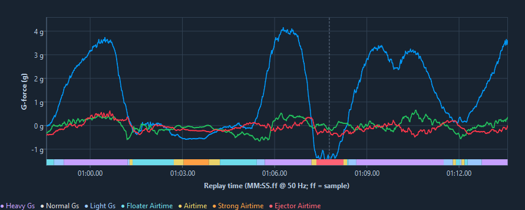
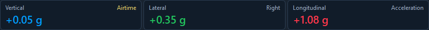
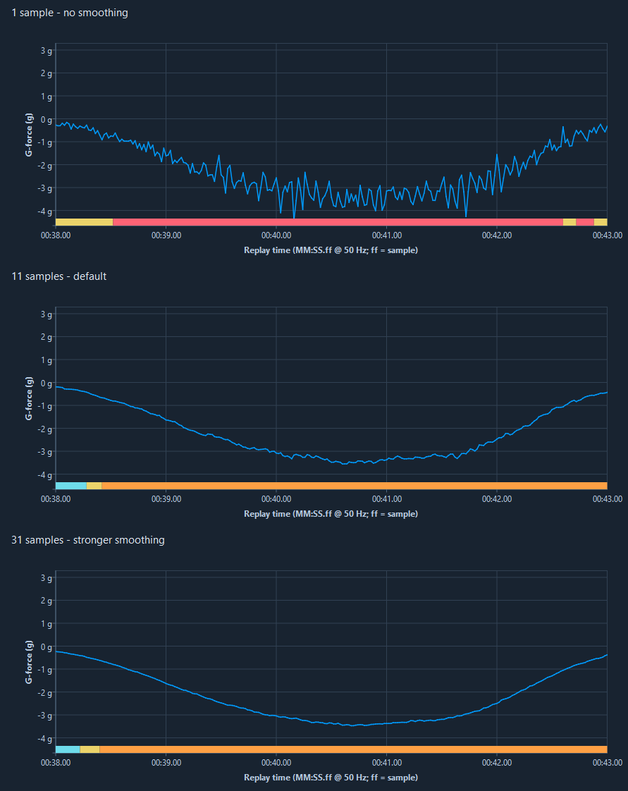
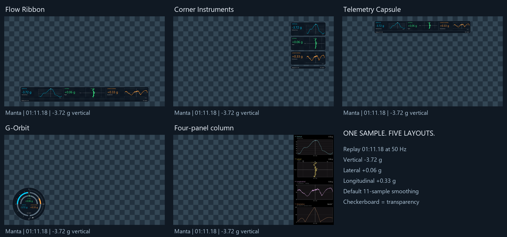
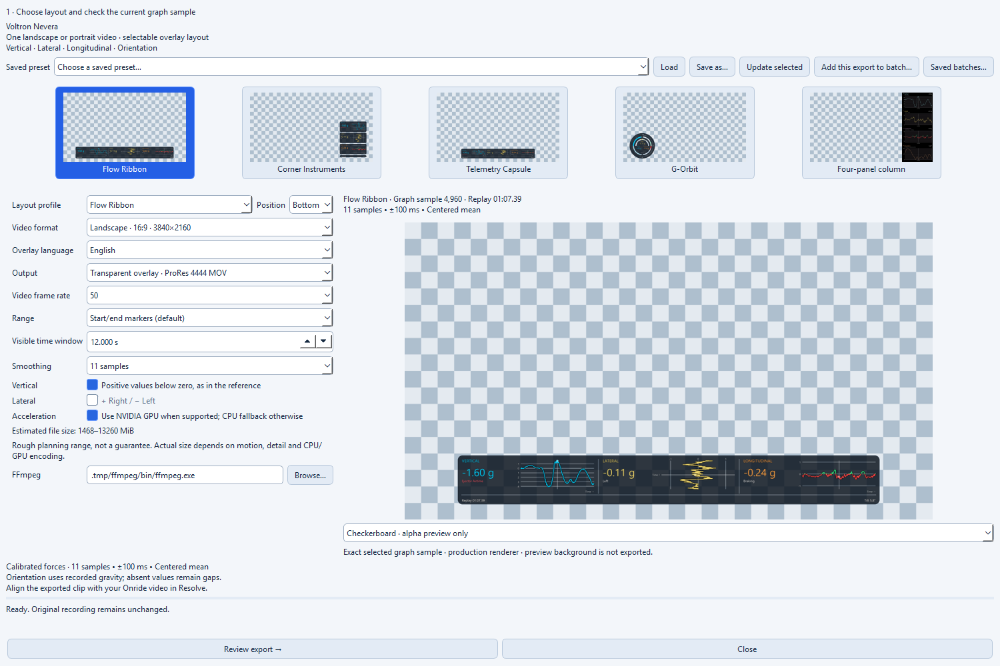
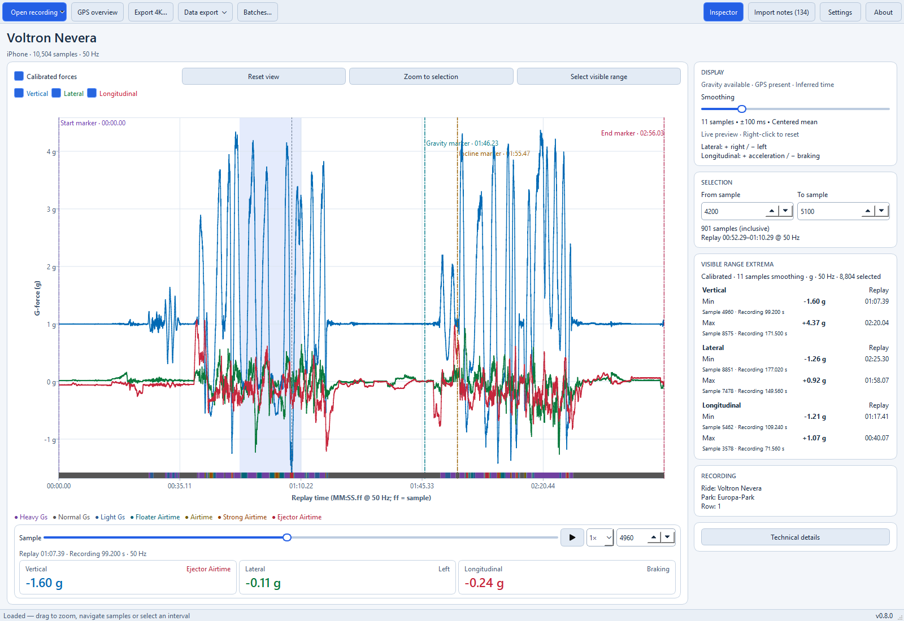

# Ride Forces Analyzer

**Relive the ride. Explore the forces. Add them to your videos.**

Find the strongest airtime moment, inspect a launch or bring your ride data into
an Onride video. Ride Forces Analyzer turns `.forces` and compressed `.zforces` recordings from the
[Ride Forces app](https://rideforces.com/) on iPhone or Apple Watch into
interactive charts and 4K video overlays on Windows, Linux and macOS.

**[Download](https://github.com/rudnerbjoern/ride-forces-analyzer/releases)**
· **[Watch the Manta demo](https://youtu.be/tsRzD416voU)**
· **[User guides](docs/README.md#for-users)**

Free and open source · Offline processing · English and German · Light and dark themes

*Follow the curves, zoom into a favorite element and inspect the forces at that moment.*

## Get started

You need **Windows 10/11 x64, Ubuntu 24.04 x64 or macOS 15+** and a recording
exported as a `.forces` or `.zforces` file from the Ride Forces app. macOS downloads are available
separately for Apple Silicon and Intel.

### 1. Download and launch

Open [GitHub Releases](https://github.com/rudnerbjoern/ride-forces-analyzer/releases)
and choose the download for your system:

| Download                    | How to start                                             |
| :-------------------------- | :------------------------------------------------------- |
| **Windows Complete ZIP**    | Recommended for Windows: extract and launch the EXE.     |
| **Linux x64 tar.gz**        | Follow the Linux setup steps, then extract and launch.   |
| **macOS Apple Silicon ZIP** | Extract and move the app to Applications.                |
| **macOS Intel ZIP**         | Extract and move the app to Applications.                |

No Python installation is needed. The Windows Complete ZIP includes FFmpeg for
video export; Linux and macOS need it installed separately. Windows EXE and
Standard ZIP downloads are also available if you prefer to use your own FFmpeg.

This is a preview release. Windows and macOS may display a security warning
when you first open the app.
Follow the [installation guide](docs/user/INSTALLATION.md) for download
verification, Linux prerequisites and first-launch instructions.

### 2. Open your ride

Click **Open recording** or press **Ctrl+O** (**⌘O** on macOS) and choose your `.forces` or `.zforces` file.
Click a point in the chart to inspect that sample, move through the ride with the
slider, or zoom into a section with the mouse wheel or by dragging across the plot.
Use **Play / Pause** beside the sample slider to follow the ride at **0.5×, 1× or 2× speed** (default **1×**).
See [Explore a recording](docs/user/EXPLORER.md) for navigation and selection.

### 3. Create an overlay

Click **Export 4K…**, choose a layout and check the preview. Export a transparent
MOV for your video editor or an MP4 with a solid background. Align the overlay
with your footage in the editor; automatic video synchronization is not available yet.
The [video export guide](docs/user/VIDEO_EXPORT.md) takes you through each step.

Your recordings stay on your computer. Opening, analyzing and exporting work
offline after setup and leave the original files unchanged.

## Explore what happened on the ride

- **Explore three force channels together.** Follow vertical loads, right/left
  forces, acceleration and braking on a shared time axis. Show or hide individual
  curves and inspect the values at any sample.
- **Focus on the interesting part.** Zoom with the mouse wheel or drag across
  the chart. Start/end markers define the initial view; reset returns to it.
  The inspector shows minimum and maximum values for the visible section of
  every channel.
- **Smooth the display interactively.** Adjust the slider while watching the
  curves update. Right-click to restore the default. Smoothing changes the
  displayed curves, while your original measurements remain intact.
- **Follow the airtime context.** A colored strip below the curves distinguishes
  normal loads, Floater, Airtime, Strong Airtime and Ejector. The vertical value
  card shows the current context, with stable labels that avoid rapid flicker.
  These are provisional interpretations of the recording, not measured sensations.
- **Keep the ride context nearby.** View available ride, park, train, row and
  seat information. Open an approximate GPS route overview when positions are
  present in the recording.
- **Prepare several exports at once.** Save your preferred settings, reuse them
  for another ride, and queue multiple recordings and layouts for one batch run.
- **Export sample data as CSV or JSON.** Save a selected interval with original values,
  prepared forces and airtime context for your own analysis. See the
  [CSV guide](docs/user/CSV_EXPORT.md) or [JSON guide](docs/user/JSON_EXPORT.md).

Directional forces are shown when the recording contains usable calibration
directions. Otherwise, you can still inspect the raw x/y/z channels, with an
explanation of what is unavailable.

### Airtime up close · [Voltron Nevera](https://rcdb.com/7121.htm)

*Follow the colored strip through the airtime moments. The cursor marks Voltron's
−1.60 g sample at replay 01:07.39, with 11-sample smoothing. Labels are provisional
interpretations of the recording.*

### Forces at a glance · [Taron](https://rcdb.com/12723.htm)

*One moment, three force channels: Taron at replay 00:22.15. Read each value
alongside its direction or current vertical context.*

### Find your smoothing level · [Manta](https://rcdb.com/4190.htm)

*The same Manta interval with **1 sample (off)**, **11 samples (default)** and
**31 samples (stronger)**. Time and force scales are fixed for this comparison.
Stronger smoothing reduces short peaks and can change the airtime context;
the original samples remain unchanged.*

## Bring the ride into your videos

**[Watch G-Orbit over Manta Onride footage](https://youtu.be/tsRzD416voU)**
to see an exported overlay in use.

| Layout                 | Look and placement                                      |
| :--------------------- | :------------------------------------------------------ |
| **Flow Ribbon**        | A strip along the bottom with force histories.          |
| **Corner Instruments** | Compact instruments in the upper right.                 |
| **Telemetry Capsule**  | A compact panel across the top.                         |
| **G-Orbit**            | Circular gauges with signed forces and peak indicators. |
| **Four-panel column**  | Stacked force and orientation plots.                    |

[Choose a layout](docs/user/EXPORT_LAYOUTS.md) or
[compare larger previews](docs/EXPORT_THEMES.md).

Export themes use yellow for lateral data, green for acceleration and red for
braking. Flow Ribbon, Corner Instruments and Telemetry Capsule also show the
current vertical context with the same colors and labels as the workspace.

Every layout supports **4K landscape** for classic YouTube videos and **portrait**
for Shorts or TikTok. Choose **Position** beside the layout to keep the action clear.
Export the whole recording, its marker interval or your
selected section. Choose the overlay language independently of the application.

*Preview the selected chart moment before rendering. The checkerboard indicates transparency and is not part of the video.*

- **Transparent MOV (ProRes 4444):** place it above your footage in a video editor
  such as DaVinci Resolve. These editing files can be large.
- **Opaque MP4 (H.264):** export a video with a solid background.
- **Optional NVIDIA acceleration:** supported hardware speeds up encoding;
  CPU export remains available.
- **Saved presets and batches:** reuse settings or run several ride/preset
  combinations sequentially. Completed videos survive cancellation of the queue.

Match the export frame rate to your footage and editing timeline, including
**59.94 fps** when that is how your footage was recorded.
Use **Settings → Export** to save your preferred frame rate for new exports.
Saved presets and batches keep their own settings.

Video export needs FFmpeg. The Windows Complete ZIP includes it; other downloads
let you select an installed FFmpeg in the export assistant.
Follow the [step-by-step export guide](docs/user/VIDEO_EXPORT.md) to create an
overlay and place it above your footage.

## Make the workspace yours

Choose **English or German** and **Dark, Light or System** appearance in
**Settings → Application**. Your saved choices are remembered. The chart adapts
to the available window space; smaller windows let you switch between the chart
and inspector.

*The same ride and selected moment, in the light theme.*

The **About…** dialog offers **Check for updates…**. Optional startup checks are
off by default. Checks contact GitHub without sending recordings, GPS data or
file paths; downloads and installation remain manual. Offline processing does
not require update checks.

## Understanding the display

Replay time uses `MM:SS.ff`, where `ff` counts samples within a second rather
than hundredths. At 50 Hz, `01:31.47` means 91.94 seconds.
Positive lateral values mean right; positive longitudinal values mean acceleration.
Negative values mean left and braking respectively.

The airtime strip follows your chart zoom. Floater and Ejector labels are
provisional: calibration and smoothing affect their interpretation. They do not
measure a rider's sensations. Results may differ from the original app.
GPS provides an approximate route, not force or speed measurements.
Missing sensor data is never invented. See the
[forces and airtime guide](docs/user/FORCES_AND_AIRTIME.md) for details.

## Help and contribute

Start with the [installation guide](docs/user/INSTALLATION.md),
[video export guide](docs/user/VIDEO_EXPORT.md) or
[layout guide](docs/user/EXPORT_LAYOUTS.md).
Have a problem or an idea? [Open an issue](https://github.com/rudnerbjoern/ride-forces-analyzer/issues).
Report security vulnerabilities privately using [SECURITY.md](SECURITY.md).

For planned features and known limits, see the [roadmap](docs/ROADMAP.md).
To contribute or run from source, see [CONTRIBUTING.md](CONTRIBUTING.md) and the
[Windows developer setup](docs/development/SETUP.md). Technical references are
listed in the [documentation index](docs/README.md).

**Independent project:** Ride Forces Analyzer is not affiliated with, endorsed
by or sponsored by the Ride Forces app or its developer.

## License

Copyright © 2026 Björn Rudner.

The application is free and open source under **GPL-3.0-or-later**, including
commercial use under its terms, without warranty. See [LICENSE](LICENSE).

Supplied [recordings](tests/fixtures/real/README.md) and
[documentation images](docs/images/README.md) have separate **CC BY-SA 4.0**
licenses, including attribution and ShareAlike requirements. These grants do not
automatically apply to your own recordings or exports. Dependencies retain their
own licenses; see [third-party notices](THIRD_PARTY_NOTICES.md) for their terms
and unresolved redistribution requirements.
