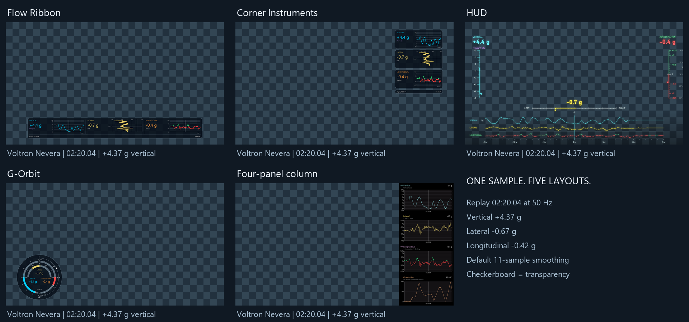
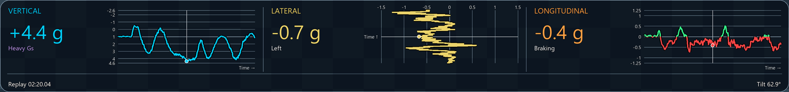
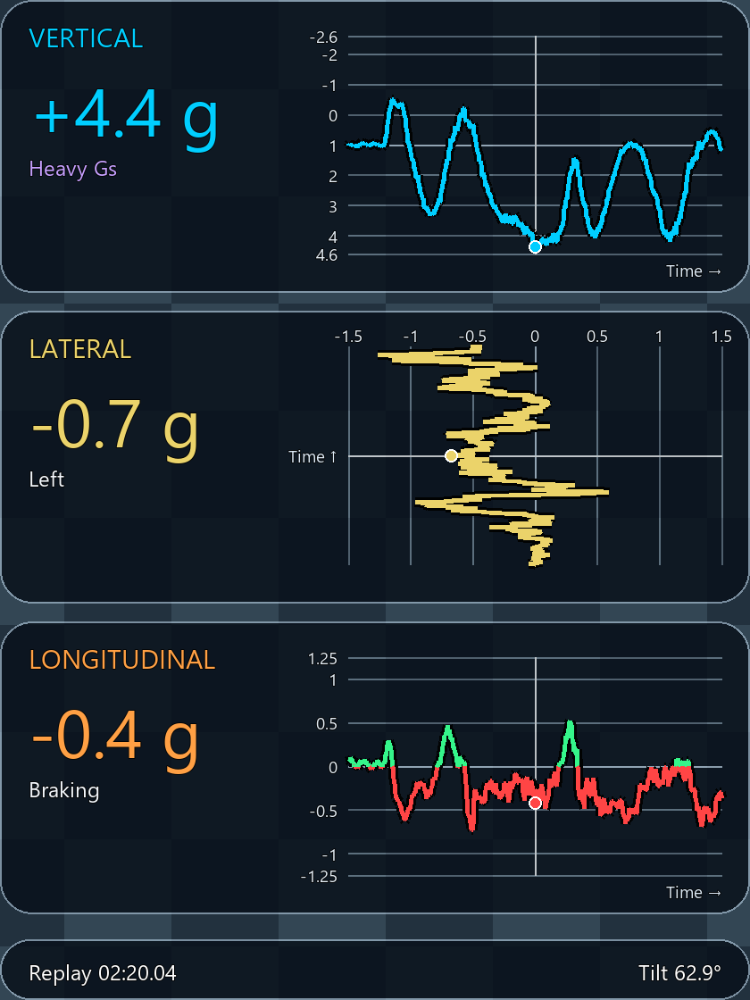
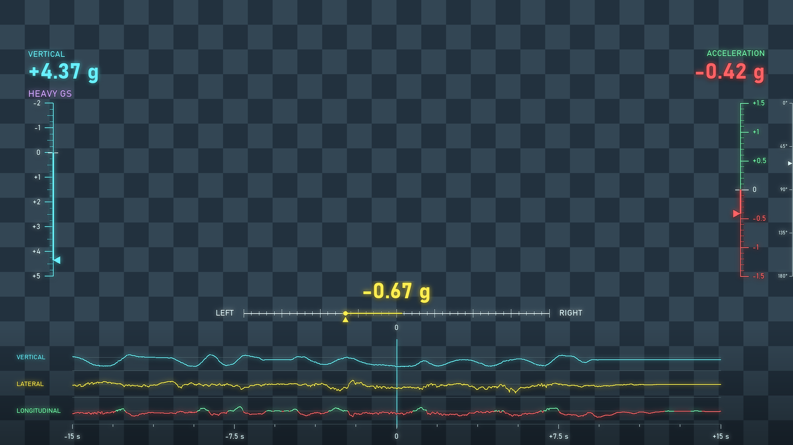
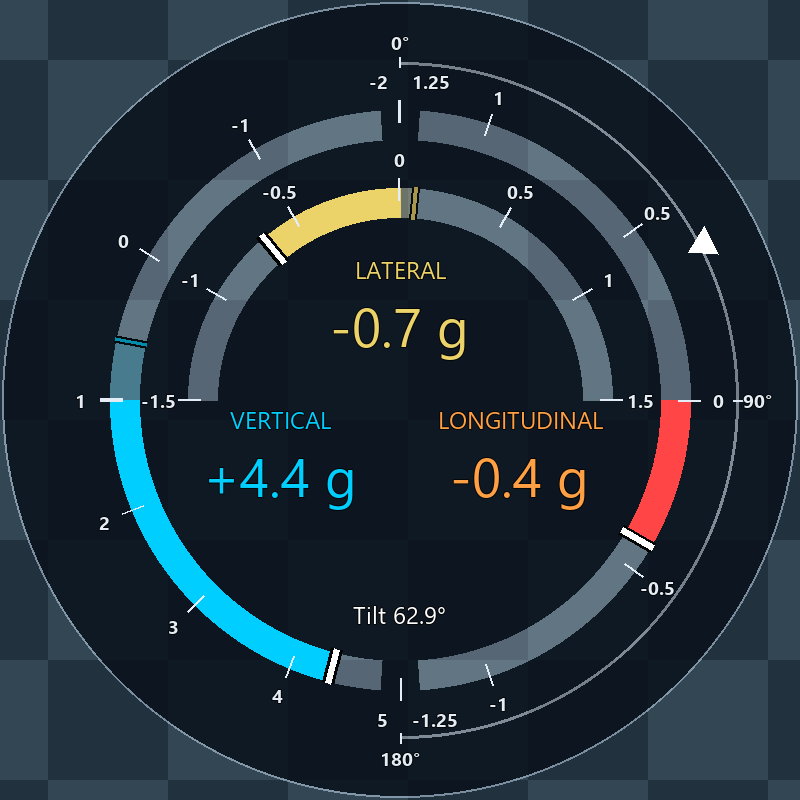
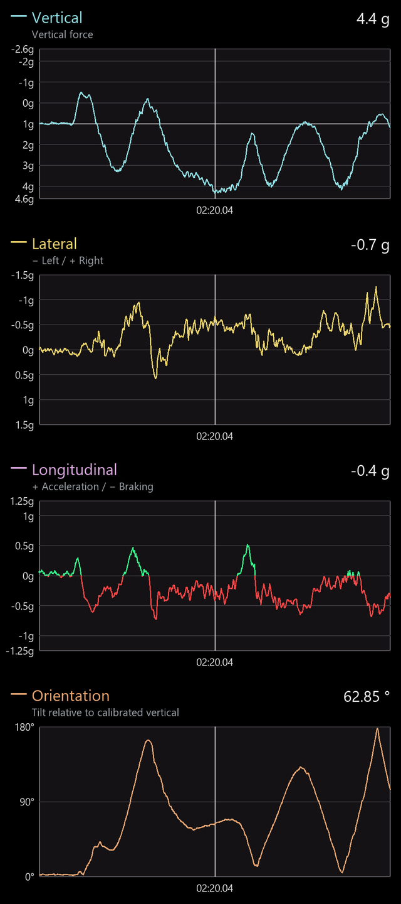

# Export layout reference — Voltron Nevera

For help choosing a layout and reading its instruments, see the
[user layout guide](user/EXPORT_LAYOUTS.md).

[Watch the Manta overlay demo](https://youtu.be/0sGiE6F8YlI) to see all five
layouts in turn over Onride footage. The additional
[Manta HUD demo](https://youtu.be/JGcNPKoKU1Q) shows only the HUD layout.

All five layouts show the same Voltron Nevera moment. Recording details, fixed settings,
reproduction commands and image licensing are documented in the
[central image guide](images/README.md).

The overview preserves placement in the full 3840×2160 landscape canvas.
Checkerboards illustrate transparent space and translucent panels; they are
not exported. Detail views below enlarge each instrument region.
These are actual production-renderer frames, not interface mockups.
All layouts default to positive vertical forces below zero (seat pressure) and
negative forces above zero (lifting), with unchanged signed readouts.
Compact lateral histories advance upward in time and deflect left/right around a
centered zero axis. G-Orbit shows the current lateral force on an upper inner
semicircle: negative left, positive right, with equal scale in both directions.
Longitudinal acceleration is always above zero and braking below zero, including
G-Orbit's right semicircle; numeric signs remain unchanged.
Across all themes, lateral diagrams and bars are yellow. G-Orbit uses muted yellow
for lateral peak markers and translucent peak fills. Longitudinal data is green
for acceleration and red for braking.
This applies to curves and their current-point markers, and to G-Orbit's current
arc, peak fills and peak markers. Channel headings and numeric text retain their
theme colors.
Theme graphics contain no Hz/fps labels; source sample rate and overlay export
frame rate are technical settings, not the frame rate of the underlying video.
Flow Ribbon, Corner Instruments and HUD show source-time vertical
context using the provisional [airtime heuristic](implementation/AIRTIME.md).
It distinguishes Floater, Airtime, Strong Airtime and Ejector using load and
recent onset, independently of axis inversion. Missing values show Unavailable.

## Flow Ribbon

A wide strip along the bottom keeps the three force traces together while
leaving most of the footage visible. The assistant's default layout.

[Open the complete 4K placement view](images/voltron-ribbon.png).

## Corner Instruments

Three stacked cards at the upper right provide larger individual values and
traces beside the footage.

[Open the complete 4K placement view](images/voltron-corners.png).

## HUD

Freely floating scales surround an open center: vertical G-force/airtime on the
left, acceleration/braking on the right, and lateral force below. Fine ticks,
luminous pointers, large technical readouts and soft black shadows follow the
frameless game-HUD design. Three wide force histories share one time cursor
at the bottom. Scale ranges adapt to actual forces; missing values remain gaps.
The complete arrangement adapts independently to landscape and portrait.

[Open the complete 4K placement view](images/voltron-hud.png). HUD video exports
retain native 1920×1080 or 1080×1920 resolution for scaling in your editor.

## G-Orbit

A lower-left instrument combines force arcs around one center: vertical on the
outer left half, longitudinal on the outer right half and lateral on the upper
inner half. A separate right semicircle carries a white orientation marker,
showing 0° at the top, 90° right and 180° below. Missing orientation
has no marker. Channel names and signed readouts accompany the arcs; direction
hints and the replay footer are omitted.
The instrument occupies a square region with a circular translucent background;
the surrounding corners remain transparent in overlay output.
The profile name appears in the selector, not in the exported graphic.
All three force tracks are 30 px thick, with bold scales and white current-value
bars. Narrower, muted peak bars hold each direction's maximum for 1.5 seconds,
then release at 1 g/s. Subtle translucent fills extend to the held peaks;
numeric readouts continue to show the current forces.

[Open the complete 4K placement view](images/voltron-orbit.png).

## Four-panel column

The right-hand column includes three force plots and a dedicated orientation
plot. All four timelines advance left-to-right. Its default vertical/lateral
force axes are positive-down, unlike the compact lateral charts;
the underlying signed values are identical. The longitudinal trace is green for
acceleration and red for braking, changing color at zero crossings.

[Open the complete 4K placement view](images/voltron-column.png).

Fixed reference settings and regeneration commands are maintained in the
[central image guide](images/README.md#image-content-and-reproduction).

[Back to the project](../README.md) · [Export behavior](implementation/VIDEO_EXPORT.md)
