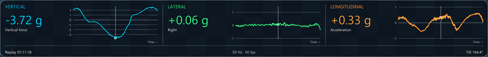
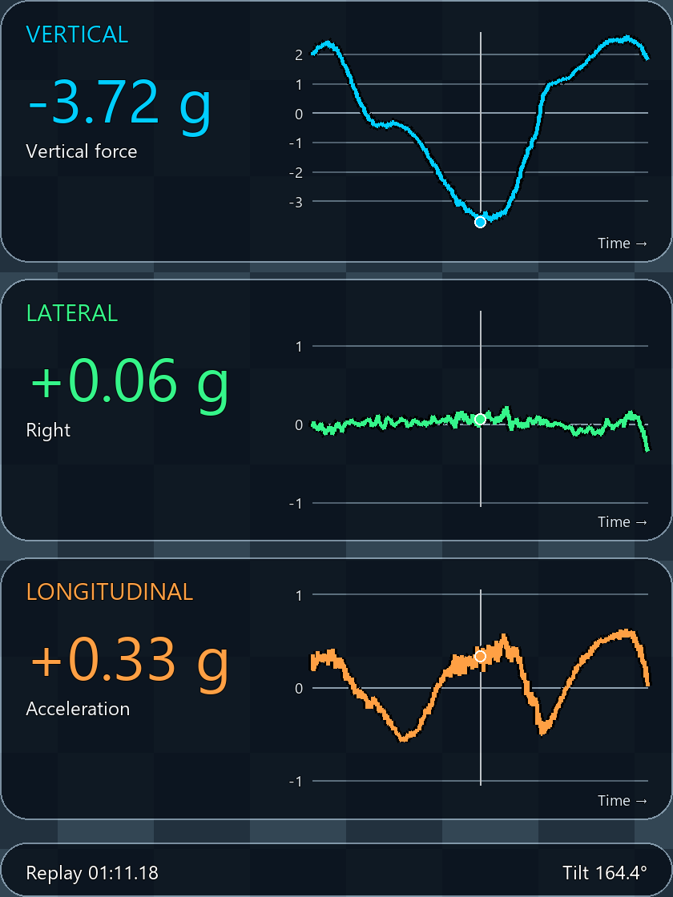
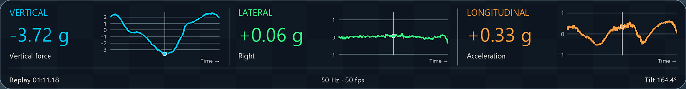
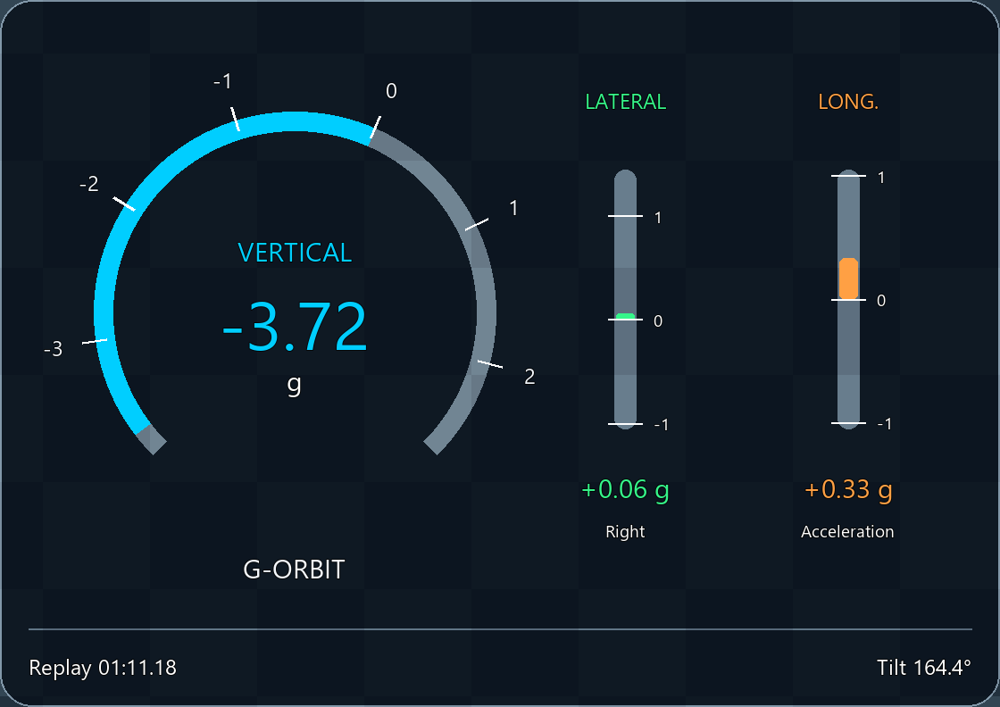
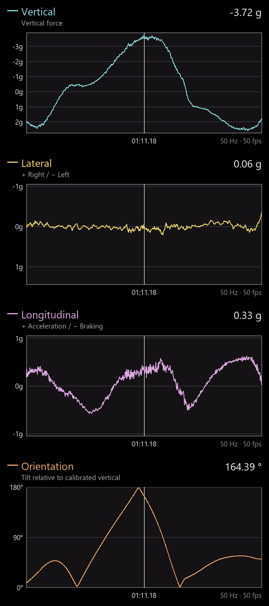

# Export layout reference — Manta

All five layouts show the same Manta moment: **01:11.18** at 50 Hz
(71.36 replay seconds), the strongest absolute force in the marker interval
with the default **11-sample smoothing**.

- Vertical: **−3.72 g**.
- Lateral: **+0.06 g**, right.
- Longitudinal: **+0.33 g**, acceleration.
- Tilt: **164.4°**.


The overview preserves placement in the full 3840×2160 landscape canvas.
Checkerboards illustrate transparent space and translucent panels; they are
not exported. Detail views below enlarge each instrument region.
These are actual production-renderer frames, not interface mockups.

## Flow Ribbon

A wide strip along the bottom keeps the three force traces together while
leaving most of the footage visible. The assistant's default layout.



[Open the complete 4K placement view](images/manta-ribbon.png).

## Corner Instruments

Three stacked cards at the upper right provide larger individual values and
traces beside the footage.



[Open the complete 4K placement view](images/manta-corners.png).

## Telemetry Capsule

A slim strip at the top presents the same three channels, replay time and tilt.



[Open the complete 4K placement view](images/manta-capsule.png).

## G-Orbit

A lower-left gauge emphasizes the signed vertical force, with lateral and
longitudinal indicators alongside it. The ring shows force, not vehicle attitude.



[Open the complete 4K placement view](images/manta-orbit.png).

## Four-panel column

The right-hand column includes three force plots and a dedicated orientation
plot. Its default vertical/lateral axes are inverted, unlike the compact charts;
the underlying signed values are identical.



[Open the complete 4K placement view](images/manta-column.png).

## Reference settings

English labels, landscape, 50 fps and a 12-second time window. Source sample
4782, recording time 95.64 seconds; the marker interval determines force bounds.
All profiles use the same unchanged Manta recording from the
[authorized catalog](development/RECORDINGS.md). The strongest point was selected
from calibrated values, not from the source's stored extrema.
Portrait layouts are also available in the assistant; this comparison shows landscape.

## Regenerate after layout changes

From the project folder in Windows PowerShell, after setup:

```powershell
.\.venv\Scripts\python.exe .\scripts\render_export_reference.py
```

The [script](../scripts/render_export_reference.py) replaces the eleven reference
PNGs in `docs/images` and writes `manta-reference.json` with the source identity,
sample, values and settings. It always uses **zero-based source sample 4782**,
11-sample smoothing, English labels, landscape, 50 fps, a 12-second window and
the original marker range. Column inversion stays enabled; compact layouts stay
positive-up. It never searches for a new maximum. The source SHA-256 must match
the authorized Manta recording or generation stops.

To inspect changes before replacing the documentation images:

```powershell
.\.venv\Scripts\python.exe .\scripts\render_export_reference.py --output .tmp\theme-preview
```

No GUI or FFmpeg is needed. The installed Windows font and current production
renderer determine appearance; the source position and comparison settings stay fixed.

[Back to the project](../README.md) · [Export behavior](implementation/VIDEO_EXPORT.md)
