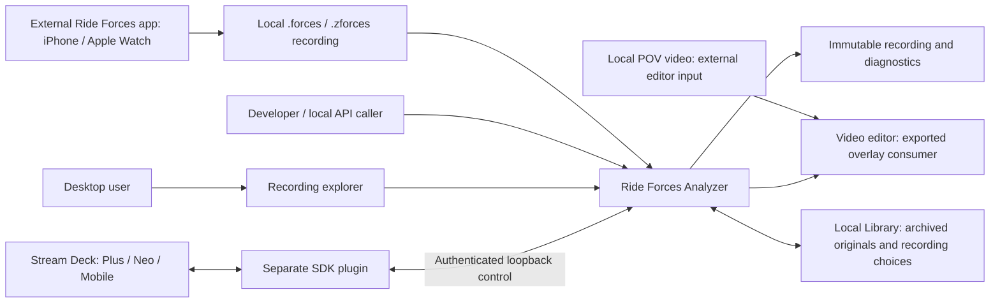

# 3. Context and Scope

[Architecture index](README.md)

## Business context

The owner supplies exported recordings from the external
[Ride Forces app](https://rideforces.com/) on
an iPhone or Apple Watch. The analyzer consumes local files; it does not connect
to the mobile app, acquire sensors or upload ride data.

Ride Forces Analyzer is developed independently of the Ride Forces app and its
developer, without affiliation, endorsement or sponsorship.

Optional update discovery contacts the public GitHub Releases API only: manual
checks or opt-in daily startup checks. It sends no recording contents or file
paths and is independent of offline import, analysis and export processing.

Optional GPS backgrounds request only visible raster tile coordinates from
OpenStreetMap after an explicit click. The provider sees the area, IP address and
application User-Agent; no full track or recording payload is uploaded. HTTP caching
and visible attribution follow the [tile policy](https://operations.osmfoundation.org/policies/tiles/).

The explorer schedules local import and analysis. Raw data and calibrated display
remain distinct; GPS supplies approximate spatial context. Exported overlays are
aligned with footage in the external editor. Optional network requests are
independent of this processing path.

## Technical context

| Interface                           | Channel and ownership                                         | Current status                                                        |
| ----------------------------------- | ------------------------------------------------------------- | --------------------------------------------------------------------- |
| Recording input                     | Local regular Path, bounded binary read, owned original bytes | Implemented; Windows network/device paths are rejected                |
| Bytes input                         | Immutable Python bytes, no filesystem access                  | Implemented                                                           |
| Import output                       | Typed ImportSuccess or ImportFailure in the caller process    | Implemented; no Qt dependency                                         |
| Desktop bootstrap                   | Local PySide6 process and native Qt event loop                | Independent Explorer windows and background file opening              |
| Recording Library                   | Per-user SQLite archive and recording services                | Exact originals, identity, current choices and export recipes         |
| Stream Deck control                 | SDK-hosted plugin and authenticated loopback WebSocket        | Optional GUI control; native acceptance tracked in validation         |
| Sample data output                  | Local CSV or JSON files from captured analysis                | Implemented; independent of Qt and FFmpeg                             |
| Video output                        | Local ProRes MOV / H.264 MP4, five layouts and two aspects    | Implemented; manual external alignment                                |
| POV input / synchronization         | Video ingest and matching remain in external editing software | Excluded from project scope                                           |
| Dependency distribution / GitHub CI | Developer network access and Windows PR runners               | Development infrastructure; not an application processing dependency  |

[Chapter 05](05_building_block_view.md) documents callable interfaces;
[chapter 07](07_deployment_view.md) separates runtime and development infrastructure.
[Stream Deck controls](../implementation/STREAM_DECK.md) own device behavior;
[validation](../validation/STREAM_DECK.md) owns native qualification status.

## Stream Deck scope

Optional control targets the current Explorer and reuses existing GUI/service
actions, validation, analysis and Library persistence. Recording processing stays
offline and independent of the plugin; original recordings remain read-only.
There is no keyboard simulation, separate force calculation or phone-facing
Analyzer service. Export controls, an explicit target-window selector, other device
models and Marketplace publication are outside current scope.
