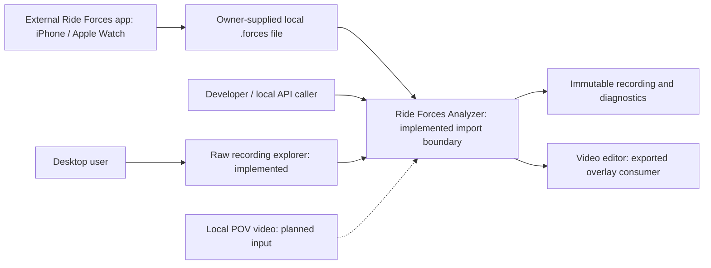

# 3. Context and Scope

[Architecture index](README.md)

## Business context

The owner supplies exported recordings from the external
[Ride Forces app](https://rideforces.com/) on
an iPhone or Apple Watch. The analyzer consumes local files; it does not connect
to the mobile app, acquire sensors or upload ride data.

Ride Forces Analyzer is developed independently of the Ride Forces app and its
developer, without affiliation, endorsement or sponsorship.

Optional update discovery contacts the public GitHub Releases API only: manual
checks or opt-in daily startup checks. It sends no recording contents or file
paths and is independent of offline import, analysis and export processing.

Optional GPS backgrounds request only visible raster tile coordinates from
OpenStreetMap after an explicit click. The provider sees the area, IP address and
application User-Agent; no full track or recording payload is uploaded. HTTP caching
and visible attribution follow the [tile policy](https://operations.osmfoundation.org/policies/tiles/).

Solid edges represent existing interactions; dashed edges are planned product
interfaces. The explorer calls the importer asynchronously; raw curves and
sample controls make no universal physical calibration claim. Source-app
projection/mean is implemented; selected-range extrema are implemented within reduced
M3. GPS supplies coarse spatial context only. The 4K overlay exporter writes one
video in one of five layouts for manual alignment in Resolve. Interactive sample
playback is implemented; POV synchronization remains planned.

## Technical context

| Interface                           | Channel and ownership                                         | Current status                                                       |
| ----------------------------------- | ------------------------------------------------------------- | -------------------------------------------------------------------- |
| Recording input                     | Local regular Path, bounded binary read, owned original bytes | Implemented; Windows network/device paths are rejected               |
| Bytes input                         | Immutable Python bytes, no filesystem access                  | Implemented                                                          |
| Import output                       | Typed ImportSuccess or ImportFailure in the caller process    | Implemented; no Qt dependency                                        |
| Desktop bootstrap                   | Local PySide6 process and native Qt event loop                | Implemented raw explorer and background file opening                 |
| Video output                        | Local ProRes MOV / H.264 MP4, five layouts and two aspects    | Implemented; manual external alignment                               |
| POV input / synchronization         | Local video ingest and matching                               | Planned                                                              |
| Dependency distribution / GitHub CI | Developer network access and Windows PR runners               | Development infrastructure; not an application processing dependency |

[Chapter 05](05_building_block_view.md) documents callable interfaces;
[chapter 07](07_deployment_view.md) separates runtime and development infrastructure.
