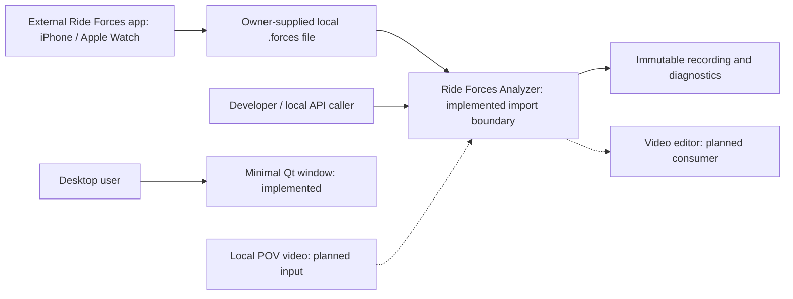

# 3. Context and Scope

[Architecture index](README.md)

## Business context

The owner supplies exported recordings from the external Ride Forces app on
an iPhone or Apple Watch. The analyzer consumes local files; it does not connect
to the mobile app, acquire sensors or upload ride data.

Solid edges represent existing interactions; dashed edges are planned product
interfaces. The minimal window is not connected to importing. Future analysis,
playback, video/export interfaces do not exist yet.

## Technical context

| Interface                           | Channel and ownership                                         | Current status                                                       |
| ----------------------------------- | ------------------------------------------------------------- | -------------------------------------------------------------------- |
| Recording input                     | Local regular Path, bounded binary read, owned original bytes | Implemented; Windows network/device paths are rejected               |
| Bytes input                         | Immutable Python bytes, no filesystem access                  | Implemented                                                          |
| Import output                       | Typed ImportSuccess or ImportFailure in the caller process    | Implemented; no Qt dependency                                        |
| Desktop bootstrap                   | Local PySide6 process and native Qt event loop                | Implemented minimal window only                                      |
| POV input and video/image outputs   | Future local files; formats and sync follow later milestones  | Planned                                                              |
| Dependency distribution / GitHub CI | Developer network access and Windows PR runners               | Development infrastructure; not an application processing dependency |

[Chapter 05](05_building_block_view.md) documents callable interfaces;
[chapter 07](07_deployment_view.md) separates runtime and development infrastructure.
