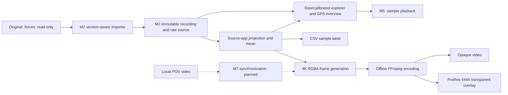

# 4. Solution Strategy

<!-- cspell:words AHRS -->

[Architecture index](README.md)

Use a version-aware import boundary to separate unstable external JSON from
immutable canonical recording data. Keep raw evidence alongside typed accessors
instead of re-encoding, silently repairing or scientifically interpreting it.
Compose pure validation workers through one public service and per-call resource
policy. The explorer consumes validated imports and prepares presentation outside widgets.

Solid edges are implemented; dashed edges describe the planned pipeline. Domain
coordinates and a common time base require explicit evidence before scientific
analysis or synchronization. M2 ingestion does not establish those semantics.

## Boundary choices

- `domain` owns representations; `importers` owns external format adapters and
  diagnostics. A valid source tree or motion subset is not a complete import.
- `analysis` exposes immutable contracts and explicit DEVICE vector/unit
  primitives. Source-app projection/mean and strict provisional frame transforms are implemented;
  basic selected-range extrema are implemented. General physical rider qualification
  and broad statistics are outside current M3 acceptance. `storage` implements
  SQLite export presets/batches; the ride library remains planned. `playback`
  supplies a Qt-independent monotonic sample clock with 0.5×/1×/2× speed selection.
  `rendering` implements the
  owner-requested 4K overlay slice, independently of interactive playback.
- `ui` owns the raw explorer, Qt Charts interactions and background worker transport.
  `explorer` prepares raw/calibrated presentation and validates local selections
  independently of Qt. The entry point uses strictly validated settings.
- Each import owns its bytes, immutable tree and diagnostics; no shared mutable
  recording state or process-global decoder configuration is introduced.

## Implemented export policy

`rendering.model` prepares source-bound calibrated forces, tilt and a deterministic
source/video clock. `rendering.frames` generates Pillow RGBA frames, delegating
compact profiles to `rendering.layouts`: ribbon, corner cards, capsule or signed
orbit gauges ([Manta G-Orbit video example](https://youtu.be/tsRzD416voU)). The original four-panel column remains available. The encoder
consumes the selected rectangular region, pads to 4K and
encodes one transparent ProRes 4444 MOV or independent opaque H.264 MP4.
Real NVIDIA probes select Vulkan/NVENC or explicit CPU fallback. Completed output
is published exclusively. Widgets only configure/transport
background jobs. Manual Resolve alignment is outside the processing path.
[Export contracts](../implementation/VIDEO_EXPORT.md) and
[encoder compatibility boundary](07_deployment_view.md#encoder-installation) scope this partial M6 implementation;
PNG sequences and additional export products remain planned.

`storage.exports` persists versioned preset/batch definitions in SQLite; originals
remain external read-only files. `rendering.batches` imports each job, checks its
saved source hash, restores its immutable preset/range and runs the existing
encoder sequentially. A unique run directory and incremental result report retain
completed work across per-job failure/cancellation. Qt owns queue editing and
worker transport, not SQL, import validation or execution logic.

## Scientific strategy

The [analysis boundary](08_concepts.md#scientific-provenance-and-gates) defines reduced
M3: existing force preparation/mean, basic extrema and verified contracts. Generic
device/frame APIs keep explicit source-bound unit gates; universal physical rider
calibration is deferred and is not a completion prerequisite. GPS is reference-only.

The app-reference path implements independently normalized source directions and
a configurable centered mean, with per-source evidence; see the source-app projection decision via chapter 09.
NumPy provides array mathematics and Pint converts declared common component units
to SI. SciPy supports existing explicit frame rotations. Additional scientific
filters are deferred.
GeographicLib/geodesic speed analysis is not required. Pandas is a tabular adapter;
AHRS is research only, pyproj requires an approved conversion use case. Adoption
policy and rationale belong to [analysis library decision](09_architecture_decisions.md#analysis-models-and-libraries).

Use explicit profiles, raw/filtered provenance and per-channel capability gates.
Do not combine acceleration/gravity, infer yaw or merge GPS/motion clocks without
independent evidence. [Concepts](08_concepts.md), [decisions](09_architecture_decisions.md)
and [risks](11_technical_risks.md) maintain these boundaries; open product work stays in the roadmap.
