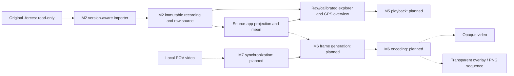

# 4. Solution Strategy

<!-- cspell:words AHRS -->

[Architecture index](README.md)

Use a version-aware import boundary to separate unstable external JSON from
immutable canonical recording data. Keep raw evidence alongside typed accessors
instead of re-encoding, silently repairing or scientifically interpreting it.
Compose pure validation workers through one public service and per-call resource
policy. The explorer consumes validated imports and prepares presentation outside widgets.

Solid edges are implemented; dashed edges describe the planned pipeline. Domain
coordinates and a common time base require explicit evidence before scientific
analysis or synchronization. M2 ingestion does not establish those semantics.

## Boundary choices

- `domain` owns representations; `importers` owns external format adapters and
  diagnostics. A valid source tree or motion subset is not a complete import.
- `analysis` exposes immutable contracts and explicit Stage 2 DEVICE vector/unit
  primitives. Source-app projection/mean and strict provisional frame transforms are implemented;
  basic selected-range extrema are implemented. General physical rider qualification
  and broad statistics are outside current M3 acceptance. `storage`, `playback` and `rendering` remain reserved boundaries
  without implemented services. Their details follow their milestone requirements.
- `ui` owns the raw explorer, Qt Charts interactions and background worker transport.
  `explorer` prepares raw/calibrated presentation and validates local selections
  independently of Qt. The entry point uses strictly validated settings.
- Each import owns its bytes, immutable tree and diagnostics; no shared mutable
  recording state or process-global decoder configuration is introduced.

## Planned export policy

M6 keeps frame generation independent of encoding and supports both an opaque
standalone MP4/H.264 video and a transparent overlay. PNG RGBA frame sequences
are the alpha baseline; any alpha-video codec requires compatibility verification
in DaVinci Resolve. FFmpeg integration, rendering and final encoding remain
planned; installed optional dependencies do not constitute these capabilities.

## Scientific strategy

[DEV-REQ-003](../requirements/DEV-REQ-003-scientific-analysis.md) defines reduced
M3: existing force preparation/mean, basic extrema and verified contracts. Generic
device/frame APIs keep explicit source-bound unit gates; universal physical rider
calibration is deferred and is not a completion prerequisite. GPS is reference-only.

The app-reference path implements independently normalized source directions and
a configurable centered mean, with per-source evidence; see ADR 0006 via chapter 09.
NumPy provides array mathematics and Pint converts declared common component units
to SI. SciPy supports existing explicit frame rotations. Additional scientific
filters are deferred; any playback interpolation needs its own M5 requirement.
GeographicLib/geodesic speed analysis is not required. Pandas is a tabular adapter;
AHRS is research only, pyproj requires an approved conversion use case. Adoption
policy and rationale belong to [ADR 0004](../decisions/0004-analysis-contracts-and-library-policy.md).

Use explicit profiles, raw/filtered provenance and per-channel capability gates.
Do not combine acceleration/gravity, infer yaw or merge GPS/motion clocks without
independent evidence. [Concepts](08_concepts.md), [decisions](09_architecture_decisions.md)
and [risks](11_technical_risks.md) maintain these boundaries; stage tasks stay in the plan.
