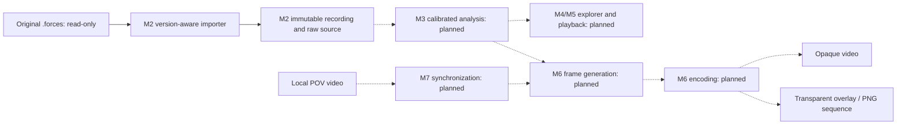

# 4. Solution Strategy

<!-- cspell:words AHRS -->

[Architecture index](README.md)

Use a version-aware import boundary to separate unstable external JSON from
immutable canonical recording data. Keep raw evidence alongside typed accessors
instead of re-encoding, silently repairing or scientifically interpreting it.
Compose pure validation workers through one public service and per-call resource
policy. UI code consumes validated results only when its integration is implemented.

Solid edges are implemented; dashed edges describe the planned pipeline. Domain
coordinates and a common time base require explicit evidence before scientific
analysis or synchronization. M2 ingestion does not establish those semantics.

## Boundary choices

- `domain` owns representations; `importers` owns external format adapters and
  diagnostics. A valid source tree or motion subset is not a complete import.
- `analysis` exposes immutable contracts and explicit Stage 2 DEVICE vector/unit
  primitives. Calibrated scientific services remain planned. `storage`, `playback` and `rendering` remain reserved boundaries
  without implemented services. Their details follow their milestone requirements.
- `ui` is the future widget boundary; the current entry point creates only the
  minimal bootstrap window and strictly validated settings.
- Each import owns its bytes, immutable tree and diagnostics; no shared mutable
  recording state or process-global decoder configuration is introduced.

## Planned export policy

M6 keeps frame generation independent of encoding and supports both an opaque
standalone MP4/H.264 video and a transparent overlay. PNG RGBA frame sequences
are the alpha baseline; any alpha-video codec requires compatibility verification
in DaVinci Resolve. FFmpeg integration, rendering and final encoding remain
planned; installed optional dependencies do not constitute these capabilities.

## Planned M3 scientific strategy

[DEV-REQ-003](../requirements/DEV-REQ-003-scientific-analysis.md) defines the
scientific engine; its implementation remains unauthorized by documentation alone.
Stage 1 implements model construction/validation only, as recorded in
[ADR 0004](../decisions/0004-analysis-contracts-and-library-policy.md).
Consume validated immutable M2 recordings and retain source provenance while
producing separate, explicitly labeled derived results. Baseline device analysis
does not imply a verified rider frame or known source units.

The required library roles are NumPy for vector/array mathematics, SciPy for
rotation/filtering/interpolation, Pint for evidenced unit boundaries and
GeographicLib for declared WGS84 horizontal geodesics. Pandas is an optional
tabular adapter; AHRS is research only and pyproj requires a concrete approved
conversion need. SciPy/Pint/GeographicLib passed an isolated Windows audit;
Pint is now adopted under the separately instructed Stage 2 scope. SciPy and
GeographicLib adoption/lock changes remain separate owner gates.

Use explicit profiles, raw-versus-filtered provenance and capability gates.
Do not combine acceleration and gravity, infer yaw from gravity alone or merge
GPS/motion clocks without evidence. See [planned concepts](08_concepts.md),
[scientific decisions](09_architecture_decisions.md) and
[risks](11_technical_risks.md); requirement/stage details remain in DEV-REQ-003.

Stage 2 implements separate device vectors and Euclidean magnitudes only after a
source-specific unit/quantity contract. NumPy performs array arithmetic; Pint
converts a common component unit to SI. No channel relationship, physical source
axis mapping or calibrated pipeline is inferred. All current recordings remain
unit-unqualified. See the [device API](../development/ANALYSIS_MODELS.md#device-only-vectors-and-units--stage-2).
