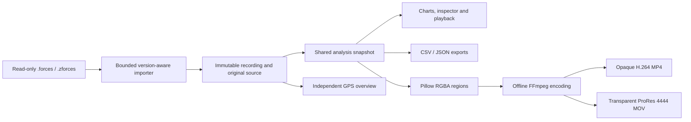

# 4. Solution Strategy

[Architecture index](README.md)

## Processing pipeline

The importer establishes structural validity and provenance. Analysis separately
prepares display quantities. Video alignment remains in external editing software.

## Boundary choices

- Own exact source bytes and an immutable source tree alongside typed accessors;
  decoding never rewrites or silently repairs the input.
- Keep numerical preparation in Qt-independent analysis services. Widgets schedule
  workers and display results; presentation formats prepared values.
- Share immutable stages across charts, previews and exports. Reconfiguration
  rebuilds only dependent stages; running exports retain their bound snapshot.
- Keep frame generation separate from encoding. Layouts own geometry and styling;
  the encoder consumes ordered region bytes and pads the output canvas.
- Store application preferences, marker overrides and export definitions locally
  in SQLite. Original recordings remain external read-only files.

[Building blocks](05_building_block_view.md) identify ownership;
[runtime](06_runtime_view.md) describes scheduling and failure handling.

## Scientific policy

The product path independently normalizes admitted source directions, projects
acceleration and applies a configurable centered mean. Raw axes remain available
when calibrated preparation is unavailable. Orientation uses source gravity,
independently of force smoothing.

Explicit device-unit and strict provisional-frame APIs remain separate from this
display policy. NumPy supplies arrays, Pint declared-unit conversion and SciPy
passive rotations. GPS supplies approximate spatial context, not force validation
or a shared clock. [Decisions](09_architecture_decisions.md) retain rationale;
[concepts](08_concepts.md#scientific-provenance-and-gates) define provenance and gates.

## Export strategy

Production renderers serve previews and video output. HUD retains native HD for
editor scaling; other layouts offer 4K Full-frame or native Content-area output.
One renderer runs serially or independent
renderer threads prepare a bounded, ordered frame stream. FFmpeg uses a probed
NVIDIA backend when supported, otherwise CPU encoding.

Single exports publish completed files exclusively or atomically replace a video
after explicit confirmation. Batches execute saved,
source-hash-bound recipes sequentially and retain completed outputs across later
failures or cancellation. [Export contracts](../implementation/VIDEO_EXPORT.md)
and [batch contracts](../implementation/EXPORT_BATCHES.md) own detailed behavior.
