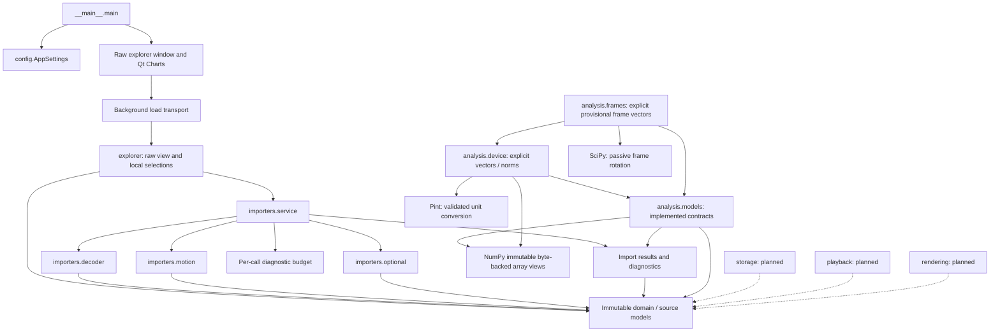

# 5. Building Block View

[Architecture index](README.md)

## White box: overall system

Arrows express dependencies. Dashed arrows describe future consumers, not
implemented services. The explorer starts import through a background worker;
widgets contain no parser, scientific transformations or source mutation.

## Contained building blocks

| Block                | Responsibility and interface                                                                    | Status / source location                                                                                                     |
| -------------------- | ----------------------------------------------------------------------------------------------- | ---------------------------------------------------------------------------------------------------------------------------- |
| Bootstrap / settings | main validates AppSettings before creating the Qt window                                        | Implemented: [entry point](../../src/ride_forces_analyzer/__main__.py), [settings](../../src/ride_forces_analyzer/config.py) |
| domain               | Recording, SourceEnvelope, SourceNumber, vectors, motion, metadata, attributes and GPS concepts | Implemented immutable representations: [domain](../../src/ride_forces_analyzer/domain/)                                      |
| importers            | Strict decoding, motion/optional validation, ordered diagnostics and public import composition  | Implemented: [importers](../../src/ride_forces_analyzer/importers/)                                                          |
| analysis             | Immutable contracts, device/frame math and source-app projection/mean                           | Implemented analysis services: [analysis](../../src/ride_forces_analyzer/analysis/); basic extrema implemented               |
| storage              | Local ride library and persistence                                                              | Reserved package; services planned for later milestones                                                                      |
| playback             | Playback timeline and interpolation consumption                                                 | Reserved package; services planned                                                                                           |
| rendering            | Frame generation and separate encoding                                                          | Reserved package; services planned                                                                                           |
| ui                   | Raw chart controls and background import transport                                              | Implemented raw explorer; persistent library/playback remain planned                                                         |

## Importer composition and interfaces

`decoder` performs bounded Path/bytes input, lexical preflight and strict 2.2.0
JSON dispatch. `motion` validates components, paired lengths, independent indices
and structural vectors. `optional` parses metadata, arbitrary ordered attributes
and indexed GPS slots. `service` composes these workers with one per-call
`DiagnosticBudget`; `result`/`diagnostics` expose immutable tagged outcomes.
Only full-service success supplies a complete Recording.

Use the [public Path/bytes API](../development/IMPORT_SERVICE.md). Standalone
[decode](../development/STRICT_DECODING.md), [motion](../development/MOTION_PARSING.md)
and [optional](../development/OPTIONAL_PARSING.md) APIs establish subset contracts.
The [domain guide](../development/CANONICAL_MODELS.md) defines owned bytes/tree,
source scalars, tuple collections and absence/default provenance.

## Analysis boundary

[Analysis models](../development/ANALYSIS_MODELS.md) retain full M2 ImportSuccess,
immutable NumPy data, provenance and independently bounded channel indices.
Opt-in `analysis.device.analyze_device_vectors` accepts source-bound
MotionUnitContract declarations and returns independent SI vectors/norms.
It never runs automatically after import. Library calls stay behind this API;
caller references do not certify source semantics.

Stage 3 `analysis.frames` supplies strict explicit-basis validation, passive
SciPy transforms and source-bound opt-in PROVISIONAL rider vectors. No real rider
calibration is qualified by this strict API. Its universal qualification and general
statistics are deferred; GPS analytics is outside reduced
[DEV-REQ-003](../requirements/DEV-REQ-003-scientific-analysis.md) acceptance.
The boundary stays independent of widgets, storage and encoding. All five fixtures
participate in capability tests, including absent Watch gravity/GPS. Deeper future
services are documented only when designed.

`analysis.reference` supplies calibrated source-direction channels for any usable import to explorer
presentation, retaining confirmed normalized-direction contracts, source hash, timestamp,
library version and raw/filtered channels. It leaves strict frame APIs unchanged.

`gps_overview` prepares immutable approximate spatial reference segments from
independent source GPS slots, preserving gaps and source ownership. `ui.gps`
renders these in a separate offline dialog, enabled only for usable positions.
The geometry has no dependencies on force analysis, sensor time or local selections.

The approved focus workspace keeps Qt-only structure in `ui.window` and local
styling in `ui.theme` and native caption/icon integration in `ui.chrome`. Qt-independent `explorer` supplies compact header text,
ordered metadata rows, sample clocks and directional current-value cards from
unchanged presentation data. Split/scroll/expand state is view-only; no scientific
or import operation moves into widgets. The separate GPS dialog is retained.

Basic per-axis extrema for inclusive selections are implemented in the pure
`force_extrema` module, with immutable source/mode/window/unit/index/time results.
Explorer presentation exposes them in the inspector; widgets perform no calculation.
Raw operation avoids importing the NumPy-backed analysis package. This is a small selected-range product, not a generic statistics engine.
