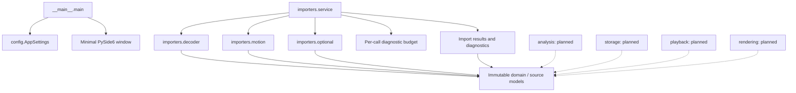

# 5. Building Block View

[Architecture index](README.md)

## White box: overall system



Arrows express dependencies. Dashed arrows describe future consumers, not
implemented services. Qt startup does not call the import service.

## Contained building blocks

| Block                | Responsibility and interface                                                                    | Status / source location                                                                                                     |
| -------------------- | ----------------------------------------------------------------------------------------------- | ---------------------------------------------------------------------------------------------------------------------------- |
| Bootstrap / settings | main validates AppSettings before creating the Qt window                                        | Implemented: [entry point](../../src/ride_forces_analyzer/__main__.py), [settings](../../src/ride_forces_analyzer/config.py) |
| domain               | Recording, SourceEnvelope, SourceNumber, vectors, motion, metadata, attributes and GPS concepts | Implemented immutable representations: [domain](../../src/ride_forces_analyzer/domain/)                                      |
| importers            | Strict decoding, motion/optional validation, ordered diagnostics and public import composition  | Implemented: [importers](../../src/ride_forces_analyzer/importers/)                                                          |
| analysis             | Calibration, scientific quantities and filtering                                                | Planned: [M3 requirements](../requirements/DEV-REQ-003-scientific-analysis.md)                                               |
| storage              | Local ride library and persistence                                                              | Reserved package; services planned for later milestones                                                                      |
| playback             | Playback timeline and interpolation consumption                                                 | Reserved package; services planned                                                                                           |
| rendering            | Frame generation and separate encoding                                                          | Reserved package; services planned                                                                                           |
| ui                   | Future widgets and product interactions                                                         | Reserved package; minimal window currently lives in the entry point                                                          |

## Level 2: importer internals

- `decoder` separates bounded binary Path input from bytes decoding. Iterative
  lexical preflight applies limits before full-tree allocation; strict JSON hooks
  reject duplicates/constants and retain number tokens. Only a supported 2.2.0
  object with required core shapes produces DecodeSuccess.
- `motion` converts finite numbers/numeric strings into typed vectors, validates
  sequence lengths and independently bounded indices, and preserves structural
  calibration vectors. It performs no force or time calculation.
- `optional` parses optional metadata, ordered arbitrary attributes and independent
  indexed GPS slots. Defective optional values warn; source data is retained.
- `service` composes decoding, motion and optional validation. One shared diagnostic
  collector enforces the aggregate budget before building the full Recording.
- `result` / `diagnostics` own immutable tagged outcomes and stable diagnostic data.
  Only full service success exposes the complete available Recording.

The domain recursively owns read-only source mappings, array tuples, immutable
scalars and original bytes. Canonical collections are copied into tuples. Optional
metadata, source provenance and explicit source/default origins remain typed.

## Important interfaces

The public package `ride_forces_analyzer.importers` exposes:

```python
import_forces(path: Path, *, limits: ImportLimits = DEFAULT_LIMITS) -> ImportResult
import_forces_bytes(data: bytes, *, limits: ImportLimits = DEFAULT_LIMITS) -> ImportResult
```

Standalone `decode_forces` / `decode_forces_bytes`, `parse_motion` and
`parse_optional_data` remain callable subset APIs. Their results establish only
that subset's contract, not complete import success or scientific readiness.
Detailed accessor and caller contracts are maintained in the
[canonical-model](../development/CANONICAL_MODELS.md),
[decoder](../development/STRICT_DECODING.md), [motion](../development/MOTION_PARSING.md),
[optional-data](../development/OPTIONAL_PARSING.md) and
[public API](../development/IMPORT_SERVICE.md) guides.

## Level 3

No deeper decomposition is needed for this implemented boundary. Future library,
analysis, widgets and render services must be documented when designed, not
invented to fill the template.

## Planned M3 analysis boundary

[DEV-REQ-003](../requirements/DEV-REQ-003-scientific-analysis.md) proposes an
immutable AnalysisProfile/AnalysisResult contract under `analysis`, consuming
validated M2 recordings without re-decoding or mutating them. Intended internal
responsibilities are device-vector/unit handling, frame/calibration validation,
filtering/statistics, GPS quality/geodesics and source-app comparison.
These are design responsibilities, not implemented modules or approved public
function signatures. The stage-1 API design must define actual boundaries.

Library calls stay behind the analysis API. Domain quantities, capabilities and
provenance must remain meaningful without exposing upstream APIs to consumers.
The engine stays independent of Qt, storage and encoders; later M4–M7 consumers
use derived results. All five recordings must participate in capability/regression
coverage, including unavailable gravity/GPS-derived channels for Iron Gwazi.
