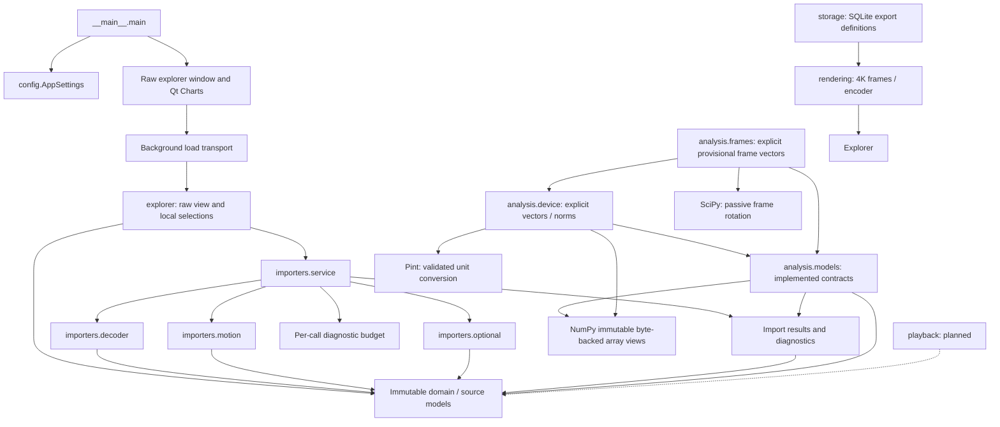

# 5. Building Block View

[Architecture index](README.md)

## White box: overall system

Arrows express dependencies. Dashed arrows describe future consumers, not
implemented services. The explorer starts import through a background worker;
widgets contain no parser, scientific transformations or source mutation.

## Contained building blocks

| Block                | Responsibility and interface                                                                    | Status / source location                                                                                                     |
| -------------------- | ----------------------------------------------------------------------------------------------- | ---------------------------------------------------------------------------------------------------------------------------- |
| Bootstrap / settings | main validates AppSettings before creating the Qt window                                        | Implemented: [entry point](../../src/ride_forces_analyzer/__main__.py), [settings](../../src/ride_forces_analyzer/config.py) |
| domain               | Recording, SourceEnvelope, SourceNumber, vectors, motion, metadata, attributes and GPS concepts | Implemented immutable representations: [domain](../../src/ride_forces_analyzer/domain/)                                      |
| importers            | Strict decoding, motion/optional validation, ordered diagnostics and public import composition  | Implemented: [importers](../../src/ride_forces_analyzer/importers/)                                                          |
| analysis             | Immutable contracts, device/frame math and source-app projection/mean                           | Implemented analysis services: [analysis](../../src/ride_forces_analyzer/analysis/); basic extrema implemented               |
| storage              | SQLite export presets and batch snapshots                                                       | Implemented export configuration; persistent ride library remains planned                                                    |
| playback             | Playback timeline and interpolation consumption                                                 | Reserved package; services planned                                                                                           |
| rendering            | Independent RGBA generation and FFmpeg encoding                                                 | Implemented five-profile landscape/portrait transparent/opaque video                                                         |
| ui                   | Raw chart controls and background import/export transport                                       | Implemented raw explorer; persistent library/playback remain planned                                                         |

## Importer composition and interfaces

`decoder` performs bounded Path/bytes input, lexical preflight and strict 2.2.0
JSON dispatch. `motion` validates components, paired lengths, independent indices
and structural vectors. `optional` parses metadata, arbitrary ordered attributes
and indexed GPS slots. `service` composes these workers with one per-call
`DiagnosticBudget`; `result`/`diagnostics` expose immutable tagged outcomes.
Only full-service success supplies a complete Recording.

Use the [public Path/bytes API](../development/IMPORT_SERVICE.md). Standalone
[decode](../development/STRICT_DECODING.md), [motion](../development/MOTION_PARSING.md)
and [optional](../development/OPTIONAL_PARSING.md) APIs establish subset contracts.
The [domain guide](../development/CANONICAL_MODELS.md) defines owned bytes/tree,
source scalars, tuple collections and absence/default provenance.

## Analysis boundary

[Analysis models](../development/ANALYSIS_MODELS.md) retain full M2 ImportSuccess,
immutable NumPy data, provenance and independently bounded channel indices.
Opt-in `analysis.device.analyze_device_vectors` accepts source-bound
MotionUnitContract declarations and returns independent SI vectors/norms.
It never runs automatically after import. Library calls stay behind this API;
caller references do not certify source semantics.

`analysis.frames` supplies strict explicit-basis validation, passive
SciPy transforms and source-bound opt-in PROVISIONAL rider vectors. No real rider
calibration is qualified by this strict API. Its universal qualification and general
statistics are deferred; GPS analytics is outside the implemented
[analysis boundary](08_concepts.md#scientific-provenance-and-gates).
The boundary stays independent of widgets, storage and encoding. All five fixtures
participate in capability tests, including absent Watch gravity/GPS. Deeper future
services are documented only when designed.

`analysis.reference` supplies calibrated source-direction channels for any usable import to explorer
presentation, retaining confirmed normalized-direction contracts, source hash, timestamp,
library version and raw/filtered channels. It leaves strict frame APIs unchanged.

`analysis.recording` contains the parallel unified recording-analysis data-model
skeleton, reusing existing contracts. Explicit snapshot validation checks source,
time, availability, payloads and shared dependencies without numerical calculation.
Preparation, sample access and reconfiguration still raise `NotImplementedError`;
numerical processing, subscriptions, cache and integration remain planned under
the [requirements](../requirements/UNIFIED_ANALYSIS.md).
Current explorer and export consumers do not use these containers.
`analysis.service` adds an explicit `NotImplementedError` API skeleton for state
queries, subscriber registration/removal, analysis requests and service cleanup.
It introduces no running workers, callback dispatch or Qt/storage dependency.

`gps_overview` prepares immutable approximate spatial reference segments from
independent source GPS slots, preserving gaps and source ownership. `ui.gps`
renders these in a separate offline dialog, enabled only for usable positions.
The geometry has no dependencies on force analysis, sensor time or local selections.

The approved focus workspace keeps Qt-only structure in `ui.window` and local
styling in `ui.theme` and native caption/icon integration in `ui.chrome`. Qt-independent `explorer` supplies compact header text,
ordered metadata rows, sample clocks and directional current-value cards from
unchanged presentation data. Split/scroll/expand state is view-only; no scientific
or import operation moves into widgets. The separate GPS dialog is retained.

Basic per-axis extrema for inclusive selections are implemented in the pure
`force_extrema` module, with immutable source/mode/window/unit/index/time results.
Explorer presentation exposes them in the inspector; widgets perform no calculation.
Raw operation avoids importing the NumPy-backed analysis package. This is a small selected-range product, not a generic statistics engine.

## Video export boundary

The [Manta G-Orbit video example](https://youtu.be/tsRzD416voU) shows the exported
overlay composed over Onride footage.

`analysis.orientation` implements source-gravity-to-vertical tilt with missing/zero
vectors retained as gaps. `rendering.model` binds source identity, smoothing,
inclusive ranges and fixed per-panel bounds to an independent video frame clock.
`analysis.airtime` prepares immutable, causal presentation labels from smoothed
vertical source g and recent load changes. Compact chart renderers consume these
labels independently of video fps and seek order.
`ExplorerData` also exposes source-index label ranges for the workspace;
Qt maps their time bounds to the clipped, zoom-dependent context strip and
uses the current label in the vertical value card. The
[provisional thresholds and limits](../implementation/AIRTIME.md) do not establish
scientific qualification or a general ride-event analysis service.
`rendering.layouts` provides one module per built-in profile and an explicit
registry of immutable layout metadata and factories. Each renderer implements
the same native-RGBA-region/source-position protocol. Shared drawing primitives
and a three-channel chart base support the related compact profiles; G-Orbit and
Column draw independently. `rendering.frames` selects the registered renderer and
composes its region into a full RGBA frame, without layout-specific drawing branches.
Each profile owns its documented design constants, including typography, geometry,
palette and stroke widths. Shared chart algorithms consume profile-specific values;
portrait variants retain their own profile's styling rather than another layout's.
`rendering.peaks` prepares immutable signed peak-hold envelopes from the selected
source interval for G-Orbit. Hold/release follows source time, so random preview
seeks and video-rate changes do not depend on prior render calls.
`ExportSettings` owns landscape/portrait dimensions. Shared region geometry drives
frame composition and encoder padding; portrait force cards reflow vertically.
Previews downsample the complete canvas proportionally. SQLite preset/job snapshots
retain the aspect, with landscape as the backward-compatible default.
The compact ribbon, corners, capsule and orbit preserve translucent panels and
opaque data. `rendering.encoding` probes NVIDIA Vulkan/NVENC, streams the selected
bounded region to FFmpeg and publishes one
new output exclusively. No GPU or codec operation changes the source clock/data.
`rendering.preview` prepares five exact-source-sample snapshots with the production
renderer and preview-only contrast backgrounds, independent of FFmpeg and Qt.
The [layout API guide](../development/EXPORT_LAYOUTS.md) documents registration,
stable persisted keys and extension rules; plugins are built in, not discovered
or installed dynamically.
Out-of-range cursors are flagged without clamping. `ui.export` owns the two-step
assistant, image transport, debounced/revision-gated preview jobs, queued progress and cooperative cancellation;
no renderer/encoder logic lives in widgets. See [export contracts](../implementation/VIDEO_EXPORT.md).

`storage.export_models` owns versioned immutable presets, source-bound jobs and
batch definitions. `storage.exports` owns SQLite schema/version protection,
transactional writes and the per-user database path. `rendering.batches` validates
source identity and applies saved smoothing/ranges before sequential exports;
its run report distinguishes completed, failed, cancelled and skipped jobs.
`ui.batches` edits saved queues and transports worker results. No recording bytes
or rendered media enter SQLite; preset changes cannot alter stored job snapshots.
