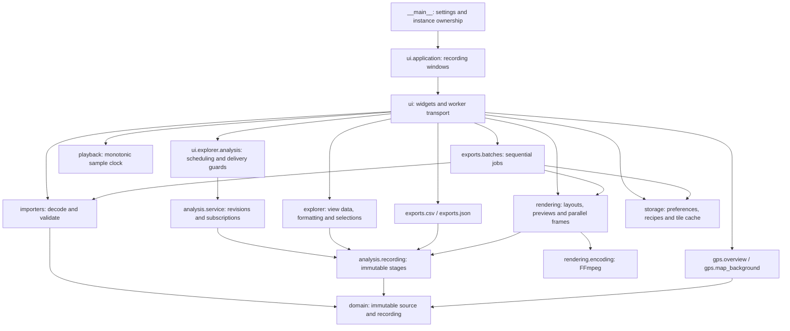

# 5. Building Block View

[Architecture index](README.md)

## White box: overall system

Arrows indicate dependencies. Domain/import/analysis code has no widget dependency.
The independent `validation.checks` module checks types, conditions, nonempty text,
enum members, lowercase SHA-256 digests, diagnostic codes and inclusive sample
intervals. Callers retain their error types and messages. Domain and analysis rules
remain with their owning packages;
`analysis.recording.validation` validates snapshot and configuration relationships.

## Contained building blocks

| Block                                                                 | Responsibility                                                                |
| --------------------------------------------------------------------- | ----------------------------------------------------------------------------- |
| `runtime.config`, `__main__`, `runtime.paths`                         | Validated settings, startup and platform data paths                           |
| `runtime.instance`, `ui.application`                                  | Local process ownership, file-open requests and recording windows             |
| `domain`, `importers`                                                 | Lossless source representation, bounded parsing and deterministic diagnostics |
| `analysis`                                                            | Prepared measurements, context/events, calibration and extrema                |
| `explorer`, `playback`                                                | View data, sample selection, formatting and monotonic playback                |
| `gps.overview`, `gps.map_background`                                  | Independent route geometry and optional bounded map requests                  |
| `exports`                                                             | Sample serialization, safe publication and sequential video jobs              |
| `rendering`                                                           | Layouts, previews, ordered frame generation and encoding                      |
| `storage`                                                             | SQLite preferences, marker choices, export definitions and map tiles          |
| `i18n`, `rendering.airtime_colors`                                    | Shared language and semantic-color contracts                                  |
| `ui`                                                                  | Qt controls, dialogs, themes, icons and asynchronous transport                |
| `runtime.cpu_resources`, `runtime.updates`, `runtime.error_reporting` | CPU topology, optional release lookup and local support reports               |

Source modules are under [ride_forces_analyzer](../../src/ride_forces_analyzer/).

## Importer composition and interfaces

`decoder` owns bounded Path/bytes input, compressed expansion, lexical preflight,
strict JSON and source-profile dispatch. `motion` validates vectors and independent
indices; `optional` parses metadata, attributes and GPS slots. `service` composes
them using one diagnostic budget. Only complete-service success returns a
`Recording`; subset APIs do not imply complete import.

[Import API](../development/IMPORT_SERVICE.md), [decoder](../development/STRICT_DECODING.md),
[motion](../development/MOTION_PARSING.md), [optional fields](../development/OPTIONAL_PARSING.md)
and [domain models](../development/CANONICAL_MODELS.md) define exact contracts.

## Analysis boundary

`analysis.models` exposes immutable base contracts through explicit package exports.
Its modules separate sample buffers, measurement channels, profiles and results;
model construction retains validation, ownership and scientific-evidence checks.
The analysis package resolves model exports on demand, keeping raw extrema and
explorer imports independent of optional NumPy.

`analysis.recording.RecordingAnalysis` binds the complete import to immutable source,
time, calibration, projection, smoothing, orientation, context and event stages.
`projection`, `smoothing`, `orientation`, `airtime`, `events` and `calibration`
own their respective calculations. Sample views read existing buffers.
`analysis.preparation` orchestrates those calculations and reuses compatible stages.
`analysis.recording` owns snapshot/configuration/notification contracts, structural
validation and sample access. Its package separates configuration, stage models,
snapshot access, technical notifications and structural validators; existing
imports remain explicit package exports. Event evaluation consumes these contracts; only the
preparation module imports the event implementation. Snapshot reconfiguration
methods delegate lazily to preparation.
`analysis.extrema` operates on prepared channels without widget logic.

`analysis.service.AnalysisService` owns current state, revisions and subscriptions.
It computes in the caller's thread and invokes callbacks outside its state lock.
`ui.explorer.analysis.AnalysisController` owns worker scheduling and guarded Qt delivery.
Closed, rebound and superseded work cannot replace current state.

The explicit `analysis.device` and `analysis.frames` APIs use source-bound
unit/frame declarations; they do not certify physical sensor semantics.
[Analysis APIs](../development/ANALYSIS_MODELS.md) and
[snapshot concepts](08_concepts.md#snapshot-lifetime-and-reuse) own details.

## Presentation and application services

The `explorer` package preserves its public imports while separating presentation
state (`model`), text/HTML (`text`), inclusive time/sample selections (`selection`)
and import/analysis composition (`loading`). `ExplorerData` delegates presentation
and selection work without repeating scientific preparation. Loading reuses the
existing import and analysis services; the raw path remains NumPy-independent.
Cursor, selection, viewport and curve visibility are view state.
`SamplePlayback` maps monotonic time to source samples without recalculating analysis.

The UI groups recording interactions in `ui.explorer`, export surfaces in
`ui.exports`, auxiliary dialogs in `ui.dialogs` and shared Qt presentation in
`ui.presentation`. `ui.application` composes the recording windows. Independent
sample controls and chart gestures live in `ui.explorer.controls` and
`ui.explorer.chart_view`. `ui.explorer.chart.ExplorerChart` owns curves, replaceable
axes, replay/value labels, source markers, cursor, selection and vertical-context
graphics. The window binds prepared snapshots and selections; navigation supplies
cursor positions. The chart emits viewport and gesture notifications without
referencing window controls.
`ui.explorer.inspector.ExplorerInspector` owns selection/smoothing inputs and
prepared metadata, diagnostics and extrema text; changes are reported through Qt
signals. `ui.explorer.navigation.ExplorerNavigation` owns sample controls, force
cards and timer transport for the existing `SamplePlayback` clock, including cursor
and viewport following. The window composes these widgets, binds the same prepared
snapshot to each component and coordinates import/analysis delivery.
Export preview widgets and background jobs live in
`ui.exports.preview` and `ui.exports.workers`. `ui.exports.form.ExportForm` owns
export inputs and retained layout placements. `ui.exports.preview_controller` owns
preview debounce, captured requests, worker revisions and stale-result rejection.
`ui.exports.presets` owns saved-preset controls, persistence and the auxiliary batch
dialog. `ui.exports.video` coordinates these components with review/start/cancellation;
analysis changes for loaded recipes still use the existing preparation service.

`RecordingApplication` owns windows and queued file-open requests.
`InstanceBroker` owns local locking/IPC. Each recording window owns its analysis
controller; language and appearance are shared application preferences.

`gps.overview` prepares independent approximate route segments. `gps.map_background`
projects route and tiles consistently and owns bounded HTTPS/image composition;
`storage.map_tiles` owns the tile cache. `ui.dialogs.gps` transports requests and rejects
late results. GPS has no force-clock or selection dependency.

The `i18n` package shares language registration and text/number formatting between
UI and rendering, with separate German/French catalogs. `ui.presentation.translation` owns Qt
bindings; the shared translation package has no Qt dependency.

`runtime.diagnostics` collects offline system, CPU, Qt and encoder support fields;
`ui.dialogs.about` presents them and offers copying without including recording contents.

`runtime.updates` performs bounded public release lookup; `ui.presentation.updates` schedules it and
presents results. `runtime.error_reporting` owns per-process local diagnostic files.
The `runtime` package groups platform paths, CPU topology and local process
ownership. Modules are imported explicitly; CPU and path helpers do not load Qt.
`runtime.cpu_resources` detects physical cores and logical processors; unknown topology
stays unknown. Render-job validation caps positive counts at available logical
processors, with a one-job fallback. [Runtime](06_runtime_view.md) and
[deployment](07_deployment_view.md) describe integration.

## Sample data export boundary

`exports.csv` and `exports.json` serialize a bound snapshot and inclusive interval;
they do not calculate analysis or depend on Qt/FFmpeg. `exports.validation` checks
the bound snapshot, inclusive range, destination suffix and available sample rate
for both serializers. `exports._file` owns exclusive creation and atomic replacement
after explicit overwrite confirmation.
`exports.formats.DataExportFormat` provides the shared `CSV`, `JSON` and `ANALYZER_JSON`
identifiers with stable text values `csv`, `json` and `analyzer_json`.
`formatting.time.format_sample_time` supplies the common replay labels for explorer,
serializers and layout renderers without importing presentation or analysis code.
`ui.exports.data_controller` owns destination suggestions, overwrite prompts and
the source-bound data-export dialog lifetime. `ui.exports.data` transports the
prepared export's progress/cancellation; serialization stays in `exports`.

[CSV](../implementation/CSV_EXPORT.md) and [JSON](../implementation/JSON_EXPORT.md)
define formats and lifecycle.

## Video export boundary

`rendering.model` binds a snapshot, range and settings into an `ExportTimeline`.
Each timeline owns an immutable `ExportSnapshot` describing its effective analysis
recipe, source identity, settings, interval and output geometry. The encoder embeds
this common snapshot in video metadata for both single and batch exports; the
batch report references it after preparation instead of building its own analysis
snapshot. Queued job definitions remain separate requested configuration for jobs
that cannot be prepared. Snapshot serialization is shared with saved presets.
`rendering.scales` owns the lateral/longitudinal range policies shared by all
layouts, shared history fitting and the HUD/G-Orbit posture-dependent vertical
instrument ranges. Export channels carry a 1 g vertical presentation reference
for every posture; lateral and longitudinal references remain zero.
Layouts consume this timeline through one native-RGBA-region/source-position
protocol. Each plugin owns its geometry, renderer, presentation defaults and optional
file-size estimate rates, including optional NVENC rates selected by the H.264
GPU preference with a same-extent CPU-rate fallback, and portrait overrides
for CPU/GPU ProRes and CPU/NVENC H.264 with same-extent fallback. The registry resolves these through the
common contract and validates geometry. Its extent resolver uses layout-owned native dimensions
for Content area and region/canvas placement for Full frame; capability and rate lookup
use the same typed extent contract. Concrete layouts never depend on one another; reusable
drawing/history primitives stay in shared modules. UI, preview, sizing and encoding
consumers use the registered metadata rather than identifying concrete layouts;
`frames` retains complete native Content-area images or scales/places Full-frame
regions. `encoding` preserves native Content-area dimensions without geometric
filters and pads Full-frame regions onto their canvas. `preview` builds exact-sample previews and `peaks`
prepares deterministic source-time peak envelopes for HUD and G-Orbit.

`parallel` uses one serial renderer or independent thread-owned renderers, images
and fonts. Only the immutable timeline is shared. `encoding` probes backends,
streams ordered region bytes and publishes completed output. `progress` defines
immutable export status, phases and remaining-frame estimates shared by both
export paths; Qt workers transport them to the dialogs. `ui.exports.video`
coordinates assistant pages and the video-export lifecycle.

`storage.export_models` defines immutable presets/jobs; `storage.exports` owns
SQLite schema and transactions. `exports.batches` imports and checks each
source before applying its saved recipe and running exports sequentially.
`ui.exports.batches` edits queues and transports results. Recordings and rendered media
never enter SQLite.

[Layout API](../development/EXPORT_LAYOUTS.md), [video contracts](../implementation/VIDEO_EXPORT.md)
and [batch contracts](../implementation/EXPORT_BATCHES.md) own detailed rules.
