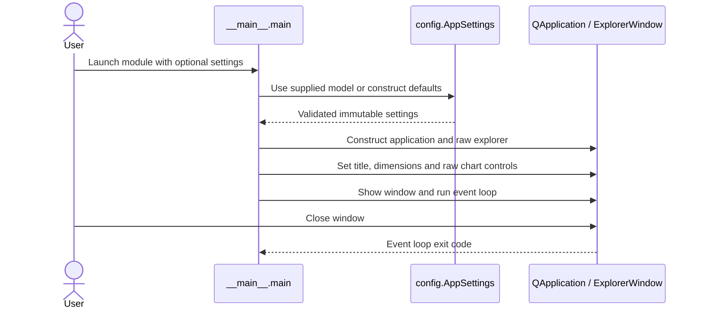
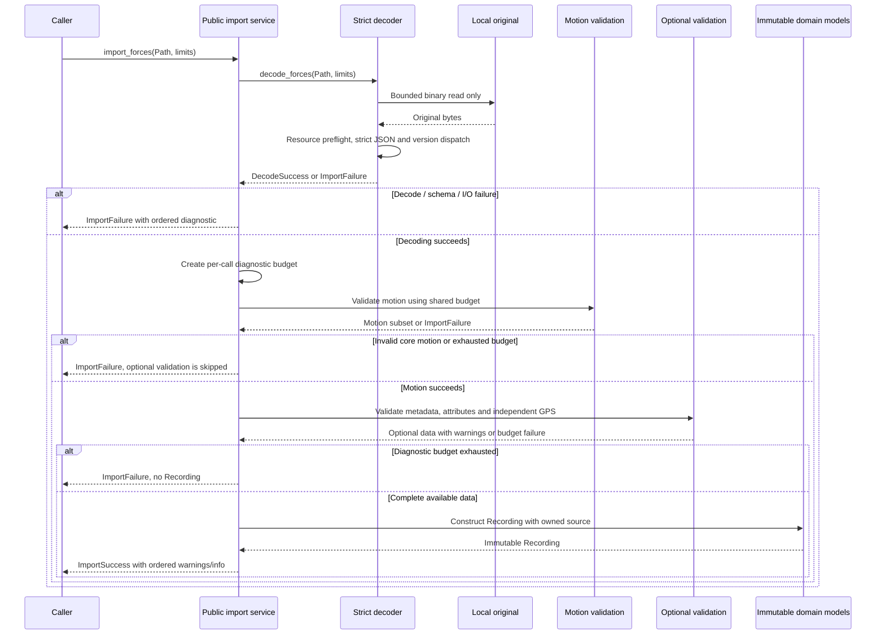
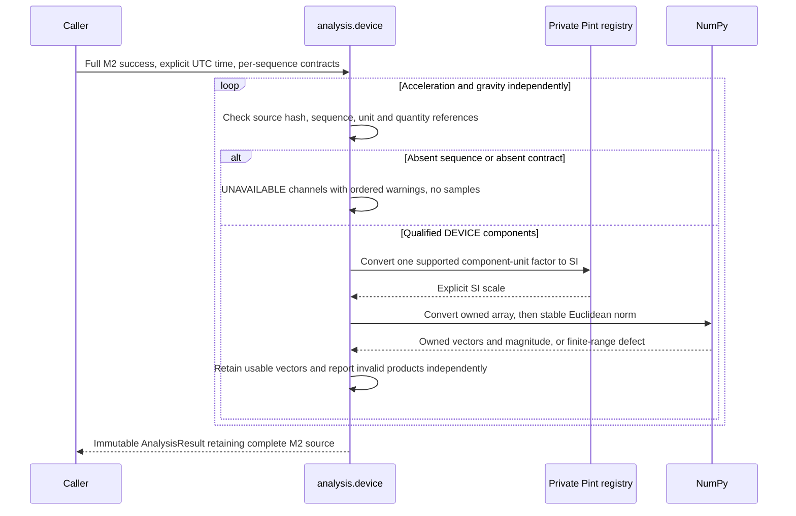
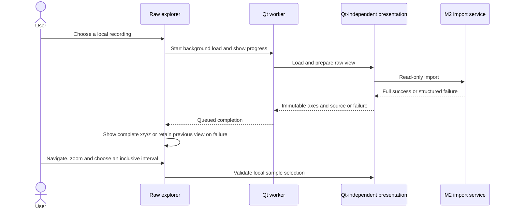
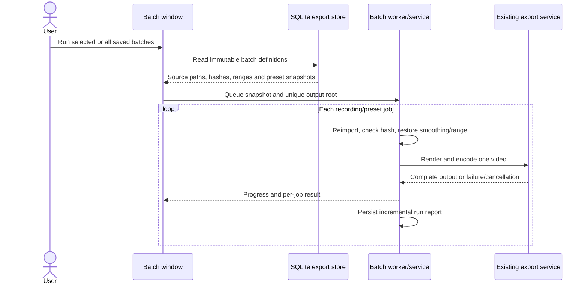

# 6. Runtime View

[Architecture index](README.md)

## Qt bootstrap

AppSettings rejects unknown settings and invalid title/dimensions outside widgets.
Window dimensions are positive and at most 16,777,215 pixels, the Qt widget limit.
Invalid model construction fails before window creation. The GUI smoke test starts
the real module in a separate Windows process and exits through the Qt event loop;
its tests exercise the real bootstrap contract above.

## Optional update discovery

Before normal interaction, the explorer schedules an optional update check after
the event loop starts. A controller applies the saved opt-in, daily attempt limit
and skipped version. A worker calls the Qt-independent release service; only the
GUI thread updates status or opens a release notice. Closing the main window
suppresses late results. Network operations have bounded reads/timeouts and never
block the GUI or recording processing. Manual checks in About bypass the daily
interval and show errors; automatic errors are silent. No installer is invoked.

## Read-only import and failures

The bytes variant bypasses the file read and otherwise uses the same composition.
The public service remains synchronous; the raw explorer runs it on a Qt worker
thread with an indeterminate progress indicator. Other callers choose scheduling. Invalid caller argument types/limit configuration raise TypeError or
ValueError; expected source/I/O defects return structured failures.

Optional missing/defective GPS does not invalidate usable core motion. Invalid
supplied gravity remains fatal; gravity is never fabricated. Global resource
failures remain fatal even inside unknown or optional content. Unreadable or
oversized inputs have no complete-source digest; no partial read is represented
as complete provenance. Each call owns independent state, so repeated same
bytes/policy produce equivalent output. See [API contracts](../development/IMPORT_SERVICE.md).

## Product boundaries

Selected-range extrema update on source/selection/mode/smoothing changes.
Persistent ride library, interactive playback and POV synchronization remain
planned. Frame rendering and encoding are implemented for the 4K overlay slice. Universal physical
rider qualification and analytical GPS are outside current M3 acceptance. This view introduces
no invented runtime interactions for those services.

## Implemented device-only analysis

Caller contract/type/hash defects raise TypeError/ValueError. Expected finite-range
calculation defects produce INVALID products with structured errors. Source
absence and unknown units produce UNAVAILABLE products with different warning
codes. A declaration cannot create absent gravity. The caller supplies calculation
time; sample indices remain indices, with no generated timeline or epoch.
There is no addition/subtraction of the two source channels, no normalization
into rider G, and no calibration, filtering or GPS processing. The registry reads
installed definitions at module initialization; subsequent calculations perform
no file or network access. Caller evidence references are explicit attestations,
not an empirical verification service.

## Explicit provisional frame projection

A separate `analysis.frames.analyze_rider_frame` call checks M2 success, source-bound
calibration, profile/assumption permission and independent device-unit contracts.
Missing mapping/data/units returns excluded channels. An explicit admitted basis
passes through SciPy passive rotation; resulting rider vectors are PROVISIONAL.
Range failures yield INVALID, while other usable sequences remain independent.
It never guesses source axes, normalizes input bases or labels real rider forces verified.
The caller supplies UTC time; no clock alignment, gravity combination or filtering occurs.
See [passive frame decision](09_architecture_decisions.md#passive-frame-transforms).

## Raw explorer interaction

Cancelling the picker changes nothing. The previous view survives load errors.
Application shutdown drains outstanding worker tasks after the window closes;
it does not kill parsing mid-call. Axis labels use source values/inferred elapsed seconds,
not rider G or a fabricated clock. Qt Charts handles interactive chart drawing;
export frame generation and encoding are separate implemented services.

Background presentation attempts source-direction projection and a configurable centered mean
(default 11) for every successful import. Loading selects calibrated curves by
default; the checkbox switches arrays/value bounds while preserving time/selection.
Expected calibration errors or absent optional NumPy retain raw data and a visible
explanation. Source hashes do not gate availability.

The focus workspace presents loaded curves with current-value cards and a right
inspector. A width breakpoint switches compact windows between chart and inspector;
scroll areas preserve reachable controls without changing chart coordinates.
Global import-note access opens the inspector/details and scrolls to diagnostics
after layout. Card values and clock text refresh from explorer presentation when
sample, calibration or smoothing changes. Technical expansion is independent of
analysis state. All raw/calibrated, failure and worker shutdown paths above remain.

## 4K export runtime

Export snapshots the loaded immutable recording, current smoothing and selected
range/profile/aspect/language. A Qt worker prepares/streams frames to FFmpeg; NVIDIA Vulkan
or NVENC is selected only after an actual encode probe, otherwise CPU is used.
Signals report backend/progress, completion and failure without blocking widgets.
Cancellation or window close sets a thread event; incomplete files are discarded.
The service publishes the completed encoder output exclusively.
No existing file is replaced. The user aligns the
single exported overlay with an Onride clip externally in Resolve.

## Saved batch runtime

Expected job failures are recorded and processing continues; cancellation discards
the active incomplete encode and skips remaining jobs. Completed files stay intact.
Close/Escape requests cancellation and never abandons an active encoder. Presets
and definitions survive restart; resume/history services remain outside scope.
