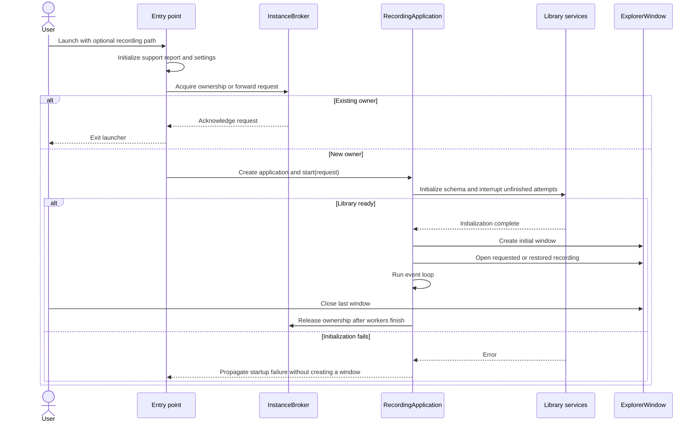
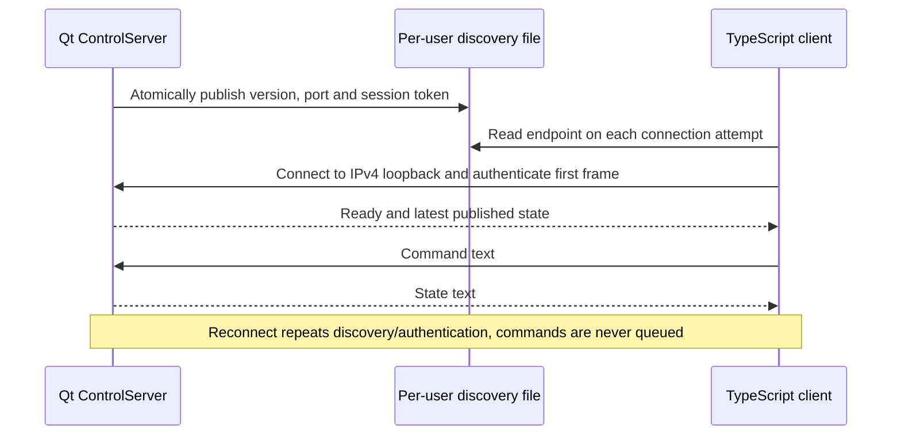
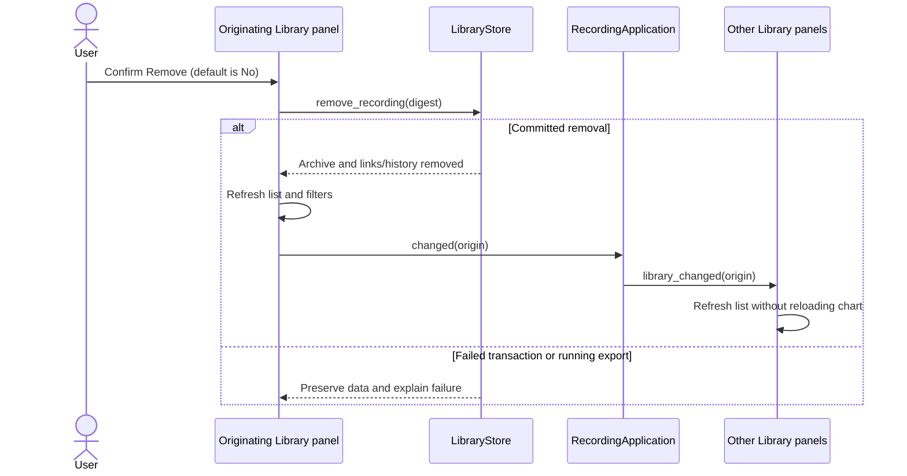
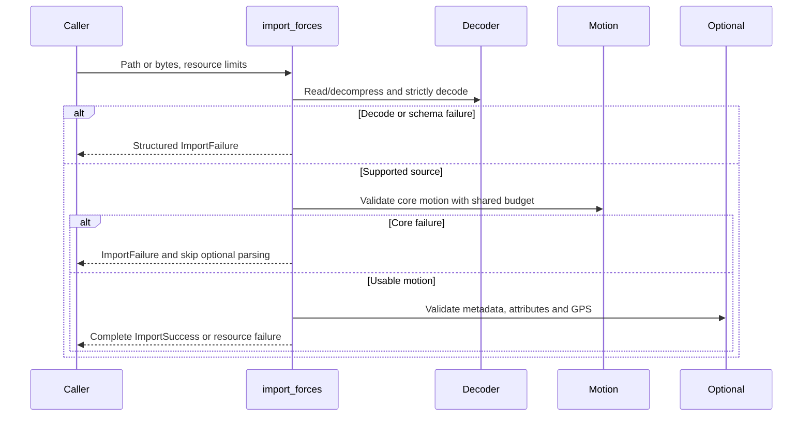
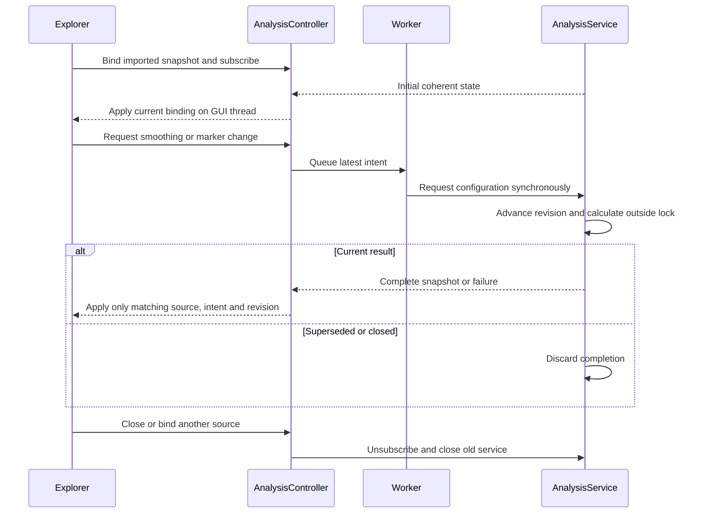
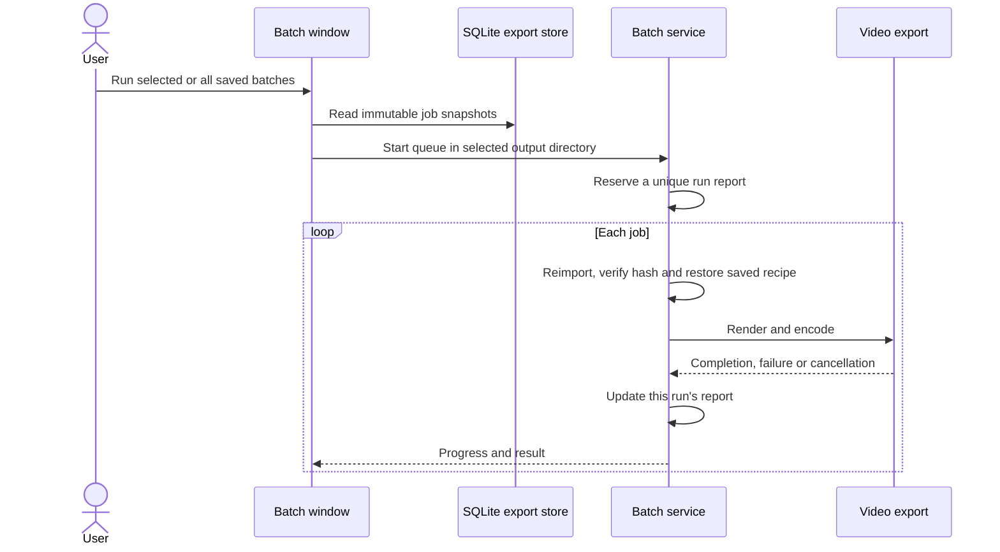

# 6. Runtime View

[Architecture index](README.md)

## Qt bootstrap

The module and frozen entry points initialize local error reporting before UI
imports. Settings are validated before creating recording windows.
`RecordingApplication` owns the Qt event loop and recording windows. File pickers
use the operating system's native dialogs; application-owned dialogs use the
shared theme and localization services.
`InstanceBroker` acquires local process ownership or forwards the optional file
path and `--new-window` request to the existing owner. Each recording has at most
one Explorer: repeated opens activate and restore its existing window without
reloading it. Archive digests identify loaded/loading recordings; external files
are also matched by path and, after import, by archived source identity.

After instance ownership is acquired, `RecordingApplication.start()` initializes
the Library, applies pending revisions and marks leftover running export attempts
as interrupted before creating the first window. Unknown finish time/duration stays unknown.
Additional windows do not repeat startup initialization. A Library error propagates
to the existing error-reporting path and prevents creation of the initial window;
the database is not replaced or reset.

Locking and local sockets use the application-data namespace, bounded forwarding
and restricted local access. Failed forwarding does not start a competing owner.
macOS file-open events enter the same request queue; Linux desktop launchers pass
a file path. Requests wait while the target window imports.

External file requests first archive the original through `LibraryArchive.import_paths()`
and then reopen the returned Library digest, preserving existing entry data on
duplicates. The main Import action and file drops share this path; multiple files
are archived sequentially and only the first successful result opens in the current
window, or one new window when explicitly requested. A repeated
external path targets its existing window and still runs the import before opening, so
updated exports at that path are processed.
Library row selection schedules the existing load worker with an archive digest
instead of an external path. It reuses archive decoding/analysis and the same
generation checks, completion and failure delivery. The list is disabled while
loading; errors remain visible in the panel and status bar without replacing the
previous chart. Additional original metadata appears only after a successful load.

Each window owns its recording, analysis, playback and child dialogs. Language
and appearance are shared. Explicit file paths take precedence over optional
Restore last file; successful loads remember the Library digest for startup restoration, while file
requests also retain their last import directory and routing path.

Support reports collect handled/unhandled errors, Qt warnings/critical/fatal
messages with severity/category and best-effort native crash stacks. Qt diagnostics
also reach the prior handler or terminal; debug/info messages are not stored.
Writes are serialized and flushed without a per-run size limit.
The first successful diagnostic write publishes report availability. Status-bar
indicators receive queued UI-thread delivery; newly opened windows read the current
state immediately. Header-only reports and failed writes do not activate the icon.
Clicking opens the report directory through the platform desktop service.
Startup removes completed-process
reports and preserves active ones. Report failure must not replace the original
error. Exception messages may contain personal paths; nothing is uploaded.

## Stream Deck transport

`runtime.stream_deck.ControlServer` and the plugin's `AnalyzerTransport` exchange
application-owned text frames. `RecordingApplication` owns one `StreamDeckController`;
the separate plugin shares one connection across visible SDK keys.

- Bind only `127.0.0.1` on a dynamic port. Discovery is `stream-deck.json` in the
  existing application-data directory; only the owner removes its published file.
  A fresh token is generated at each start; the file requests owner read/write permissions.
- Handshake version 1 and the token are required within five seconds. Browser
  origins and binary messages are rejected; incoming and published state frames
  are bounded to 64 KiB. The application contract below defines payload validation;
  commands route through the GUI-thread controller.
- The client retries after one second, including missing/invalid discovery and
  connection failure. Disconnected sends return false; stop cancels retries and
  stale connection attempts. Reconnected peers receive the latest state.
- Native Windows Qt/Node exchange and restart recovery are verified. macOS uses
  the same APIs and its existing Application Support path; native socket,
  permissions, process and device behavior remain unverified.
- **Settings → Application → Enable Stream Deck** is off by default and saved in
  existing user preferences. Startup reads it; Save applies changes to the shared
  server. Cancel leaves it unchanged. Disabling disconnects clients and removes
  discovery; application shutdown also closes the server and removes its owned
  discovery file.

## Stream Deck control contract

[Python wire models](../../src/ride_forces_analyzer/runtime/control_contract.py)
validate commands, responses and full state events; matching
[TypeScript types](../../plugins/stream-deck/src/protocol.ts) describe plugin messages.
Shared examples cover both languages. The application's Qt-thread controller routes
commands through existing controls/services and publishes state from their signals.
The plugin validates incoming messages before state-driven rendering or command
generation. Its configurable SDK key action covers the agreed command types. Plus uses six native main pages and a local
navigation action. It addresses only the bundled `profiles/plus`, remembers
Playback/Markers subgroups per device for the plugin session and confirms cyan
selection through appearance events, including swipes. SDK send completion never
confirms a page; failures alert without changing confirmed selection. User profile
copies are preserved and are not switch destinations. The six-page update replaces
the existing `profiles/plus` bundle identity; no parallel Plus variant is introduced. Native Windows six-page import, SDK switching, subgroup recall and physical swipe
feedback are verified on Plus. Menu captions use confirmed application state;
marker feedback prioritizes Failed, Pending and preview count on every page.
Press-only dials reuse existing commands and ignore rotation/touch without alerts.
Filter dial proposals are device-local plugin state. Rotation sends nothing;
press/touch use `library.filter.set` with exact option values. GUI/option changes
invalidate the affected proposal; page, target/session and connection changes
discard proposals. Active values always come from application snapshots.
Plus presentation uses the same confirmed feedback with separate native text,
status symbol/band and static menu background tiles. The production SVG assets
and feedback also drive reference illustrations; decoration carries no live state.
Library dial 2 is a display-only assignment whose gestures are ignored.

### Native page routing

- Plus page indices are 0 Library, 1 Playback/Navigate, 2 Playback/Selection,
  3 Curves, 4 Markers/Markers and 5 Markers/View. Native main pages preserve all
  four top-row menu keys; nested folders would reserve key 1 for Back.
- `switchToProfile(deviceId, "profiles/plus", page)` addresses the bundled profile,
  not arbitrary imported copies. Its completion confirms sending only; appearance
  events, including swipes, confirm the visible page. Failed requests do not change
  confirmed selection; repeated selection is a no-op.
- Subgroup recall, sample step size and filter proposals are device-local plugin
  session state. Devices do not share unconfirmed proposals or navigation state.
- Python models, TypeScript types/decoder, action availability and shared examples
  evolve together. Park labels/values remain exact Unicode data within 64 KiB,
  including long names, whitespace, punctuation and emojis; they are not opaque IDs.

### Envelopes and compatibility

- Application protocol `version: 4` is independent of discovery/authentication version 1.
  Authenticate first; transport `ready` is not an application state event.
- Require an exact application protocol version. Invalid shapes, unknown fields/actions,
  coercions and non-finite numbers are rejected. Contract changes require a new version.
  Unsupported versions produce `unsupported_protocol` in the server's supported envelope;
  the client enters `incompatible` and disables commands.
- Commands contain `type: "command"`, unique per-connection `id`, explicit `target`
  and typed `action`. Duplicate IDs are rejected without repeated execution.
- A target contains opaque `window_id`, nullable source `recording_id` and integer
  `generation`. Window IDs last for the process; generation changes when the active
  target or its loaded recording changes, including reopening the same source.
  Copy the latest target into commands; reject mismatches as `stale_target`, never
  redirect queued work to another Explorer. An Explorer without a recording can use Library actions.
- Responses contain `type: "response"`, the request `id` and addressed `target`.
  `status: "ok"` confirms the GUI action was invoked; import/open outcomes continue
  through the existing loading workflow and state feedback. `pending` acknowledges analysis only.
  Pending requests receive a final `ok` or `error` with the same ID after adoption/failure.
- Error responses use `status: "error"`, `code` and nullable availability `reason`.
  Codes: `invalid_command`, `unsupported_protocol`, `stale_target`, `unavailable`,
  `analysis_failed`. IDs/targets may be null only when the request cannot be identified.
- State events contain `type: "state"`, a non-secret server `session_id`, monotonic
  `sequence` and the complete current snapshot. Publish after authentication and
  relevant application changes; coalesce playback updates. Ignore older sequences
  within a session; a reconnect starts from a fresh snapshot, not cached toggle values.
- Client-local connection states are `disconnected`, `connecting`, `connected` and
  `incompatible`. Connection loss clears actionable target/preview feedback; never
  replay commands or assume an interrupted apply succeeded. No disconnected frame is sent.
  Disabling the opt-in setting stops the server rather than sending control commands.

### Actions

| `action.name`                                 | Arguments                                                            | Behavior                                                                             |
|-----------------------------------------------|----------------------------------------------------------------------|--------------------------------------------------------------------------------------|
| `library.move`                                | `direction: -1 \| 1`                                                 | One visible sorted/filtered entry; cyclic boundaries                                 |
| `library.open`                                | None                                                                 | Open selection in the addressed current Explorer                                     |
| `library.open_new_window`                     | None                                                                 | Open selection in an additional Explorer; retain the addressed window                |
| `library.import`                              | None                                                                 | Open the existing import dialog                                                      |
| `library.filter.reset`                        | None                                                                 | Clear park/status/search through the existing Library reset                          |
| `library.filter.set`                          | `filter: park \| status`, `value: string \| null`                    | Set one current dropdown choice; retain the other filter and search                  |
| `playback.toggle`                             | None                                                                 | Invoke actual play/pause                                                             |
| `playback.speed.step`, `playback.speed.reset` | Step: `direction: -1 \| 1`; reset: none                              | Adjacent supported speed; reset to 1×                                                |
| `position.step`                               | `steps: -20 \| -10 \| -1 \| 1 \| 10 \| 20`                           | Source samples; pause playback and clamp bounds                                      |
| `selection.step`                              | `boundary: start \| end`, `steps: -20 \| -10 \| -1 \| 1 \| 10 \| 20` | Adjust the inclusive selection through existing Inspector controls; clamp each bound |
| `view.zoom`                                   | `direction: -1 \| 1`                                                 | Decrease/increase time magnification through existing chart navigation               |
| `view.reset`, `view.selection`                | None                                                                 | Reset viewport or zoom to the existing selection                                     |
| `smoothing.step`, `smoothing.reset`           | Step: `direction: -1 \| 1`; reset: none                              | Adjacent existing odd window or application default                                  |
| `curve.set`                                   | `curve`, `enabled: boolean`                                          | Set `first`, `second`, `third`, `combined` or `calibrated` control                   |
| `marker.preview`                              | `marker`, `steps: -20 \| -10 \| -1 \| 1 \| 10 \| 20`                 | Pause playback; adjust only that preview within valid bounds                         |
| `marker.apply`, `marker.discard`              | `marker`                                                             | Adopt or discard only that marker's preview                                          |

Markers are `start`, `gravity`, `incline`, `end`. First/second/third curve slots
follow the current chart axes; state supplies actual raw/directional labels.

Filter values are the dropdown's exact data, not indices or display labels. Null
means All; an empty park string means Unknown park. Unknown or removed choices
produce `invalid_command` without changing a filter. Park values and labels are
plain Unicode strings, without the opaque-ID length restriction, trimming or
normalization; JSON serialization preserves quotes, control characters and emojis.
The existing 64 KiB UTF-8 transport-message limit still applies to the whole payload.
Step-size selection and menu navigation stay local to the plugin. Relative
steps may remain in flight together so aggregated dial ticks and rapid Library/selection
steps retain one command per step; the server serializes and revalidates
them against current GUI state. No disconnected commands are queued or replayed.
Plus press invokes Open/Play/Reset/Apply; marker touch discards only that preview.
Neo InfoBar has no input handlers. Other view,
curve, smoothing and speed actions leave playback running; marker apply/discard
does not resume it. No valid preview means apply is unavailable.

### Feedback and availability

- Global and per-action availability are `{available: true}` or
  `{available: false, reason: ...}`. Global blocking overrides individual controls;
  missing controls are unsupported. Reasons cover foreground loss, input focus,
  modal dialogs, absent windows/recordings/selections, empty Library, busy analysis,
  unsupported data, missing previews and invalid marker positions.
- `target: null` explicitly means no active Explorer. Library feedback contains
  visible count and the selected entry's identity, title and zero-based index;
  an empty list has count zero and null selection.
- Library `park_filter` and `status_filter` each expose confirmed `value` and
  ordered `options` containing `value`/`label` pairs. Before choices are loaded,
  an empty options list with null value is explicit. Enabled control initializes
  existing Library choices once; both dropdown and option-model changes publish
  even if entry count/selection stay unchanged. Filter commands use existing
  shared Library setters and availability/target guards; they open no recording
  and never change a recording's manual workflow status.
- Playback exposes actual playing/speed, current sample, source time, formatted
  replay label and last valid sample. Selection exposes confirmed Start/End sample,
  source time and replay label, independently of recording markers. Selection turns
  update immediately, clamp at the other bound/source limits and perform no analysis
  or Library marker writes. View feedback exposes source-time bounds
  and the actual odd smoothing window. Missing data uses null, not invented values.
- Curves expose label, confirmed effective `active` value and independent availability.
  Combined is unavailable in raw mode. Device visuals follow actual application state.
- Each marker exposes nullable `applied` and `preview` positions, status
  `applied`/`preview`/`pending`/`failed`, apply `request_id`, nullable failure code and
  per-marker preview/apply/discard availability. Positions carry sample, source time
  and the application's replay label; no sampling-rate inference occurs in the plugin.
- Previews survive menu changes, but target/recording changes discard them. Preview
  changes update only dotted, labelled Explorer chart overlays, without recalculating
  or persisting analysis. An off-screen preview centers the viewport where recording
  boundaries permit, without changing zoom; already visible previews do not pan it.
  Adopted marker lines stay unchanged; discard/apply and
  target changes clear the corresponding overlays. Apply stays pending until successful
  adoption; only then update `applied` and persist through existing services. Failure
  retains the last adopted value; concurrent applies must not overwrite newer markers.
- Existing `runtime.instance.OpenRequest` JSON and one-shot acknowledgements remain
  unchanged on their separate local socket; no control envelope is added there.

The controller rejects stale targets and duplicate request IDs before dispatch.
Responses go only to their originating client; state is shared with authenticated
clients. Library navigation reads the existing sorted/filtered tree. Marker apply
uses the existing analysis queue, blocks conflicting requests while pending and
confirms only adopted values; the analysis controller retains persistence ownership.
Unset calibration markers cannot be adjusted until an existing value is available.

The plugin's `ControlClient` accepts increasing state sequences within a server
session, discards stale contexts and correlates responses with outstanding request
IDs. Connection loss clears pending actions and cached state. `ControlAction`
updates only changed key presentations; icons/titles and actual on/off values are
independent of command acknowledgement. Unsupported protocol messages disable control.

## Library actions and shared windows

For **Open in new window…**, the panel emits an archive digest through the window.
`RecordingApplication` registers an independent Explorer in the same process and
schedules `open_archived()`. Each window owns its analysis, playback and chart state.
The application's Library view notification shares park/status filters, search,
selection and scrolling between panels. New panels copy the current view; applying
another panel's view suppresses notifications and recording-open signals.

Confirmed removal follows the storage transaction before publishing one change:

Every panel subscribes, including hidden panels; the origin skips its own forwarded
notification because it already refreshed. Cancelled/failed removals publish no
change. Loaded analyses, samples, zoom and playback are unaffected, and Qt removes
destroyed-panel subscriptions automatically. External originals/outputs stay intact.

Repeat preparation and backup/restore run in workers; transfer closure requests
cancellation and waits for safe completion. [Library storage](../development/LIBRARY.md)
owns transaction/recipe rules; [Explorer interactions](../implementation/RAW_EXPLORER.md#library-interactions)
own dialog, selection, scrolling, accessibility and layout behavior.

## Optional update discovery

A worker performs an opt-in startup check at most once per day or an explicit
check from Settings → Updates. The Qt-independent service uses bounded HTTPS reads; the UI
discards late results after closure. Manual failures show a retry message,
automatic failures remain silent. Download and installation stay manual.
[Release discovery](../development/RELEASE.md#in-application-update-discovery)
defines selection and persistence.

## Read-only import and failures

Path reads are bounded and read-only; bytes imports bypass filesystem access.
Optional-data defects may retain usable core motion with warnings. Invalid supplied
gravity and global resource failures remain fatal. Caller misuse raises
`TypeError`/`ValueError`; expected input/I/O defects return structured failures.
[Import contracts](../development/IMPORT_SERVICE.md) own detailed rules.

## Explorer analysis delivery

The import worker prepares a complete immutable analysis snapshot. Expected
unavailable stages still permit raw display; failed imports retain the previous
view. The UI adopts the prepared snapshot without repeating calculations.

The service owns revisions, current state and subscriptions, not Qt or workers.
Callbacks run outside its state lock and are serialized per subscription. Initial
state precedes subsequent notifications. Failure retains the previous complete
snapshot with its original configuration; no partial result replaces it.

The adapter checks active binding, source, revision, terminal status and UI-intent
generation again on GUI delivery. Load generations similarly reject late imports.
Thus a delayed pending message cannot undo completion, and an old error cannot
affect a new recording.

Smoothing retains projection and independent orientation. Gravity changes rebuild
calibration, forces and tilt; Incline changes retain tilt. Successful current marker
results save all choices atomically before view delivery. Stale/invalid requests do
not save; storage failure keeps session values and reports the failure.
[Snapshot concepts](08_concepts.md#snapshot-lifetime-and-reuse) own dependencies.

## Product boundaries

Cursor, selection, viewport, language and appearance are presentation state.
Visible-range extrema follow the viewport; From/To remains a separate inclusive
export interval. Playback uses monotonic elapsed time and the source sample rate;
delayed UI ticks catch up without accumulating drift. Seeking resets the origin.
Displayed values remain source samples; playback does not calculate analysis.
Video synchronization remains in external editing software.

## Implemented device-only analysis

Explicit `analysis.device` calls validate source-bound unit/quantity contracts,
convert independent sequences with Pint and calculate vectors/norms with NumPy.
Absent data/units yield unavailable channels; numerical range defects yield invalid
products without discarding independent usable channels. Caller declarations do
not certify sensor semantics. [Device API](../development/ANALYSIS_MODELS.md#device-only-vectors-and-units)
defines the contract.

## Explicit provisional frame projection

`analysis.frames` checks explicit source calibration, unit contracts, profile
permission and a proper orthonormal basis before applying passive SciPy rotation.
Available rider vectors remain provisional. No source basis repair, gravity
combination or clock alignment occurs.
[Frame API](../development/ANALYSIS_MODELS.md#passive-frame-math-and-provisional-rider-vectors)
owns admission and failure rules.

## Raw explorer interaction

Qt workers import and prepare data; Qt Charts displays raw or calibrated channels.
Calibration/preparation unavailability retains raw data with an explanation.
Navigation, zoom, curve visibility and appearance preserve the snapshot. Failed
loads preserve the previous usable view; shutdown drains background work.

The GPS dialog reads independent route data. Explicit map requests use a worker,
retain the route on failure and reject results after close/replacement. Resize
alone does not start a request. [Explorer contracts](../implementation/RAW_EXPLORER.md)
own interaction details.

## Sample data export runtime

Before destination selection, the UI pauses playback and captures the snapshot
and inclusive From/To interval. Existing destinations require explicit confirmation.
A shared worker serializes CSV or JSON and transports progress/cancellation.
Confirmed replacement commits atomically after success; failure/cancellation
preserves an existing file and removes temporary output. Only success remembers
the destination folder. The worker retains its bound snapshot until completion.
For archived hashes, worker execution starts an attempt with frozen requested
settings. Existing data validation admits its effective recipe before serialization.
Actual completion/cancellation/failure is saved independently of exporter output;
history-write errors are reported without deleting successful files.

## Video export runtime

The assistant captures its opening analysis snapshot. Preview requests select the
rounded sample at 60% of the chosen export interval, independently of the workspace
cursor. Range changes recompute it; other settings retain it. Debounced workers
receive current settings; revision checks discard outdated results.
Layout, format and extent changes invalidate the current preview and capture a
new request. Gallery and main view share images fitted to the resolved output
geometry; Full-frame-only gallery profiles retain their complete canvas.
Export binds the selected range, layout, aspect, language and analysis recipe.
Preparing the timeline captures its export-owned settings/analysis snapshot.
Single and batch encoding embed the same snapshot in the video comment; batch
reporting collects that snapshot without creating another analysis representation
or a per-video JSON sidecar.
For archived hashes, Start captures a requested recipe before timeline/encoder
preparation. It records preparation failures and destination-picker cancellation.
The worker attaches the shared effective snapshot and finalizes its actual outcome;
destination and queue waiting are excluded from monotonic attempt duration.
Successful output survives a history-write failure, which remains visible separately.

A worker streams the native Content-area image or Full-frame layout region to
FFmpeg, which retains native dimensions or pads to the chosen canvas. The local render-job
preference selects serial generation or a bounded thread pool with independent
renderers. Ordered prefetch preserves frame order. NVIDIA Vulkan/NVENC is used
only after a successful probe; CPU remains the fallback.

For single-video exports, an optional callback forwards already rendered RGBA
regions at approximately two-second video intervals, including the first and last
frame. Preview composition applies the selected display-only backdrop in the worker;
Qt signals deliver the resulting image to the dialog without a second render.

Cancellation joins active renders, cancels queued work and discards incomplete
output. Successful encoding publishes a new file exclusively or atomically replaces
an existing video after save-dialog confirmation. The user aligns the
overlay in their editor. [Video contracts](../implementation/VIDEO_EXPORT.md)
define output, timing and publication details.

## Saved batch runtime

Videos run sequentially; their frames use the local render-job preference.
Before encoding, the queue reads each distinct source to calculate per-job frame
budgets from saved inclusive bounds, source sample rates and export frame rates.
Overall dialog/taskbar progress uses those frame weights; settled failed jobs consume
their planned share, while unreadable sources have no known budget.
Each job replays its saved export area through the shared geometry/encoding path,
independently of current assistant settings and later preset edits.
Per-job failures allow later jobs to continue. Cancellation skips pending jobs and
preserves completed videos. Closing the dialog requests cancellation and waits for
the active encoder. Definitions survive restart; automatic resume is outside scope.
Each started archived-source job creates its own Library attempt before import;
skipped jobs create none. The report and Library retain requested/effective settings,
observed backend and actual results; `history_error` reports independent persistence
failures. The Library history dialog prepares repeats in a worker from archived bytes
and saved recipes. Video repeats use the assistant's review; data repeats use the
existing save/overwrite flow. A started repeat creates a fresh attempt.
