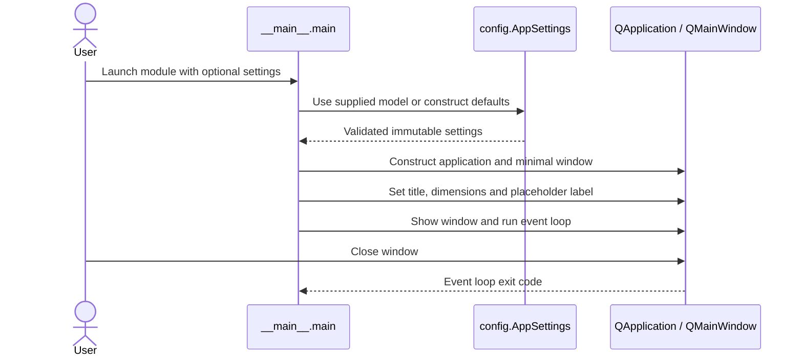
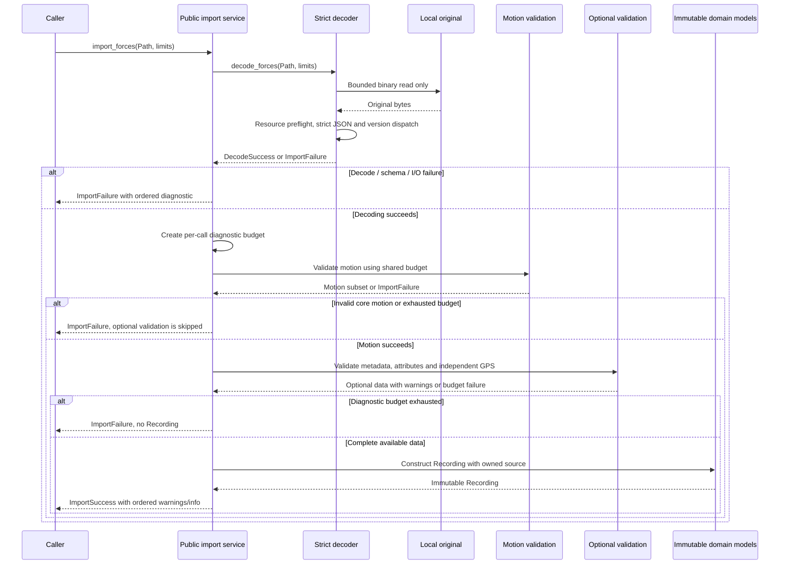
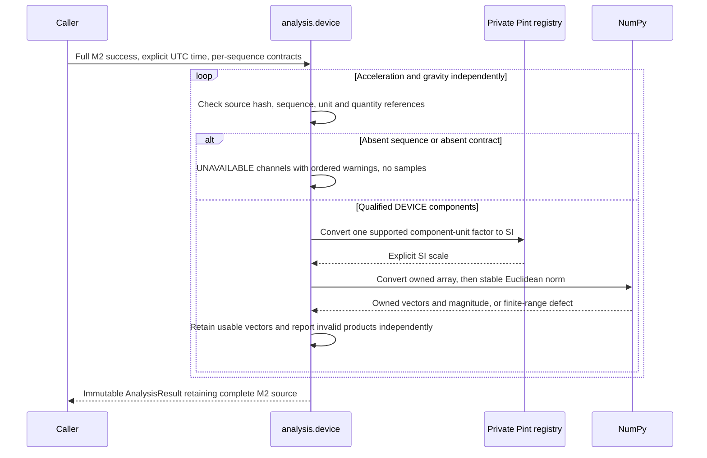

# 6. Runtime View

[Architecture index](README.md)

## Qt bootstrap

AppSettings rejects unknown settings and invalid title/dimensions outside widgets.
Window dimensions are positive and at most 16,777,215 pixels, the Qt widget limit.
Invalid model construction fails before window creation. The GUI smoke test starts
the real module in a separate Windows process and exits through the Qt event loop;
see [M1 evidence](../validation/M1.md).

## Read-only import and failures

The bytes variant bypasses the file read and otherwise uses the same composition.
A call is synchronous; scheduling, background workers and progress UI are not
implemented. Invalid caller argument types/limit configuration raise TypeError or
ValueError; expected source/I/O defects return structured failures.

Optional missing/defective GPS does not invalidate usable core motion. Invalid
supplied gravity remains fatal; gravity is never fabricated. Global resource
failures remain fatal even inside unknown or optional content. Unreadable or
oversized inputs have no complete-source digest; no partial read is represented
as complete provenance. Each call owns independent state, so repeated same
bytes/policy produce equivalent output. See [API contracts](../development/IMPORT_SERVICE.md).

## Future scenarios

Library import through widgets, calibrated scientific analysis, interactive playback, frame
rendering, encoding and POV synchronization remain planned. This view introduces
no invented runtime interactions for those services.

## Implemented device-only analysis

Caller contract/type/hash defects raise TypeError/ValueError. Expected finite-range
calculation defects produce INVALID products with structured errors. Source
absence and unknown units produce UNAVAILABLE products with different warning
codes. A declaration cannot create absent gravity. The caller supplies calculation
time; sample indices remain indices, with no generated timeline or epoch.
There is no addition/subtraction of the two source channels, no normalization
into rider G, and no calibration, filtering or GPS processing. The registry reads
installed definitions at module initialization; subsequent calculations perform
no file or network access. Caller evidence references are explicit attestations,
not an empirical verification service.
