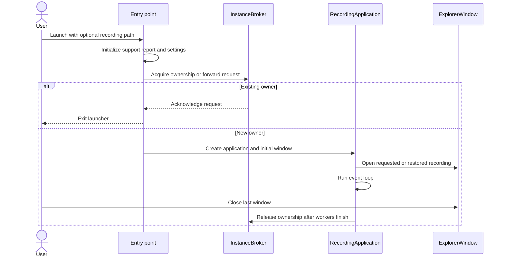
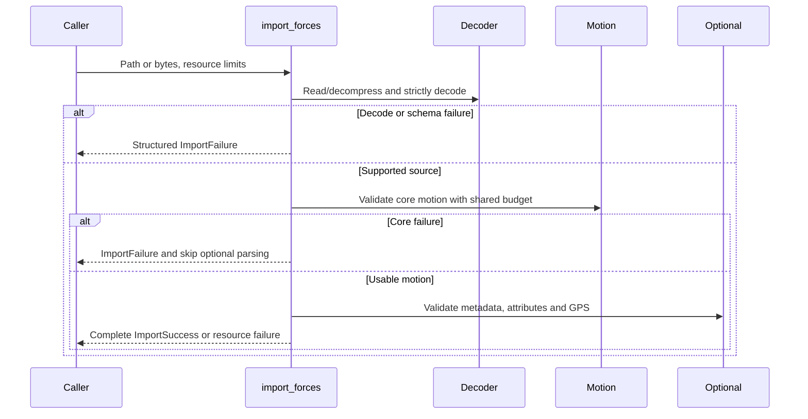
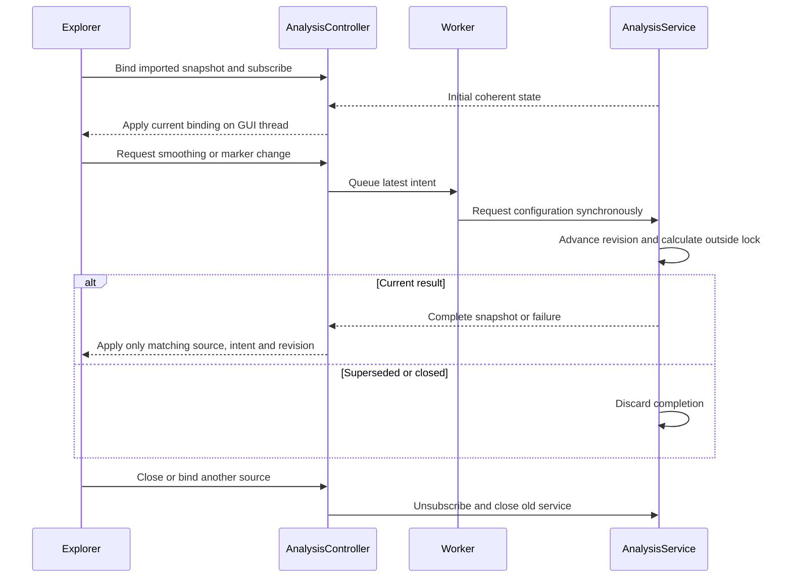
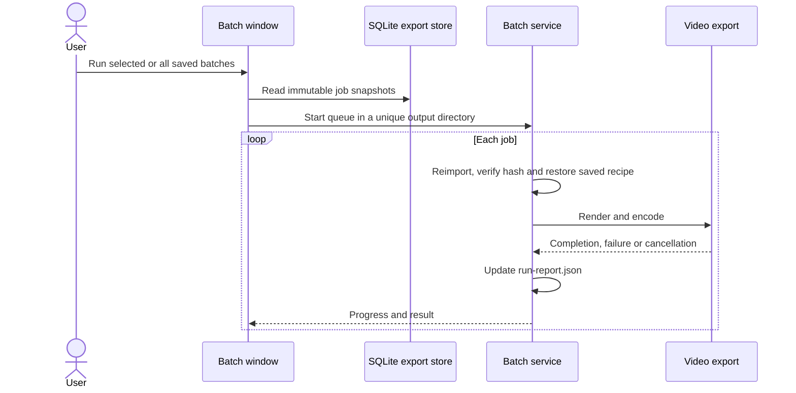

# 6. Runtime View

[Architecture index](README.md)

## Qt bootstrap

The module and frozen entry points initialize local error reporting before UI
imports. Settings are validated before creating recording windows.
`RecordingApplication` selects Qt dialogs before constructing `QApplication`, so
file-open, save and folder selection share the application palette and stylesheet.
`InstanceBroker` acquires local process ownership or forwards the optional file
path and `--new-window` request to the existing owner.

Locking and local sockets use the application-data namespace, bounded forwarding
and restricted local access. Failed forwarding does not start a competing owner.
macOS file-open events enter the same request queue; Linux desktop launchers pass
a file path. Requests wait while the target window imports.

Each window owns its recording, analysis, playback and child dialogs. Language
and appearance are shared. Explicit file paths take precedence over optional
Restore last file; only successful imports update the remembered path.

Support reports collect handled/unhandled errors, Qt warnings/critical/fatal
messages with severity/category and best-effort native crash stacks. Qt diagnostics
also reach the prior handler or terminal; debug/info messages are not stored.
Writes are serialized and flushed without a per-run size limit.
The first successful diagnostic write publishes report availability. Status-bar
indicators receive queued UI-thread delivery; newly opened windows read the current
state immediately. Header-only reports and failed writes do not activate the icon.
Clicking opens the report directory through the platform desktop service.
Startup removes completed-process
reports and preserves active ones. Report failure must not replace the original
error. Exception messages may contain personal paths; nothing is uploaded.

## Optional update discovery

A worker performs an opt-in startup check at most once per day or an explicit
check from Settings → Application. The Qt-independent service uses bounded HTTPS reads; the UI
discards late results after closure. Manual failures show a retry message,
automatic failures remain silent. Download and installation stay manual.
[Release discovery](../development/RELEASE.md#in-application-update-discovery)
defines selection and persistence.

## Read-only import and failures

Path reads are bounded and read-only; bytes imports bypass filesystem access.
Optional-data defects may retain usable core motion with warnings. Invalid supplied
gravity and global resource failures remain fatal. Caller misuse raises
`TypeError`/`ValueError`; expected input/I/O defects return structured failures.
[Import contracts](../development/IMPORT_SERVICE.md) own detailed rules.

## Explorer analysis delivery

The import worker prepares a complete immutable analysis snapshot. Expected
unavailable stages still permit raw display; failed imports retain the previous
view. The UI adopts the prepared snapshot without repeating calculations.

The service owns revisions, current state and subscriptions, not Qt or workers.
Callbacks run outside its state lock and are serialized per subscription. Initial
state precedes subsequent notifications. Failure retains the previous complete
snapshot with its original configuration; no partial result replaces it.

The adapter checks active binding, source, revision, terminal status and UI-intent
generation again on GUI delivery. Load generations similarly reject late imports.
Thus a delayed pending message cannot undo completion, and an old error cannot
affect a new recording.

Smoothing retains projection and independent orientation. Gravity changes rebuild
calibration, forces and tilt; Incline changes retain tilt. Successful current marker
results save all choices atomically before view delivery. Stale/invalid requests do
not save; storage failure keeps session values and reports the failure.
[Snapshot concepts](08_concepts.md#snapshot-lifetime-and-reuse) own dependencies.

## Product boundaries

Cursor, selection, viewport, language and appearance are presentation state.
Visible-range extrema follow the viewport; From/To remains a separate inclusive
export interval. Playback uses monotonic elapsed time and the source sample rate;
delayed UI ticks catch up without accumulating drift. Seeking resets the origin.
Displayed values remain source samples; playback does not calculate analysis.
Video synchronization remains in external editing software.

## Implemented device-only analysis

Explicit `analysis.device` calls validate source-bound unit/quantity contracts,
convert independent sequences with Pint and calculate vectors/norms with NumPy.
Absent data/units yield unavailable channels; numerical range defects yield invalid
products without discarding independent usable channels. Caller declarations do
not certify sensor semantics. [Device API](../development/ANALYSIS_MODELS.md#device-only-vectors-and-units)
defines the contract.

## Explicit provisional frame projection

`analysis.frames` checks explicit source calibration, unit contracts, profile
permission and a proper orthonormal basis before applying passive SciPy rotation.
Available rider vectors remain provisional. No source basis repair, gravity
combination or clock alignment occurs.
[Frame API](../development/ANALYSIS_MODELS.md#passive-frame-math-and-provisional-rider-vectors)
owns admission and failure rules.

## Raw explorer interaction

Qt workers import and prepare data; Qt Charts displays raw or calibrated channels.
Calibration/preparation unavailability retains raw data with an explanation.
Navigation, zoom, curve visibility and appearance preserve the snapshot. Failed
loads preserve the previous usable view; shutdown drains background work.

The GPS dialog reads independent route data. Explicit map requests use a worker,
retain the route on failure and reject results after close/replacement. Resize
alone does not start a request. [Explorer contracts](../implementation/RAW_EXPLORER.md)
own interaction details.

## Sample data export runtime

Before destination selection, the UI pauses playback and captures the snapshot
and inclusive From/To interval. Existing destinations require explicit confirmation.
A shared worker serializes CSV or JSON and transports progress/cancellation.
Confirmed replacement commits atomically after success; failure/cancellation
preserves an existing file and removes temporary output. Only success remembers
the destination folder. The worker retains its bound snapshot until completion.

## Video export runtime

The assistant captures its opening snapshot and preview sample. Debounced preview
workers receive current settings; revision checks discard outdated results.
Layout, format and extent changes invalidate the current preview and capture a
new request. Gallery and main view share images fitted to the resolved output
geometry; Full-frame-only gallery profiles retain their complete canvas.
Export binds the selected range, layout, aspect, language and analysis recipe.

A worker streams the native Content-area image or Full-frame layout region to
FFmpeg, which retains native dimensions or pads to the chosen canvas. The local render-job
preference selects serial generation or a bounded thread pool with independent
renderers. Ordered prefetch preserves frame order. NVIDIA Vulkan/NVENC is used
only after a successful probe; CPU remains the fallback.

Cancellation joins active renders, cancels queued work and discards incomplete
output. Successful encoding publishes a new file exclusively or atomically replaces
an existing video after save-dialog confirmation. The user aligns the
overlay in their editor. [Video contracts](../implementation/VIDEO_EXPORT.md)
define output, timing and publication details.

## Saved batch runtime

Videos run sequentially; their frames use the local render-job preference.
Each job replays its saved export area through the shared geometry/encoding path,
independently of current assistant settings and later preset edits.
Per-job failures allow later jobs to continue. Cancellation skips pending jobs and
preserves completed videos. Closing the dialog requests cancellation and waits for
the active encoder. Definitions survive restart; automatic resume is outside scope.
