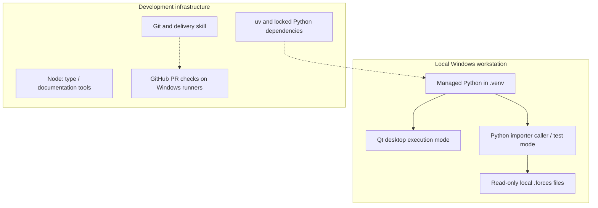

# 7. Deployment View

[Architecture index](README.md)

## Infrastructure level 1

The Python API and raw explorer are local entry points. The explorer invokes
import in a worker thread in the same process; no IPC service is introduced. No cloud component participates in recording processing. Developer
installation, reference lookups, GitHub delivery and dependency-update proposals
may require network access; installed runtime and checks work offline.

## Mapping and environment

The Qt entry point runs in the Windows desktop session; domain/importer APIs run
in the caller process without Qt. [Windows setup](../development/SETUP.md) owns
installation, version checks and invocation: `setup.ps1` creates the locked
`.venv`, `start.ps1` launches it without dependency synchronization. The optional
`-Development` switch installs Node tools; Node is not a runtime dependency.
Caches/downloads belong in `.tmp/`.

Analysis models require NumPy; opt-in `analysis.device` additionally requires
Pint, and `analysis.frames` requires SciPy. Its private registry loads bundled definitions at initialization with no
disk cache; calculations need no cloud, Qt or per-sample Pint objects.
[ADR 0004](../decisions/0004-analysis-contracts-and-library-policy.md) retains
isolated Windows x64 wheel-audit evidence. SciPy is adopted for Stage 3 frames;
GeographicLib is not required by reduced M3; no new numerical dependency is needed
for basic extrema.
This does not verify ARM64, free-threaded Python, a clean VM or a release installer.

## Validation and release boundary

[PR CI](../development/CI.md) selects application, documentation and skill jobs on
Windows after local acceptance. It cannot replace native desktop verification.
FFmpeg/encoding and standalone installation/uninstallation remain planned for
M6/M8; the checkout is a development environment, not a released installer.
