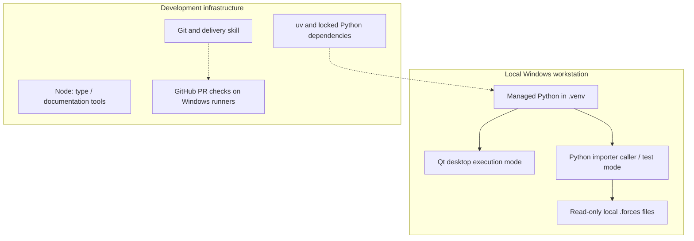

# 7. Deployment View

<!-- cspell:words Segoe LOCALAPPDATA -->

[Architecture index](README.md)

## Infrastructure level 1

The Python API and raw explorer are local entry points. The explorer invokes
import in a worker thread in the same process; no IPC service is introduced. No cloud component participates in recording processing. Developer
installation, reference lookups, GitHub delivery and dependency-update proposals
may require network access; installed runtime and checks work offline.

## Mapping and environment

The Qt entry point runs in the Windows desktop session; domain/importer APIs run
in the caller process without Qt. [Windows setup](../development/SETUP.md) owns
installation, version checks and invocation: `setup.ps1` creates the locked
`.venv`, `start.ps1` launches it without dependency synchronization. The optional
`-Development` switch installs Node tools; Node is not a runtime dependency.
Caches/downloads belong in `.tmp/`.

Analysis models require NumPy; opt-in `analysis.device` additionally requires
Pint, and `analysis.frames` requires SciPy. Its private registry loads bundled definitions at initialization with no
disk cache; calculations need no cloud, Qt or per-sample Pint objects.
[ADR 0004](../decisions/0004-analysis-contracts-and-library-policy.md) retains
Windows x64 wheel compatibility and license boundaries. SciPy supports explicit frames;
GeographicLib is not required by reduced M3; no new numerical dependency is needed
for basic extrema.
This does not verify ARM64, free-threaded Python, a clean VM or a release installer.

## Validation and release boundary

[PR CI](../development/CI.md) selects application, documentation and skill jobs on
Windows after local acceptance. It cannot replace native desktop verification.
The partial M6 video export uses offline FFmpeg; standalone installation/uninstallation remains planned for
M8; the checkout is a development environment, not a released installer.

## Encoder installation

`setup.ps1 -VideoExport` installs the version/checksum-pinned full FFmpeg build
from ffmpeg.json into `.tmp/ffmpeg/bin`, or the export dialog accepts an existing
executable. Installation may download the archive; video processing never downloads
codecs or uses cloud services. Pillow is an existing locked render extra; Windows
Segoe UI supplies text, with a scalable bundled Pillow-font fallback. Supported
NVIDIA devices can use Vulkan ProRes 4444 or NVENC H.264; CPU remains independent.
[Native export evidence](../validation/VIDEO_EXPORT.md) records actual hardware,
codec/alpha verification and the separate Resolve compatibility boundary.

## Local export configuration

Python's built-in sqlite3 stores presets and batch definitions at
`%LOCALAPPDATA%/Ride Forces Analyzer/exports.sqlite3`. Connections are short-lived,
writes transactional and schema versions explicit; no server/ORM dependency is
introduced. Recordings remain at their original paths with pinned content hashes.
The user selects an output root; every batch run creates a unique subdirectory
containing videos and run-report.json. Test databases stay under .tmp/.
