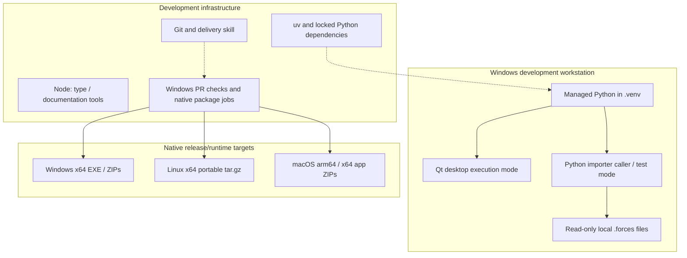

# 7. Deployment View

<!-- cspell:words Segoe LOCALAPPDATA -->

[Architecture index](README.md)

## Infrastructure level 1

The Python API and raw explorer are local entry points. The explorer invokes
import in a worker thread in the same process; no IPC service is introduced. No cloud component participates in recording processing. Developer
installation, reference lookups, GitHub delivery and dependency-update proposals
may require network access; installed runtime and checks work offline.

## Mapping and environment

The development Qt entry point runs in the Windows desktop session; domain/importer APIs run
in the caller process without Qt. [Windows setup](../development/SETUP.md) owns
installation, version checks and invocation: `setup.ps1` creates the locked
`.venv`, `start.ps1` launches it without dependency synchronization. The optional
`-Development` switch installs Node tools; Node is not a runtime dependency.
Caches/downloads belong in `.tmp/`.

Analysis models require NumPy; opt-in `analysis.device` additionally requires
Pint, and `analysis.frames` requires SciPy. Its private registry loads bundled definitions at initialization with no
disk cache; calculations need no cloud, Qt or per-sample Pint objects.
[analysis library decision](09_architecture_decisions.md#analysis-models-and-libraries) retains
Windows x64 wheel compatibility and license boundaries. SciPy supports explicit frames;
GeographicLib is not required by reduced M3; no new numerical dependency is needed
for basic extrema.
This does not verify ARM64, free-threaded Python, a clean VM or a release installer.

## Validation and release boundary

[PR CI](../development/CI.md) selects application, documentation and skill jobs on
Windows after local acceptance. It cannot replace native desktop verification.
Manual CI runs all suites, native package jobs, workflow validation and mandatory secret scanning; a separate `v*` tag workflow validates source
archives and package builds before a narrowly authorized job publishes native
downloads under the [release policy](../development/RELEASE.md). Neither runs a duplicate
full check after a push to `main`.
The partial M6 video export uses offline FFmpeg; standalone installation/uninstallation remains planned for
M8; the checkout is a development environment, not a released installer.

The Windows packaging path builds a PyInstaller EXE with an embedded interpreter
and libraries, plus standard and FFmpeg-complete ZIPs with notices. An isolated
native smoke checker executes each artifact and the complete package's CPU encoder.
The release workflow requires these checks and integrity verification of supplied
source archives before publishing binaries. Missing provider sources are recorded
in the shipped redistribution catalog and reported without blocking the build;
local candidates do not establish public binary or clean-VM acceptance. See
[Windows packages](../development/RELEASE.md#windows-packages).

## Native distribution targets

Development, editor configuration and the full local regression suite remain on
Windows. Native Linux/macOS workers are release-build and runtime-validation
targets, not additional developer setups. PyInstaller does not cross-compile
these packages from Windows.

| Target            | Baseline                                  | Package                                 | Encoder                                            |
| ----------------- | ----------------------------------------- | --------------------------------------- | -------------------------------------------------- |
| Windows x64       | Windows 10/11                             | EXE, standard/complete ZIP              | Existing pinned complete bundle or external FFmpeg |
| Linux x64         | Ubuntu 24.04, glibc 2.39, desktop session | Portable one-directory tar.gz           | External FFmpeg                                    |
| macOS arm64 / x64 | macOS 15 or newer                         | Separate architecture-specific app ZIPs | External FFmpeg                                    |

The existing Windows builder also owns shared notice collection. The native
[POSIX builder](../../scripts/build_posix.py) reuses it and the same frozen
entry point/self-test. Linux archives preserve executable permissions; macOS
archives preserve framework symlinks and ad-hoc signatures. These signatures
are not Developer ID signing or notarization. Native checkers extract the actual
package, isolate preferences, run from `/`, verify notices and exercise the GUI,
real import, German/light presentation, 4K rendering and external CPU encoding.

The [native workflow](../../.github/workflows/posix-packages.yml) builds on
Ubuntu 24.04, macOS 15 Apple Silicon and macOS 15 Intel. The required CI gate
includes all three; release quality reuses those same jobs/artifacts before
Windows packaging and publication. No target failure is optional. Static Windows
checks cannot establish a working macOS package; native job success is required.
See [release installation and limits](../development/RELEASE.md#linux-and-macos-packages).

Local state uses LOCALAPPDATA on Windows, absolute XDG_DATA_HOME (fallback
`~/.local/share`) on Linux, and `~/Library/Application Support` on macOS.
Recording files and independent GPS are unchanged. Native Qt chooses the UI font;
Pillow retains its scalable fallback when Segoe UI is unavailable. Export staging
uses the chosen destination folder and is removed on completion/failure, so a
read-only launch directory is supported. External encoders do not inherit frozen
Linux library paths. Update checks require an asset for the running OS/architecture.

## Encoder installation

`setup.ps1 -VideoExport` installs the version/checksum-pinned full FFmpeg build
from ffmpeg.json into `.tmp/ffmpeg/bin`, or the export dialog accepts an existing
executable. Installation may download the archive; video processing never downloads
codecs or uses cloud services. Pillow is an existing locked render extra; Windows
Segoe UI supplies text, with a scalable bundled Pillow-font fallback. Supported
NVIDIA devices can use Vulkan ProRes 4444 or NVENC H.264; CPU remains independent.
Representative native checks cover CPU/GPU encodes, both aspects, preview parity,
and alpha. The original landscape column was exported for complete
Manta/Kraken/Voltron recordings (9,640/10,084/10,504 frames at 50 fps) and imported
into Resolve 21.1.0.17 as 3840×2160 ProRes 4444 with Straight alpha and exact frame
counts. Start/ride/end comparisons retained exact alpha and mean RGB error below
0.022/255. This establishes media-pool import, not a visually qualified Onride
composite or complete-ride coverage of every layout/aspect/language. ProRes files
remain large; FFV1 was evaluated but is not an application output. See
[FFmpeg ProRes options](https://www.ffmpeg.org/ffmpeg-codecs.html#ProRes) and the
[Blackmagic codec list](https://documents.blackmagicdesign.com/SupportNotes/DaVinci_Resolve_19_Supported_Codec_List.pdf).

## Local export configuration

Python's built-in sqlite3 stores presets and batch definitions in `exports.sqlite3`
under the platform data directory described above. Connections are short-lived,
writes transactional and schema versions explicit; no server/ORM dependency is
introduced. Recordings remain at their original paths with pinned content hashes.
The user selects an output root; every batch run creates a unique subdirectory
containing videos and run-report.json. Test databases stay under .tmp/.
