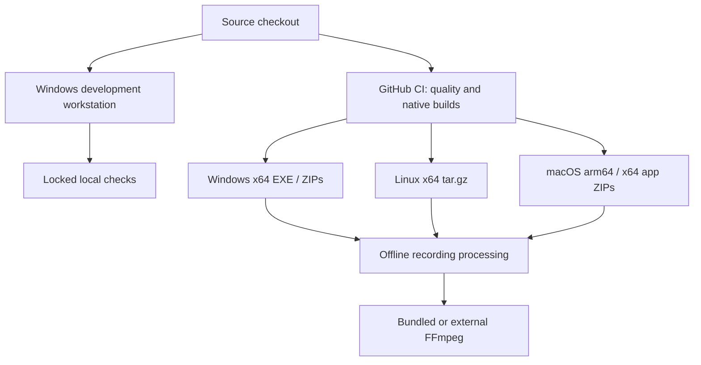

# 7. Deployment View

<!-- cspell:words Segoe LOCALAPPDATA -->

[Architecture index](README.md)

## Infrastructure level 1

No cloud service participates in recording processing. Optional release checks
contact GitHub; explicit map-background requests contact OpenStreetMap.
Development tools, dependency installation and GitHub delivery require network
access as applicable.

## Mapping and environment

Development and local regression checks run on native Windows.
`setup.ps1` creates the locked environment; `start.ps1` starts the application
without dependency synchronization. Node supplies development checks only.
[Windows setup](../development/SETUP.md) owns versions and commands.

NumPy serves analysis buffers, Pint explicit unit conversion and SciPy passive
frame transforms. Import/raw handling remains independent of those optional
analysis libraries. A frozen application contains its Python runtime, Qt and
required modules; users do not install Python.

## Validation and release boundary

PR CI selects checks by changed scope; release calls validate the tagged revision
and require native package checks before publication. Local acceptance and explicit
owner delivery authorization remain separate from CI.
[CI routing](../development/CI.md) and [release policy](../development/RELEASE.md)
own exact gates.

Windows distribution uses portable EXE, Standard ZIP and Complete ZIP packages.
Installer/uninstaller support is optional future work. Package self-tests isolate
preferences and exercise GUI startup, import, rendering and encoding. The shared
Qt hook omits the unused PDF image plugin. The redistribution catalog records the
accepted delivery scope and verification limits.

## Native distribution targets

| Target            | Baseline                                   | Package                    | FFmpeg                              |
| ----------------- | ------------------------------------------ | -------------------------- | ----------------------------------- |
| Windows x64       | Windows 10/11                              | EXE; Standard/Complete ZIP | Bundled in Complete ZIP or external |
| Linux x64         | Ubuntu 24.04 / glibc 2.39, desktop session | One-directory tar.gz       | External                            |
| macOS arm64 / x64 | macOS 15+                                  | Separate app ZIPs          | External                            |

Each package is built and executed on its native target; Windows does not
cross-compile Linux/macOS packages. Native CI verifies real imports, visible GUI,
rendering and CPU encoding. This does not establish compatibility with every
desktop, GPU or clean system. Windows is unsigned; macOS uses ad-hoc signing
without notarization. [Installation](../user/INSTALLATION.md) owns first-launch steps.

The shared SVG icon produces Windows ICO, macOS ICNS and Linux PNG/desktop-entry
assets. Builders collect it and required license notices. Native checkers verify
package layout, hashes and execution; macOS additionally checks the app signature.
[Release packaging](../development/RELEASE.md) owns artifact construction.

## Encoder installation

Windows Complete ZIP contains the encoder pinned in `ffmpeg.json`.
Development setup can install it under `.tmp/ffmpeg/bin`; the assistant also
accepts an external executable. Linux/macOS use an external native FFmpeg.

Pillow generates RGBA regions. Supported NVIDIA backends provide Vulkan ProRes
4444 with alpha or NVENC H.264; a real probe selects the backend. CPU fallback
remains available. HUD exports native HD and other layouts 4K. Output format and
editor compatibility depend on the selected encoder and editor.
[Video contracts](../implementation/VIDEO_EXPORT.md) define encoding/publication
and [the user guide](../user/VIDEO_EXPORT.md#5-put-the-overlay-above-your-footage)
explains compositing.

Export staging uses the destination filesystem and is cleaned after completion,
failure or cancellation, including when launched from a read-only directory.
External Linux encoders do not inherit frozen-library overrides.

## Local export configuration

The platform data root is LOCALAPPDATA on Windows, absolute XDG_DATA_HOME or
`~/.local/share` on Linux, and `~/Library/Application Support` on macOS.

- `preferences.sqlite3`: language, appearance, folders, restore/update consent,
  render-job count and source-hash-bound marker choices.
- `exports.sqlite3`: versioned presets and immutable batch jobs.
- `map-cache.sqlite3`: optional cached map tiles and HTTP metadata.
- `support/`: per-process diagnostic reports.

SQLite writes are transactional; recordings and rendered media remain external.
Batch output directories contain videos and `run-report.json`.
[Persistence concepts](08_concepts.md#rendering-and-persistence) describe ownership.
