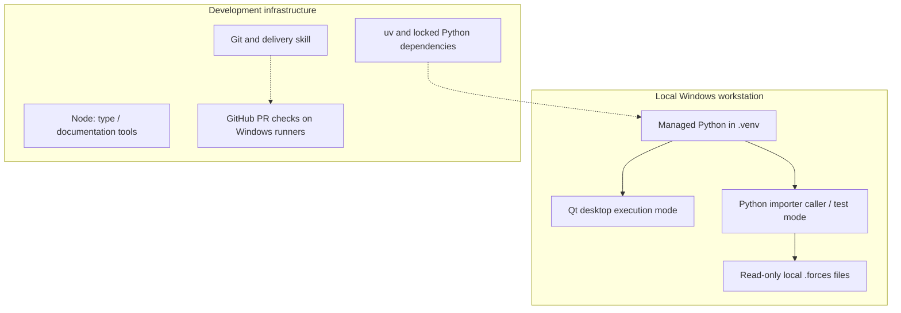

# 7. Deployment View

[Architecture index](README.md)

## Infrastructure level 1

The execution modes are alternatives, not a GUI/import integration or an IPC
protocol. No cloud component participates in recording processing. Developer
installation, reference lookups, GitHub delivery and dependency-update proposals
may require network access; installed runtime and checks work offline.

## Mapping and environment

The application entry point runs PySide6 in the local desktop session.
Domain/importer modules execute in the caller's Python process without Qt.
`uv.lock` owns Python dependencies; `package-lock.json` and `.node-version` own
Node development tools. Native Windows uses Python 3.14.6; reproduce the
configured environment through [Windows setup](../development/SETUP.md).

`uv run python -m ride_forces_analyzer` starts the minimal window.
`uv sync --locked --all-extras --group dev` installs the current development
validation environment. Optional analysis/render dependencies are not proof
that future product features are implemented. Node is not an application runtime
requirement. Temporary artifacts and tool caches stay under `.tmp/`.

The Stage 1 contract package requires the existing NumPy `analysis` extra and can
construct results without Qt, SciPy, Pint or GeographicLib. The separate Stage 2
`analysis.device` module requires Pint 0.26.1 in the `analysis` extra, now root-locked
with flexcache, flexparser and platformdirs. Its private registry uses bundled unit
definitions and no disk cache; no cloud, Qt or per-sample registry is required.
The earlier Stage 1 candidate-library audit used a separate exact-version uv project/lock/venv under `.tmp/`, with native
CPython 3.14.6 AMD64 wheels and no source build. That isolated audit left root
dependencies/locks unchanged; the subsequent Stage 2 Pint adoption updates them.
This is local development evidence, not clean-VM, ARM64, free-threaded or released
installer validation; see [ADR 0004](../decisions/0004-analysis-contracts-and-library-policy.md).

## Infrastructure level 2: validation and release boundary

PR CI uses separate selected application, documentation and skill jobs on
`windows-latest`, plus detection and the final required gate; see
[CI selection](../development/CI.md). It validates published content after local
acceptance and does not replace a real Windows desktop startup check.

Standalone packaging, installation/uninstallation on a clean Windows VM and
FFmpeg deployment are planned for M8/M6. No released installer or bundled
scientific/render stack is claimed by the existing development checkout.
