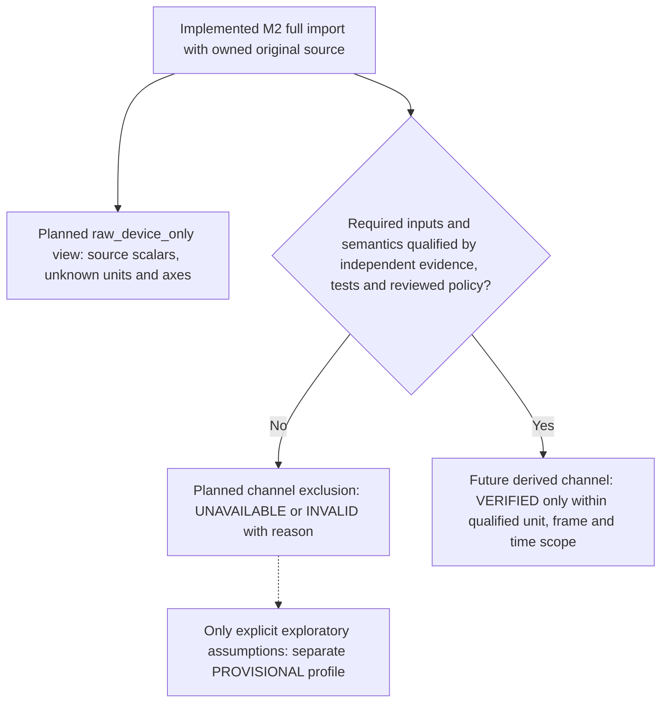

# 8. Cross-cutting Concepts

[Architecture index](README.md)

## Source ownership and absence

SourceEnvelope owns exact immutable bytes, recursive mappings/tuples and source
provenance; a Path is provenance only. Preserve unknown fields, ordering, number
tokens versus numeric strings, null versus absence and all GPS values. Canonical
floats supplement original evidence. Exact bytes, not re-encoding, are the round-trip.

Device metadata controls expected availability, not scientific interpretation.
Apple Watch may lack gravity/GPS. Absence-only owner defaults are rate 50 and
ridingPosition Seated, with DEFAULT provenance and no insertion into source data.
Invalid present rate fails; invalid riding position warns and becomes unavailable.
Zero never denotes absence. Independent bounded markers do not imply chronology
or slicing. GPS keeps independent indexed slots, including unavailable fixes;
negative speed/course/accuracy remains preserved with warnings. Attributes keep
arbitrary labels/order. See the [domain](../development/CANONICAL_MODELS.md) and
[optional-data](../development/OPTIONAL_PARSING.md) contracts.

## Decoding, diagnostics and settings

Strict UTF-8 permits one retained leading BOM. Reject duplicate keys/non-JSON
constants and unsupported versions; only 2.2.0 is dispatched. Preflight bounds
bytes, depth, arrays, nodes, members and string/number lengths, including unknown
content. [ImportLimits](../../src/ride_forces_analyzer/importers/limits.py) and the
[decoder guide](../development/STRICT_DECODING.md) define defaults/ceilings.
Budgets do not guarantee peak RAM, CPU time or hostile-filesystem behavior.

ImportSuccess owns a complete Recording; ImportFailure has none and carries an
error. Diagnostics sort error/warning/info, escaped RFC 6901 pointer, then code,
with stable ties. Messages identify defects without source payloads/coordinates.
One shared per-call budget guards generation; overflow is fatal. Decoder/core
errors stop later validation; optional defects recover only with usable core data.
Caller misuse remains TypeError/ValueError. No shared recording state or global
decoder mutation is introduced. See the [service](../development/IMPORT_SERVICE.md).

AppSettings is a separate strict immutable Pydantic bootstrap model, rejecting
unknown settings. [Quality scenarios](10_quality_requirements.md) link tests and
acceptance evidence; commands belong in the development guide.

## Analysis contracts and capability policy

[Analysis contracts](../development/ANALYSIS_MODELS.md) retain full M2 input,
source hash, algorithm/configuration, explicit caller UTC time, quantity/unit/frame,
time basis and raw/filtered provenance. SampleValues owns float64 bytes and explicit
validity; fresh NumPy views cannot modify the model. Missing rows use NaN/false,
valid zero stays finite/true. Indices bind to their own source sequence.

Channel states are VERIFIED, PROVISIONAL, UNAVAILABLE and INVALID. The
raw_device_only default permits source values with UNKNOWN units; VERIFIED raw
handling and VALID result structure do not certify physical interpretation.
Physical values reject UNKNOWN/incompatible units. Assumed unit evidence requires
PROVISIONAL and explicit exploratory permission; interpreted frames need references.
Reference strings are caller attestations, not empirical proof or owner approval.

[ADR 0003](../decisions/0003-scientific-semantics-and-capability-gates.md) remains a
proposed scientific policy. Its right-handed RIDER convention (X forward, Y left,
Z rider-up, passive column-vector conversion) does not map actual source vectors.
Gravity leaves yaw unresolved; Flying/Watch mounting needs pose-specific evidence.
The diagram describes the proposed per-channel policy, not the implemented runtime:

All originals permit raw inspection; none qualifies for definitive rider loading
or source-app extrema equivalence. Unknowns restrict capability without modifying
source evidence. [ADR 0004](../decisions/0004-analysis-contracts-and-library-policy.md)
separates implemented models/device primitives from future scientific services.

## Implemented device-unit gates

MotionUnitContract binds source SHA-256, acceleration/gravity sequence, common
component unit, physical quantity and independent unit/quantity references.
Absent sequence/contract yields UNAVAILABLE; a declaration cannot fabricate data.
Pint converts SI, centimeters/s², feet/s² or explicit standard_gravity to m/s².
Bare `g` is rejected; standard gravity is a conversion constant, not measured
rider load. NumPy computes stable DEVICE norms without combining source channels.

Source indices, unit/quantity evidence, original unit and library versions remain
retained. Float64 range failure creates INVALID products; norm overflow preserves
usable vectors. Rounding/underflow never overwrites exact M2 precision. Synthetic
tests do not qualify real source units, axes, time or GPS semantics.

## Planned scientific and rendering behavior

Distinct proper acceleration, gravity and kinematic acceleration require evidence
before combination. Explorer index/rate time is INFERRED_UNIFORM with rate provenance;
source/GPS epochs and offsets remain open. Preserve raw/filtered outputs with filter
edges and peak effects. GPS is rough spatial reference; no derived ride speed
or distance measurement is required. Generic physical rider qualification, extra
scientific filters and sensor/GPS alignment are deferred or excluded from current M3.
The explorer source-app path already implements a configurable centered mean;
its adopted projection policy and per-source qualification are separate.

Render frames separately from encoding, with independent opaque video and
transparent overlay outputs. Alpha compatibility and synchronization require
later verification; see [strategy](04_solution_strategy.md).

## Stage 3 frame gate

[ADR 0005](../decisions/0005-passive-frame-transforms.md) defines rows as target
axes expressed in DEVICE and passive `v_target = R @ v_device`. Inverse uses the
opposite conversion; determinant +1 and orthogonality are mandatory. Admission
is float64 absolute `1e-10`/relative zero, never normalization or calibration proof.

Source-bound RiderCalibration plus matching unit/quantity evidence and explicit
provisional profile permission yield PROVISIONAL rider vectors only. Raw source
vectors, gravity or Seated/Flying metadata do not create a basis. No calibration
means UNAVAILABLE; invalid math yields INVALID. References are attestations, not
source-app truth. Exact source, assumptions, basis, libraries and units are retained.
The generic frame path does not qualify originals. The separate confirmed Manta
app-reference contract is described below; WORLD/GRAVITY heading stays open.

## Raw explorer presentation

The first explorer view reads the complete acceleration x/y/z sequences, preserving
M2 source ownership. Horizontal coordinates are inferred seconds (`index / effective sample rate`), starting
at zero and ending at `(count - 1) / rate`. The UI labels INFERRED_UNIFORM and
source/default rate provenance; no measured timestamps or GPS alignment are claimed. Units
and physical rider directions remain unknown. Viewport bounds include all source
values with fixed bounds: negative minimum and positive maximum each padded by
5% of its magnitude. Zero is included for one-sided data; all-zero data uses
[-1, 1] display bounds. Only time can be zoomed; samples remain unchanged. Local selections are
inclusive and independent of source endIndex semantics. Horizontal viewport changes
are bounded to the first-to-last sample interval, preserving the zoom width when
possible and stopping zoom-out at the complete recording. Mouse wheel zoom is
anchored at the pointer and stops zoom-in at one sampling interval. Presentation preparation
and selection validation live outside widgets; Qt handles chart interaction.
Failed/cancelled opens retain the previous view, and no missing sensors are filled.

Source marker presentation reads the retained start/end/gravity/incline indices
outside Qt. The chart draws distinct vertical lines with source field names and
inferred seconds; optional missing markers remain absent. Labels follow the time
view without modifying the source, local selection or calibration capability.

Default time view on load/reset uses effective start/end markers; absent source
boundaries fall back independently to recording limits with INDEX_DEFAULTED
warnings, without adding source markers. Initial cursor starts at effective start.
Zoom-out remains bounded by the complete recording rather than the default view.

Explorer metadata presentation maps name/location to Ride/Park and reads available
Train/Row/Seat attributes as source text or exact numeric tokens. Absent/blank
fields are omitted; duplicate attributes remain visible. Qt displays plain text
above the chart without inferring locations, rides or seating.

The app-reference path applies explicit unit-direction dot products and centered
11-sample means, retaining raw projections/source values separately. The GUI uses
the owner-adopted g interpretation and permits raw x/y/z switching without changing
time or selection. It does not use the exact OrthonormalFrame contract or silently
repair a rotation. All imports with usable directions can use it; policy is in
ADR 0006 (chapter 09).

Explorer display now uses replay-relative MM:SS.ff at integer sample rates, with
ff denoting the sample counter (at 50 Hz, .47 = 47/50 second). Effective startIndex
is replay zero; samples before it have negative labels. Recording-origin seconds
remain the internal axis coordinates and are shown separately in readouts/tooltips.
Axis labels follow zoom using sample-aligned category positions. Fractional rates
retain explicit seconds instead of implying an integer replay counter.

Calibrated forces now defaults on for all successfully prepared source directions,
without a source-hash allowlist. Source hash remains provenance/evidence identity,
not an availability gate. Preparation failures become CALIBRATION_UNAVAILABLE
presentation notes and raw fallback; source/import logic remains outside widgets.
Short nonempty recordings use normalized partial mean windows. Independently
verified Manta provenance and general-policy source provenance remain distinct.

Calibrated presentation follows the owner-confirmed source-app sign convention:
positive lateral is right, negative is left; positive longitudinal is acceleration,
negative is braking. Legends, visibility controls and sample readouts show these
mappings without changing projected values or the separate generic RIDER frame.
Raw x/y/z displays carry no directional interpretation.

GPS product scope is a coarse spatial reference independent of ride/force
measurement. Its irregular timestamped fixes, gaps and uncertainty must not define
sensor time, force calibration or ride segmentation. A future map must distinguish
approximate connected fixes from reconstructed track geometry; GPS-derived ride
speed, distance and height remain unqualified. See the owner clarification in
DEV-REQ-003 and the Voltron comparison report.

Calibrated display smoothing is now locally configurable over odd windows 1–51,
with the compared 11-sample mean retained as the opening default. The analysis
reference filters original projected channels and records actual window/algorithm;
presentation recomputes signed value bounds without changing sensor time, cursor,
selection, raw data or GPS. Raw view disables the slider. One sample is unfiltered;
the UI shows ±time support at the effective sample rate and updates curves during dragging.

Calibrated force axes always include explicit -1 g, 0 g and +1 g labels/grid levels.
Presentation extends the padded source range to at least [-1.05, 1.05]; Qt category
axes place labels at numeric values with a bounded tick count. Source-unit raw
views retain their original padding contract and carry no g interpretation.

## Reduced-M3 extrema boundary

Implemented extrema use the selected inclusive indices and existing full raw/calibrated
channels at the current smoothing setting. No second filtering occurs at selection
edges. Each of the three channels returns min/max value, source index and recording
time; ties use the earliest index. Results retain source/mode/window/unit and interval
count/bounds. This contract does not require threshold events, additional filters,
GPS speed/geodesics or universal physical calibration.
