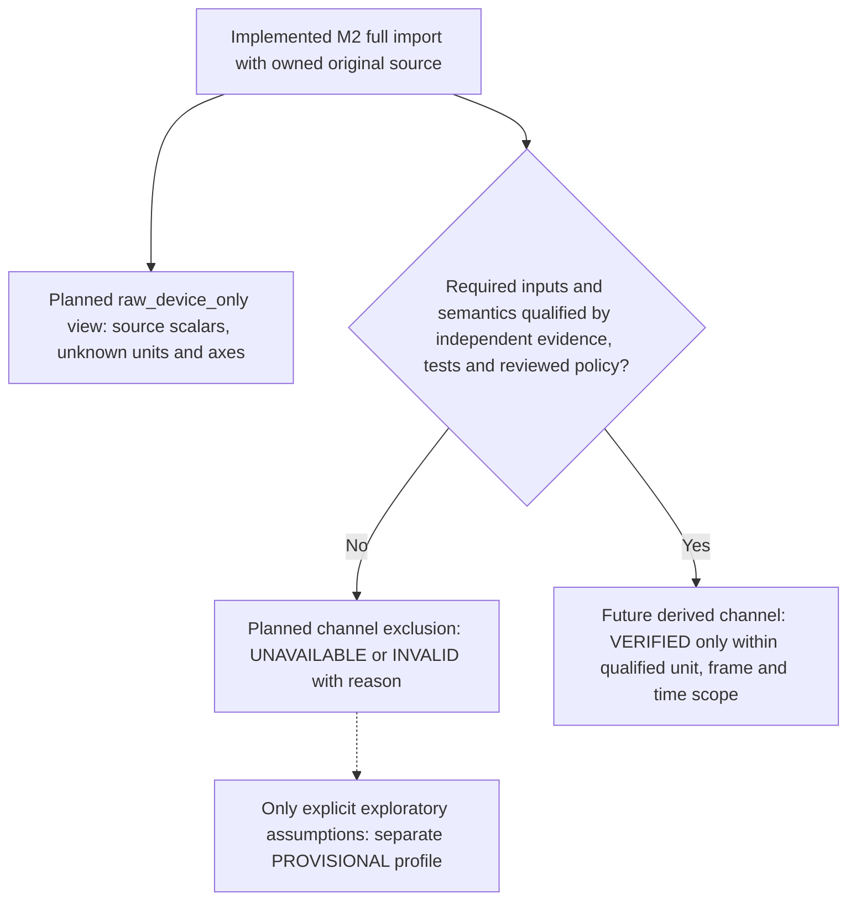

# 8. Cross-cutting Concepts

[Architecture index](README.md)

## Source ownership and typed accessors

SourceEnvelope owns exact immutable input bytes and a recursively immutable
JSON tree; a Path is provenance only. Retain original byte count and SHA-256
where complete input is available. Retrieving original bytes is the lossless
round-trip, not JSON re-encoding. Unknown nested fields, order, number tokens,
numeric strings, null, absent properties and GPS values remain distinguishable.
Canonical floating-point accessors never replace original evidence.

## Availability, defaults and scientific boundaries

Device metadata indicates expected data availability, not scientific semantics.
The authorized Apple Watch fixture has acceleration but no gravity/GPS;
missing capabilities stay explicit. iPhone/unknown-profile absence is diagnosed
according to [ADR 0002](../decisions/0002-forces-source-contract.md).

Owner-default sampleRate 50 and ridingPosition Seated apply only when absent,
with source/default provenance and no insertion into the retained source tree.
Invalid present rate fails core validation; invalid present riding position warns
and becomes unavailable. Zero never means absent. A successful acceleration-only
Recording is complete for available input, not proof of rider-analysis eligibility.

Motion indices are bounded independently; Taron's gravityIndex before startIndex
is valid structural evidence, not permission to infer chronology. Structural
vectors are retained without normalization, axis mapping or force calculation.
GPS slots keep their own length/order and source indices, with no alignment to
acceleration. Negative speed/course/accuracy stays raw and warns; defective fixes
retain slots with unavailable typed data. No units, epoch or sentinel interpretation
is asserted. Ordered attributes retain arbitrary source labels and values.

## Strict decoding and resource policy

Strict UTF-8 decoding permits one leading BOM while retaining it in source bytes.
The root must be an object, duplicate keys/non-JSON constants are rejected and
only schema 2.2.0 is dispatched. Iterative preflight bounds bytes, container depth,
array lengths, nodes, object members and string/number-token lengths before
full allocation, including unknown fields. A shared per-call diagnostic budget
bounds validation while records are generated; overflow is fatal.

Actual defaults and configurable ceilings are maintained in
[ImportLimits](../../src/ride_forces_analyzer/importers/limits.py),
[decoder contracts](../development/STRICT_DECODING.md) and ADR 0002.
These budgets do not guarantee peak RAM, CPU time or hostile-filesystem safety.

## Results and diagnostics

ImportSuccess owns a complete immutable Recording; ImportFailure has no Recording
and at least one error. Stable diagnostics carry severity, code, RFC 6901 JSON
Pointer, message and optional source index. Order is error/warning/info, escaped
pointer, then code; ties retain emission order. Messages identify defects without
coordinate values, recording payloads or exception excerpts.

Decoder/core errors fail fast before later stages. Optional defects can warn and
recover if the core remains valid. Caller misuse remains distinct from source
failure. There is no shared recording state or process-global decoder mutation.

## Settings and validation

Bootstrap AppSettings uses immutable strict Pydantic validation with rejected
unknown settings; it is not a recording-schema model. Pylance/Pyright share strict
configuration, mypy checks source and pytest verifies runtime contracts. All five
originals have pinned byte-length/SHA-256 regression guards and full import tests.
Quality workflows and dated evidence are linked from
[chapter 10](10_quality_requirements.md); procedural details stay in development guides.

## Future render concept

Render frames independently of encoding, preserving independent opaque-video and
transparent-overlay outputs. Alpha/video compatibility and time synchronization
need explicit verification before implementing export; see [strategy](04_solution_strategy.md).

## Planned M3 scientific contracts

[DEV-REQ-003](../requirements/DEV-REQ-003-scientific-analysis.md) requires
distinct proper acceleration, measured gravity and kinematic acceleration; no
combination of source sequences is justified by successful M2 parsing. Define
DEVICE, WORLD/GRAVITY and RIDER frames only with documented units, handedness,
sign and transform direction. A scientific ADR/reference gate precedes verified
rider outputs; synthetically correct rotations do not prove source calibration.

Analysis products must retain source hash, algorithm/configuration, quantity,
frame, time basis and raw/filtered provenance. Stage 1 represents channel states
VERIFIED, PROVISIONAL, UNAVAILABLE and INVALID, with a deterministic raw_device_only
default. Additional rider_calibrated, gps_exploratory and gps_strict profile labels
require explicit policy references; their scientific workers remain planned.
Unknown units/missing capabilities are not replaced with zero, standard gravity
or synthetic sensor data.

A future index/rate timeline is labeled INFERRED_UNIFORM and retains source/default
rate provenance; source date/GPS epochs and offsets remain unverified. Keep raw
samples alongside configurable offline filtering, with edge/short-segment and
filter-induced peak changes explicit. Future accepted WGS84 segments yield a
horizontal path estimate, not 3D track length; derived speed requires a verified
time basis. Preserve rejected fixes and negative reported values in M2 evidence.
These scientific operations remain planned, not implemented M2 interpretation.

### Proposed scientific capability gate

[ADR 0003](../decisions/0003-scientific-semantics-and-capability-gates.md) records
Stage 0 observations and the proposed policy; owner review and scientific
qualification remain open. Raw DEVICE x/y/z retains UNKNOWN units/directions.
The proposed mathematical RIDER convention is right-handed, X forward, Y left,
Z rider-up, with passive column-vector conversion; it is not a mapping of source
vectors. WORLD/GRAVITY heading cannot be determined from gravity alone. Flying
and Watch mounting require independent pose-specific evidence.

This is a proposed policy view, not an implemented analysis runtime. Gates apply
per channel: structural pairing never proves gravity compensation, finite GPS
never proves WGS84/time semantics, and numerical frame validity never proves
rider calibration. All five originals permit raw inspection; none currently
qualifies for definitive rider loading or source-app extrema equivalence.
Iron Gwazi's absent GPS/gravity remains unavailable. Owner defaults and source
extrema retain their M2 provenance. Unknown acceptance restricts capability;
it never silently converts an assumption into a verified measurement.

### Implemented Stage 1 model boundary

[Analysis contracts](../development/ANALYSIS_MODELS.md) now implement immutable
profiles/results/channels, quantities/frames/time labels, source provenance and
ordered diagnostics. Results retain full M2 ImportSuccess and use per-sequence
index bounds. SampleValues owns float64 bytes and explicit row validity; each
NumPy accessor is a fresh read-only view. Missing/invalid data remain distinct
from finite zero and cannot be fabricated for absent Watch gravity/GPS.

Physical values reject UNKNOWN or incompatible units; VERIFIED physical values
reject ASSUMED unit evidence. Rider/world references and explicit provisional
profile permission are required structurally. Caller reference strings do not
establish empirical truth or grant owner approval. VERIFIED raw source handling
and VALID result structure do not certify rider loading. Frame mapping, source
units/epochs, yaw and app equivalence remain open under ADR 0003.

[ADR 0004](../decisions/0004-analysis-contracts-and-library-policy.md) separates
these implemented contracts from future numerical workers and pending project
dependency adoption. No processing, conversion, projection or GPS alignment is
performed by model construction.

### Implemented Stage 2 unit and device gates

`analysis.device` is opt-in and independent of model construction. MotionUnitContract
binds SHA-256, ACCELERATION or GRAVITY, a supported common component unit, explicit
SPECIFIC_FORCE/GRAVITY/KINEMATIC_ACCELERATION meaning and separate unit/quantity
references. Neither field name determines meaning. A missing declaration leaves
vectors and magnitude UNAVAILABLE; absent source gravity stays absent even with
a declaration. Real fixtures have no qualified declarations.

Pint converts SI, centimeters/s², feet/s² or explicitly declared standard_gravity
to m/s². Bare `g`, dimensionless and unrelated units are rejected before calculation.
Standard gravity is a conversion constant, not a measured gravity vector or
rider load. NumPy computes the stable Euclidean norm of DEVICE components only;
there is no source-channel combination. Unit/quantity references, original unit,
library versions, source indices and source/algorithm provenance remain retained.
Unknown physical axis mapping, yaw, source epochs and GPS units are unchanged.

Missing rows preserve NaN plus a false validity flag; zero remains valid zero.
SI values/norms outside float64 range become INVALID products with errors. Floating
point conversion can round/underflow within float64; exact source precision remains
in M2 original bytes. Norm overflow does not discard usable vector components.
No scientific source-app equivalence is established by the synthetic tests.
