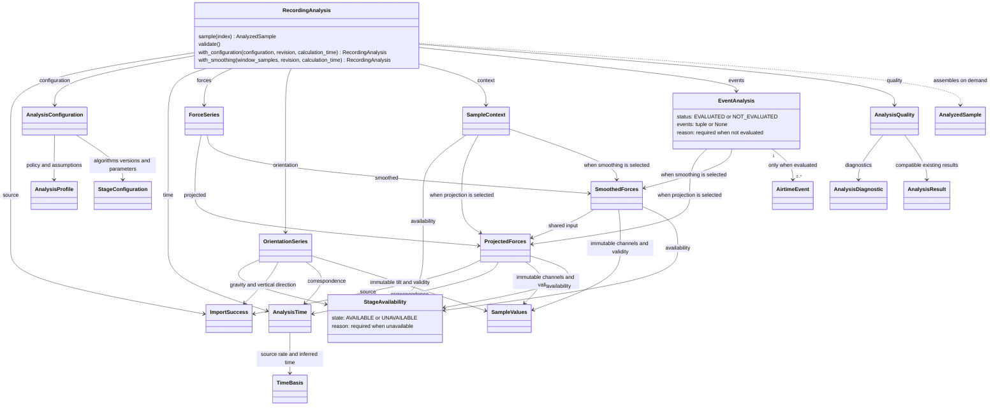

# Analysis contracts and device primitives

The [analysis package](../../src/ride_forces_analyzer/analysis/) exposes executable
model contracts. `analysis.device` provides opt-in qualified DEVICE vectors/norms
and Pint conversion; explicit provisional frames and source-app calibrated
projection are implemented as separate contracts below.
Use the already locked NumPy from the `analysis` extra. The regular bootstrap
and M2 importer do not import this package. The
[analysis library decision](../architecture/09_architecture_decisions.md#analysis-models-and-libraries)
records library roles, adoption gates and immutable API boundaries;
[physical qualification boundary](../architecture/09_architecture_decisions.md#physical-qualification) remains
the proposed scientific qualification policy.

## Public model shape

| Model / label      | Contract                                                                                                                  |
| ------------------ | ------------------------------------------------------------------------------------------------------------------------- |
| AnalysisProfile    | Profile name/schema, frozen scalar configuration, policy/assumption references, explicit provisional permission           |
| AnalysisResult     | Full M2 ImportSuccess, profile, provenance, tuple channels, ordered diagnostics, result schema                            |
| AnalysisChannel    | Identifier, quantity/unit/frame, capability, source sequence/indices, time basis, processing, samples or exclusion reason |
| SampleValues       | Owned float64 byte snapshot, immutable shape/row-validity, fresh read-only NumPy view                                     |
| UnitAssignment     | Canonical unit label, UNKNOWN/ASSUMED/VERIFIED state and references                                                       |
| TimeBasis          | Index/inferred/unverified/verified-seconds label, optional M2 rate/origin, epoch only when verified                       |
| AnalysisProvenance | Retained M2 provenance, engine/algorithm identity, explicit UTC calculation time                                          |
| AnalysisDiagnostic | Stable code, reused M2 severity, message, optional channel and source index                                               |

Every constructor performs runtime validation. Model collections own tuples or
read-only scalar mappings. Supply tuple collections to the typed public API;
runtime ownership also protects against mutable collections passed around typing.
Schema version `1` is the initial contract identifier, not a serialization format.
Any later persistence/serialization adapter must document compatible schema and
algorithm changes rather than treating every version string as interoperable.

## Unified recording analysis

[`analysis.recording`](../../src/ride_forces_analyzer/analysis/recording.py) exposes
the unified recording model consumed by explorer and export services.
Frozen data containers cover configuration, shared force stages, independent
orientation, sample context, event evaluation, sample views and request/notification
payloads. They reuse the existing source, time, immutable sample buffers, unit,
quality and provenance types. Import them explicitly from `analysis.recording`;
the explorer consumes these snapshots; package exports remain explicit.

The snapshot combines the lossless `ImportSuccess`, `AnalysisConfiguration`,
`AnalysisTime`, `ForceSeries`, independent `OrientationSeries`, `SampleContext`,
`EventAnalysis` and `AnalysisQuality`. Metadata (including ride/location, seating
attributes and weather), original marker indices, independent GPS and unknown
source fields remain accessible through `analysis.source.recording`; no metadata
copy or GPS-to-force alignment is created.



Context and events each reference exactly one configured force input, either
projection or smoothing; the diagram's paired arrows denote alternatives.
Different snapshots can share the same `ProjectedForces` instance while holding
different smoothing, context and event results. Orientation depends on source
gravity/vertical direction and its configuration, independently of force stages.
`sample(index)` assembles immutable scalar values, times, context, availability and
quality on demand; `AnalyzedSample` does not retain a back-reference to its parent
snapshot or duplicate the full channel arrays.

AVAILABLE requires a calculated payload; UNAVAILABLE requires a stable coded
reason and no payload. Missing prerequisites propagate to dependent stages without
empty arrays, zero fills or fabricated normal-load labels. Row validity is separate
from whole-stage availability. `EventAnalysis` distinguishes NOT_EVALUATED (None
collection and a reason) from EVALUATED (an event tuple, possibly empty); an empty
result describes only the valid observed coverage. Technical dirty/pending status
belongs to the service, separately from these immutable result states.

`AnalysisQuality` aggregates capabilities, diagnostics and compatible existing
results; available payloads may remain provisional, and INVALID capabilities are
not promoted by composition. Calculated stages retain attributable quality and
provenance; smoothed forces inherit the projection's unit assignment, while
orientation carries its own. Source-app outputs are never relabeled as qualified
physical rider-frame results.

Unlike the validated constructors above, these containers store references without
normalizing or validating them. Call `RecordingAnalysis.validate()` explicitly to
check types, immutable collections, availability/payload/reason combinations,
source hashes, calculation provenance, configuration and stage dependencies.
The full force axis must preserve source indices/order and scalar buffer lengths;
rate value/provenance and replay origin must match the source. Missing measurements
remain distinct from valid zero. Validation returns None or raises TypeError for
incompatible types and ValueError for inconsistent field values/relationships.
It performs no I/O, copies no arrays and does not certify scientific accuracy.
`prepare_recording_analysis(source, configuration, revision=..., calculation_time=...)`
prepares and validates one snapshot. `sample(index)` reads its buffers without
repeating calculations; it rejects non-integer indices with TypeError, indices
outside the recording with IndexError and index-only snapshots without a time
rate with ValueError. Recording/replay seconds retain the existing inferred rate
and start-relative origin. Raw vectors, metadata, unknown fields and independent
GPS remain in the original import; no GPS/sample alignment is added.

`RecordingAnalysis` preparation and reconfiguration use one numerical implementation
per stage: `analysis.projection.project_directions`,
`analysis.smoothing.centered_mean`, `analysis.orientation.orientation_degrees`,
`analysis.airtime.AirtimeContext.prepare` and `analysis.events.evaluate_events`.
The analysis service delegates numerical requests to that preparation path.
Projection preserves the supplied vertical/lateral/longitudinal row order and
signs. It admits the documented rounded basis (Gram-matrix deviation at most
0.003, positive determinant), normalizes each row and dot-projects without
making the rows orthogonal or repairing their rotation. This source-app policy does not establish
qualified physical rider/world frames.

Smoothing accepts odd windows 1–51 and always starts from the unfiltered projection.
Recording edges use only available neighbors and renormalize their weights,
including recordings shorter than the window. Neither primitive changes source
samples or time; non-finite numerical results raise ValueError instead of being
filled or clamped. Preparation represents excluded stages with availability reasons
and stores valid results in immutable `SampleValues` buffers. Orientation remains
independent of force smoothing; context stabilization and opt-in event rules remain
separate calculations. Supported stage configurations are:

| Stage       | Algorithm (version `1`)            | Parameters                                                         |
| :---------- | :--------------------------------- | :----------------------------------------------------------------- |
| Projection  | `source-direction-unit-projection` | None                                                               |
| Smoothing   | `centered-mean`                    | `window_samples`: odd integer 1–51, default 11                     |
| Orientation | `source-gravity-tilt`              | None                                                               |
| Context     | `vertical-context`                 | Existing airtime constants, either omitted or explicitly unchanged |

Unsupported algorithms, versions, parameters, revisions and non-UTC calculation
times raise ValueError. The context version fixes the current heuristic; custom
thresholds are not silently accepted. Context can read projection or smoothing,
as declared by `context_input`, without filtering graph values again.
`RIDER_CALIBRATED` requires explicit provisional permission, assumptions and policy
references. Derived results remain PROVISIONAL, with assumed units and stage-specific
provenance retaining source identity, application/NumPy versions and calculation time.
The raw profile excludes all derived stages while preserving original samples.

Missing or inadmissible directions and numerical force range failures exclude
only affected stages with diagnostic reasons. Orientation is independent of
projection and smoothing; absent gravity/vertical direction excludes it, while
zero gravity is an explicit invalid row with NaN, False validity and an indexed
diagnostic. Sample views return None for missing force/orientation rows and
unavailable stages, retaining stage availability and applicable diagnostics.
`events=StageConfiguration("airtime-events", "1")` enables the separate
[airtime event contract](../implementation/AIRTIME_EVENTS.md); parameters are finite
scalar overrides defined there. Events without configuration, unavailable force input or
all-missing vertical rows retain NOT_EVALUATED with a reason. Other valid input
produces EVALUATED with zero or more source-ordered episodes. Missing rows split
events and are diagnosed; recording/gap boundaries mark incomplete observations.
Categories summarize the strongest observed portion, not a per-sample display label.
Event quality is PROVISIONAL, with actual force-stage dependency and calculation
provenance. Unsupported rules/versions/parameters raise ValueError, producing a
matching service failure without replacing the last snapshot. Source-app defaults
keep this optional evaluation disabled.

`with_configuration(configuration, revision=..., calculation_time=...)` returns a
new validated snapshot. It reuses stages whose configuration and actual input
objects are unchanged; a profile change invalidates policy-dependent projection
and orientation. `with_smoothing(window_samples, ...)` retains source, time,
projection and orientation, then smooths the unfiltered projection. Context/events
are replaced only if their selected input or configuration changes. Consumers of
projection therefore survive smoothing changes. An unchanged configuration or
smoothing window performs no numerical work and still returns a new revision.
Stage configurations are compared by their stored values, without normalizing
parameter order or omitted defaults in `with_configuration`; `with_smoothing`
recognizes an unchanged effective window, including the implicit default.

Reconfiguration requires a strictly increasing integer revision and an explicit
UTC calculation time. Invalid requests raise TypeError/ValueError without changing
the previous snapshot. Reused stages retain their original provenance; recalculated
stages receive the supplied time. Expected numerical range exclusions still produce
a consistent raw-capable snapshot and can recover with a usable smoothing window.

A snapshot holds its source and stage references, never its predecessor or a map
of past configurations. Returning to a released window may recompute it. Consumers
such as exports retain their own snapshot until finished; normal reference lifetime
releases obsolete snapshots and buffers. Tests check stage identity, calculation
calls, unchanged export values and absence of new references to prior snapshots.
The service retains only its current state, active work and current queued deliveries;
the explorer adapter owns worker scheduling and queued UI delivery.

The [source-app evidence tests](../../tests/analysis/test_source_app_evidence.py)
exercise unified snapshots against original-file extrema and independently supplied
replay screenshots, including the documented Kraken/Voltron differences. Tests of
projection, smoothing, preparation, sample views and partial recalculation cover
current numerical contracts. These comparisons do not qualify physical
interpretation or event-detection rules.

[`analysis.service`](../../src/ride_forces_analyzer/analysis/service.py) implements
`AnalysisService`: `get_state`, `subscribe`, `unsubscribe`, `request_analysis`,
`request_configuration`, `request_smoothing` and `close`. It owns an immutable
`AnalysisState`, selected import, monotonically increasing request revisions and
service-specific subscription handles. New views immediately receive coherent
initial state, including an older completed snapshot and pending/failure status.
Registration and state capture are coordinated; initial delivery precedes later
notifications even when callbacks start another request.

Requests calculate synchronously in the calling thread, outside the state lock.
They enter PENDING, then READY with `AnalysisUpdated` or FAILED with `AnalysisFailed`.
Source/configuration top-level type errors are caller errors; calculation and
configuration errors terminate their assigned revision with a diagnostic. Expected
unavailable stages still produce READY raw-capable snapshots. Failed calculations
retain the last complete snapshot with its original source/configuration/revision.
New configuration/smoothing requests use the selected source, including after a
failure, and reuse compatible snapshot stages. No-op requests still advance revision.

Stage interests filter numerical notifications. Initial state and terminal status
matching observed pending work bypass the filter, also when subsequent requests
supersede a queued result without changing any interested stage. Dirty stages
include dependent force/context/event stages. Superseded success/failure cannot
replace current state; older queued notifications release their references when
a newer request starts. Detailed pending indications may be coalesced once a
request has already completed. Per-registration delivery is serialized, including
reentrant requests, while other registrations can progress concurrently.

Callbacks execute outside the lock. Ordinary callback exceptions are logged and
remove only the failing registration. Duplicate callbacks have independent handles;
unsubscribe removes queued work and is idempotent. Handles are accepted by object
identity when their registration exists, preventing equal numbers from another
service from removing it. `close` is idempotent, advances revision, clears owned
source/snapshot/registrations/queues and prevents running work from publishing.
Independent export snapshots remain readable. No history cache or executor is kept.

The Qt-independent service owns no worker or mutable lists inside snapshots.
[`AnalysisController`](../../src/ride_forces_analyzer/ui/analysis.py) supplies worker
scheduling and guarded UI delivery. The [runtime view](../architecture/06_runtime_view.md#explorer-analysis-delivery)
owns the notification sequence, initial state, failure/stale-delivery behavior and
subscription cleanup. [Cross-cutting concepts](../architecture/08_concepts.md#snapshot-lifetime-and-reuse)
own snapshot lifetime and shared-stage ownership.

`ExplorerData.analysis` owns the snapshot. Calibrated `plotted_channels` are
read-only NumPy views sharing its immutable buffers; raw channels remain tuples.
Callers must handle this union rather than assuming tuple comparison or `.index`.
Sample cards and technical values use `analysis.sample(index)`, and context labels
come from its prepared categories without reclassification. Navigation, zoom,
mode, language and appearance changes do not recalculate analysis.
`with_analysis` preserves the import and checks its identity. The synchronous
`with_smoothing` helper also delegates to partial snapshot recalculation, while the
live explorer uses the worker controller. Extrema retain their existing contract.

`ExplorerData` retains presentation state and a bound snapshot. `calibration_available`
reads the prepared force stage; `calibrated_enabled` and `with_calibration` select
calibrated or raw display without numerical work. `smoothing_window` reads the
snapshot configuration. Cards and technical sample values use its sample views;
`vertical_context_label` and strip segments format prepared context categories.
Missing calibrated samples remain unavailable rather than displaying raw values.
Extrema read the same smoothed buffers and preserve their quality/provenance.
`prepare_export` and `build_previews` require `RecordingAnalysis` directly.
They accept no explorer/presentation input; the UI captures its snapshot before
scheduling preview/export work. Layouts consume the resulting `ExportTimeline`.
`ExportTimeline.analysis` retains the bound snapshot for its full lifetime.
`ExportValues` exposes shared scalar buffers as a read-only sequence with None for
invalid rows. Force bounds use the selected interval; orientation and context read
full-recording preparation. Context lookup floors fractional source positions;
numerical values keep the existing linear interpolation and missing-data rules.

`prepare_export_analysis` returns the same snapshot for an equal configuration,
otherwise delegates to partial recalculation. Changing layout, language, frame rate,
resolution or interval never prepares numerical stages again. All five preview
layouts share one snapshot, including full-history context outside the export range.
Running exports retain their snapshot independently of workspace/preset changes.
Saved presets/jobs require `analysis_configuration`, the complete versioned recipe,
without source bytes or arrays. The stored window must agree with that recipe.
All serialized fields, including aspect/language and configuration dependencies,
are required; incomplete records are rejected without migration or data removal.
`make_job` accepts a snapshot. Batches import directly, check source hashes before
calculation and use the analysis service to prepare the saved full-history recipe
before binding the concrete export interval.
Service tests cover initial and terminal states, filtering, reentrant calls, competing
requests, stale success/failure, shutdown, callback isolation and snapshot ownership.
The [focused coverage workflow](CODE_QUALITY.md#recording-model-and-service-coverage)
reports both modules and enforces the configured minimum.

## Raw values and qualified quantities

`AnalysisProfile()` is raw_device_only, with no processing configuration or
assumptions. It permits SOURCE_VALUES/RAW channels with UNKNOWN units. A VERIFIED
raw channel says its data contract is established; it does not certify physical
axes, source acquisition semantics or rider G. Keep canonical originals through
`result.source.recording.source`; import warnings remain in `result.source.diagnostics`.

SPECIFIC_FORCE, GRAVITY, KINEMATIC_ACCELERATION and DEVICE_VECTOR_MAGNITUDE use
explicit canonical `m/s^2`; LOAD_FACTOR is dimensionless; DISTANCE/ALTITUDE,
SPEED and ANGLE require `m`, `m/s` and `deg`. Available physical values cannot
use UNKNOWN units. VERIFIED physical values require VERIFIED unit references;
ASSUMED assignments require a PROVISIONAL channel and a separately approved
opt-in profile with named assumptions. Reference strings are caller attestations,
not automatic qualification of a source. No current real fixture is assigned these
units or projected into RIDER/WORLD_GRAVITY by the implemented models.

Interpreted frames require references. The right-handed/passive numerical convention
is implemented; physical yaw/pose mapping remains unqualified. Ordinary DEVICE labels retain
source x/y/z, not known Earth or rider directions. Pint's `g` symbol is gram,
not the project's dimensionless loading ratio; future conversion must use the
explicit standard-gravity normalization policy, never an ambiguous symbol.

Unavailable/invalid channels have `samples=None`, no source indices and a reason.
Within available arrays, missing rows require explicit NaN and `valid_rows=False`;
valid zero requires a finite sample and `True`. No hidden finite placeholder,
infinity or inferred missingness is accepted. Partial missing rows must stay
explicit in future algorithm diagnostics; this stage implements no recovery math.

Source indices and indexed diagnostics are bounded against their own acceleration,
gravity or GPS sequence, not a common length. Iron Gwazi's missing gravity/GPS
cannot be referenced by available channels. This validation neither aligns clocks
nor normalizes/changes M2 marker indices.

## Immutability and determinism

SampleValues copies numeric input into little-endian float64 bytes. It does not
retain a writable ndarray alias. `samples.values` is a fresh ndarray view over
immutable bytes: its WRITEABLE flag cannot be enabled. Caller view metadata cannot
change the model's shape, dtype or next accessor. `values.copy()` is a mutable,
independent work array. Source precision/types remain in the immutable M2 envelope;
the float64 snapshot is an explicit canonical numerical representation.

Diagnostics sort ERROR, WARNING, INFO, then channel ID, source index (rows without an index
first) and code. Exact-key ties preserve supplied order. Messages should describe
defects without raw GPS/source payloads. Result validity is INVALID for error
diagnostics/invalid channels, RESTRICTED for provisional/unavailable channels,
otherwise VALID. That describes the supplied result contract, not blanket
scientific accuracy. Timestamp generation is absent;
callers must supply the UTC calculation time explicitly for reproducible results.

## Model-only construction example

This example copies a typed M2 component; it performs no physical calculation:

```python
from datetime import UTC, datetime
from pathlib import Path

import numpy as np

from ride_forces_analyzer.analysis import (
    AnalysisChannel,
    AnalysisProfile,
    AnalysisProvenance,
    AnalysisResult,
    CapabilityState,
    FrameLabel,
    QuantityKind,
    SampleValues,
    SourceSequence,
)
from ride_forces_analyzer.importers import ImportSuccess, import_forces

source = import_forces(Path("example.forces"))
if isinstance(source, ImportSuccess):
    copied_x = np.array([v.x for v in source.recording.motion.acceleration], dtype=np.float64)
    channel = AnalysisChannel(
        "source-x",
        QuantityKind.SOURCE_VALUES,
        CapabilityState.VERIFIED,
        SourceSequence.ACCELERATION,
        frame=FrameLabel.DEVICE,
        samples=SampleValues(copied_x),
        source_indices=tuple(range(len(copied_x))),
        columns=("x",),
    )
    result = AnalysisResult(
        source,
        AnalysisProfile(),
        AnalysisProvenance(
            source.recording.source.provenance,
            "example-model-caller",
            "source-component-copy",
            datetime(2026, 10, 14, tzinfo=UTC),
        ),
        (channel,),
    )
```

The example time identifies this illustrative caller operation, not the recording
epoch. Production callers choose their own explicit calculation time.

## Verification and scope

```powershell
uv run --locked pytest -o cache_dir=.tmp/pytest-cache tests/analysis/test_models.py
```

Tests cover caller aliases/read-only views, explicit missing versus zero,
configuration/tuple ownership, unit/frame/profile gates, provenance/time rejection,
deterministic diagnostic order, independent indices and all five read-only fixtures.
A fresh-process check denies file/network access during construction, verifies
no Qt import and requires no SciPy/Pint/GeographicLib import. Synthetic qualified
descriptors test structural gates, not the actual files' scientific semantics.

Source-app projection and centered mean live in `analysis.projection` and
`analysis.smoothing`, separately from the physical-frame APIs.
Selected-range extrema have their own contract below. Planned analysis features
and milestone status belong in the [roadmap](../ROADMAP.md); model construction
does not perform GPS analytics or qualify physical calibration.

## Device-only vectors and units

Public opt-in API: `ride_forces_analyzer.analysis.device` (NumPy and Pint analysis
extra required). Importing just `analysis` models does not import Pint.

- `MotionUnitContract(source_sha256, source_sequence, unit, quantity, unit_evidence, quantity_evidence)`:
  immutable source-specific caller attestations. Unit and physical meaning require
  separate nonempty references; strings alone do not prove source-app semantics.
  Supported DeviceAccelerationUnit members: SI, CENTIMETERS, FEET, STANDARD_GRAVITY.
  QuantityKind must identify SPECIFIC_FORCE, GRAVITY or KINEMATIC_ACCELERATION.
- `convert_device_vectors(samples, contract) -> SampleValues`: common-unit x/y/z
  rows into SI, preserving owned bytes and explicit invalid rows. This primitive
  validates the contract and shape; its caller must enforce source binding.
- `device_vector_norm(channel) -> AnalysisChannel`: verified raw DEVICE SI x/y/z
  into a separately identified DEVICE_VECTOR_MAGNITUDE channel. Stable NumPy
  Euclidean norm; no frame transformation or source relationship.
- `analyze_device_vectors(source, *, calculation_time, acceleration_contract=None, gravity_contract=None) -> AnalysisResult`:
  full M2 input only, source/sequence binding enforced, separate vector and norm
  channels for each motion sequence. Caller supplies aware UTC calculation time.
  `device_vectors` profile records original units, meanings and library versions;
  channel evidence, source indices and complete M2 provenance are retained.

Absent data or undeclared units yield UNAVAILABLE products with no samples and
SOURCE_SEQUENCE_ABSENT / SOURCE_UNIT_UNKNOWN warnings. Hash/type/contract defects
raise ValueError/TypeError; finite-range defects yield INVALID products and
UNIT_CONVERSION_RANGE / DEVICE_NORM_RANGE errors. Usable vectors survive norm
overflow. Diagnostics retain deterministic model ordering. Source data/diagnostics,
GPS, unknown fields, numeric strings and extrema are untouched.

Example for an imported synthetic source whose independent test protocol explicitly
specifies common SI components and specific-force meaning:

```python
from datetime import UTC, datetime
from ride_forces_analyzer.analysis import QuantityKind, SourceSequence
from ride_forces_analyzer.analysis.device import (
    DeviceAccelerationUnit,
    MotionUnitContract,
    analyze_device_vectors,
)

# imported is full M2 ImportSuccess; these references must concern that exact source.
contract = MotionUnitContract(
    imported.source_sha256,
    SourceSequence.ACCELERATION,
    DeviceAccelerationUnit.SI,
    QuantityKind.SPECIFIC_FORCE,
    ("synthetic protocol: m/s^2 for every orthogonal device component",),
    ("synthetic protocol: specific force, independent of gravity export",),
)
result = analyze_device_vectors(
    imported,
    calculation_time=datetime(2026, 10, 14, tzinfo=UTC),
    acceleration_contract=contract,
)
```

Stationarity tests declare synthetic specific force +g0 z and independent gravity
-g0 z; each magnitude is g0. Zero specific force remains zero. Neither test establishes
real recording conventions. Bare `g` is rejected (Pint gram); standard_gravity is
an explicit acceleration conversion, not an assigned 1 g source value. No rider G,
axis mapping, gravity compensation, frame rotation, filtering, GPS units, timeline
or epoch is calculated. All five originals remain unit-unqualified; Watch gravity
and GPS remain absent. NumPy float64 rounding/underflow does not replace source
precision; exact source bytes remain in the retained ImportSuccess.

## Passive frame math and provisional rider vectors

Opt-in `analysis.frames` requires the locked SciPy analysis extra:

- `OrthonormalFrame(rows)`: three immutable Vector3 target axes expressed in DEVICE
  coordinates. Rejects non-unit/skew/parallel/reflected bases without normalization;
  numerical admission is absolute `1e-10`, relative zero, on orthogonality/determinant.
- `rotate_vectors(samples, frame, *, inverse=False) -> SampleValues`: passive
  `v_target = R @ v_device`, or its inverse. Rows of sample arrays multiply `R.T`.
  This is unit-neutral math; missing rows remain explicit and finite range is checked.
- `RiderCalibration(source_sha256, basis, references)`: explicit source-bound
  exploratory mapping. No constructor infers mounting, yaw or a pose from source vectors.
- `analyze_rider_frame(source, *, calculation_time, calibration=None, profile=None,
  acceleration_contract=None, gravity_contract=None) -> AnalysisResult`: complete M2
  input only. Available vectors require a rider_calibrated profile, `allow_provisional=True`,
  named assumptions, policy references, calibration and independent motion contracts.

Longitudinal/lateral/vertical columns follow the explicit project convention
X forward/Y left/Z rider-up. Every available rider result remains PROVISIONAL;
no API in this stage certifies real rider loading. Without calibration/qualified
units/data, channels are UNAVAILABLE with reasons. Wrong source/profile/opt-in
raises TypeError/ValueError; range defects yield INVALID with FRAME_TRANSFORM_RANGE.
Diagnostics remain deterministic; raw unfiltered quantity/unit/time/source indices
and complete M2 input survive. Profile configuration records source unit/quantity,
NumPy/Pint/SciPy versions and the frame matrix/tolerance; references remain channel evidence.

Example with a separately constructed synthetic basis and source-matching unit contract:

```python
from ride_forces_analyzer.analysis import AnalysisProfile, ProfileName
from ride_forces_analyzer.analysis.frames import RiderCalibration, analyze_rider_frame

profile = AnalysisProfile(
    ProfileName.RIDER_CALIBRATED,
    policy_references=("synthetic passive-basis test protocol",),
    assumptions=("explicit simulated mounting; no real-app qualification",),
    allow_provisional=True,
)
# imported, basis, unit_contract and calculation_time are explicit caller inputs.
calibration = RiderCalibration(imported.source_sha256, basis, ("synthetic basis protocol",))
result = analyze_rider_frame(
    imported,
    calculation_time=calculation_time,
    calibration=calibration,
    profile=profile,
    acceleration_contract=unit_contract,
)
```

All five real fixtures remain unit/frame-unqualified; absent Watch gravity stays
absent. See [passive frame decision](../architecture/09_architecture_decisions.md#passive-frame-transforms),
[analysis contract](../architecture/08_concepts.md#scientific-provenance-and-gates) and `tests/analysis/test_frames.py`. Source-app
references remain required for generic physical calibration. Existing app-reference
projection/mean has separate [source-bound evidence](../validation/APP_REFERENCE.md).

## Selected-range extrema

`ride_forces_analyzer.force_extrema.calculate_extrema(source, first, last, *, forces=None, calculation_time=None)`
is a pure typed API with no Qt or optional NumPy requirement for raw use. The module
sits outside the NumPy-backed analysis package so raw fallback remains available.
Pass the snapshot's `SmoothedForces` for calibrated values. Its projection must
retain the same import, source-index correspondence and rate; the stage must be
available with provenance and full-length channels/validity masks. Raw mode reads
original x/y/z; no source
minForce/maxForce is substituted. Intervals are inclusive and must be valid.

Frozen SelectionExtrema/ChannelExtrema/Extremum results retain source identity,
algorithm, aware calculation time, mode/unit/window/capability, effective rate/origin,
interval endpoints/count and each min/max value/index/recording second. Calibrated
results retain the actual stage's `quality` and `provenance` by reference, with its
provisional capability; source-app comparison evidence does not promote them to
qualified physical values. Raw results have no derived stage quality/provenance.
Ties use the earliest source sample. Empty/invalid intervals, mismatched or
unavailable stages and missing/non-finite selected values raise ValueError. Filtering is never repeated at selection
edges. Source arrays/bytes are unchanged.

ExplorerData.selection_extrema delegates calculation; extrema_text formats replay
notation and processing context; its optional `rich=True` presentation returns
per-channel HTML tables with aligned extrema/replay columns and smaller sample
and recording-time details. Plain text remains the default. The inspector maps
the visible time range through `select_visible` and refreshes on load, zoom,
mode and smoothing, including while the slider is held. Cursor movement,
explicit From/To selection and hiding a curve do not change the result.
The [analysis contract](../architecture/08_concepts.md#scientific-provenance-and-gates)
summarizes this scope; it is not a general statistics or physical-calibration API.
