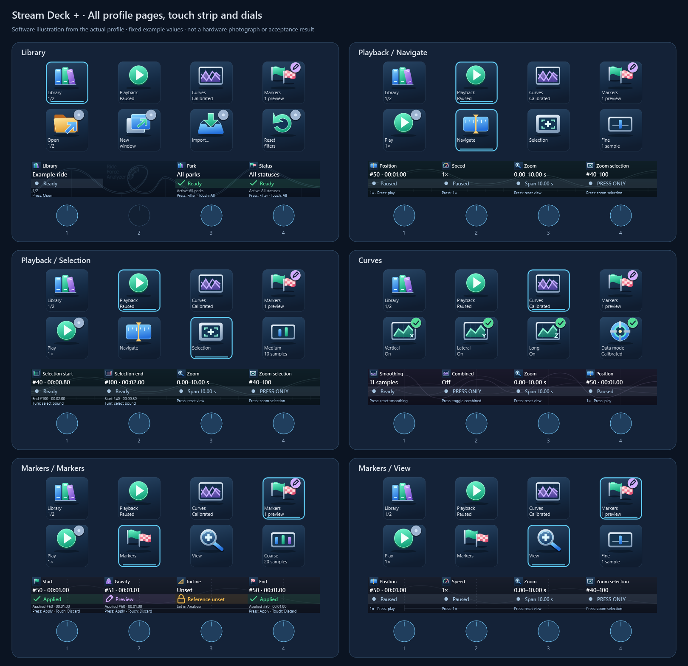

# Stream Deck control behavior

[User operation](../user/STREAM_DECK.md) owns setup and everyday instructions.
This document owns the device assignments, interaction and presentation contracts.
[Runtime architecture](../architecture/06_runtime_view.md#stream-deck-control-contract)
owns transport, typed messages and application routing; the
[plugin guide](../../plugins/stream-deck/README.md) owns build/install procedures.
[Validation](../validation/STREAM_DECK.md) owns tested scope and remaining native checks.

[Integration scope](../architecture/03_context_and_scope.md#stream-deck-scope),
[deployment](../architecture/07_deployment_view.md#mapping-and-environment) and
[runtime settings](../architecture/06_runtime_view.md#stream-deck-transport)
define boundaries, supported platforms and opt-in behavior.

## Supported controls

| Device             | Controls                                                |
| ------------------ | ------------------------------------------------------- |
| Stream Deck +      | 2×4 keys, four push dials and four 200×100 touch fields |
| Stream Deck Neo    | 2×4 keys, 232×50 InfoBar and two native Touch Points    |
| Stream Deck Mobile | Reduced six-key landscape layout; no dials or InfoBar   |

## Integration and command contract

- Separate connections: plugin ↔ Stream Deck SDK; plugin ↔ Analyzer loopback WebSocket.
- Discovery/authentication version 1; application protocol version 4. Strict typed
  messages identify the target window, recording and generation. Incompatible or
  stale-target commands are rejected rather than redirected.
- Use the active Explorer; never select an arbitrary window or activate Analyzer
  implicitly. Block application commands during background operation, text/number
  editing, open dropdowns/dialogs, missing data or conflicting analysis.
- Native folders, Home, app/website actions and local Step size remain independent
  of Analyzer command availability.
- Feedback follows confirmed GUI/service state. A press or transport acknowledgement
  must not imply that a toggle changed or marker analysis was adopted.
- Disconnect clears actionable/pending state; reconnect requires a fresh snapshot.
  Never queue/replay disconnected commands. Preserve the separate file-open transport.
- Coalesce playback feedback and reuse existing analysis services.

Detailed ownership and wire contracts remain in
[building blocks](../architecture/05_building_block_view.md),
[transport](../architecture/06_runtime_view.md#stream-deck-transport) and
[control contract](../architecture/06_runtime_view.md#stream-deck-control-contract).

## Device controls

### Menu structure

- Plus has six native main pages: Library, Playback/Navigate, Playback/Selection,
  Curves, Markers/Markers and Markers/View. Keys 1–4 select Library, Playback,
  Curves and Markers; keys 6/7 switch the Playback/Markers subgroups. Start on Library.
  Remember confirmed subgroups per device for the plugin session; appearance events,
  including native swipes, drive cyan selection. No Plus Back/Home/App/Website keys.
- Neo Start: native Start app, Library, Explorer and Website actions.
- Neo Explorer: Playback, Curves and Markers. Playback adds Position, Smoothing
  and Speed folders; Markers opens the four individual key editors.
- Neo native main pages: Start and Quick controls. Its Touch Points select the
  previous/next native page; the InfoBar action receives no input events.
- Mobile Start: Start app, Library, Playback and Website. Playback opens View.
- Back is key 1 in every folder. Neo Home is key 8 and returns the invoking
  device to Start. Neo Quick controls uses Start-return actions for Back/Home.
  Mobile deliberately has no Home key.
- Number keys left to right, top row first. Menu changes never apply a marker
  preview or switch the target Explorer.
- Start app uses Elgato Open with the packaged app icon and a user-configured
  desktop EXE/shortcut or Mac `.app`. Website uses Elgato Website, the project URL
  and the bundled globe icon. Neither action requires an Analyzer connection.

### Library navigation

- Plus dial 1: one visible entry per notch; press opens it. Neo/Mobile use
  Previous, Next and Open keys. Import opens the existing file-import dialog.
- Follow visible sorting/filtering and skip hidden entries. Wrap in both
  directions; a single entry stays selected, an empty list cannot be opened.
- Rotation/browsing changes selection only. Open uses the current Explorer and
  never creates another window. The separate New window key opens the selection
  in an additional Explorer through the existing Library action; the current
  Explorer stays unchanged. An already open/loading recording activates its existing
  window instead, without reloading or changing its view. It requires a selection
  and obeys the same locks.
- Library stepping always uses one entry, independent of Step size.
- Keys show short action names and selected index/count. Plus touch/Neo InfoBar
  show the selected name; full names remain available in the Analyzer Library.

### Stepping and playback

- Plus Step size is per device, defaults to fine after plugin startup and survives
  menu changes. Key 8 cycles Position, Selection and marker dials through 1/10/20/1
  source samples per notch. Labels/icons are Fine (one bar), Medium (two), Coarse
  (three); the dedicated key shows the current size. Library is unaffected.
- Neo Position/marker editors expose fixed −10/+10 and −1/+1 keys. Mobile exposes
  only −1/+1 position steps.
- Position, Selection and marker adjustments clamp to valid bounds; only Library
  navigation wraps. Display sample index and existing replay-time labels.
- Manual position changes and marker previews pause playback. Apply/Discard do not
  resume it. Play resumes it; view/curve/selection/speed changes leave it running.
- Smoothing moves through existing odd windows 1–51, stops at both ends and resets
  to 11. Raw mode retains unfiltered source values and disables smoothing.
- Speed uses existing playback settings; reset returns to 1×. Zoom/reset reuse
  existing chart navigation.

### Selection bounds

- Adjust the inclusive Inspector Select range immediately, independently of ride
  Start/End markers. Start clamps between zero and End; End between Start and the
  last source sample. No wraparound or preview/apply phase.
- GUI changes and recording/target changes publish current bounds.
- No replay seek, pause, analysis recalculation or Library marker write. Existing
  selection-based views/exports use the same GUI range.

### Plus marker page

| Dial | Marker  | Admitted samples                                    |
| ---- | ------- | --------------------------------------------------- |
| 1    | Start   | Zero through effective End                          |
| 2    | Gravity | Any valid source sample, independent of ride bounds |
| 3    | Incline | Any valid source sample, independent of ride bounds |
| 4    | End     | Effective Start through last source sample          |

- Rotate: preview only that marker. Press: apply only its preview. Touch: discard
  only its preview and restore the applied value. Other previews remain untouched.
- Preserve previews across menus; discard them on recording/target changes.
  Never apply a preview to a different recording/window.
- Only successful analysis adoption atomically persists current Library marker
  choices. Concurrent confirmations must not overwrite newer adopted state.
- Show each marker preview in the Explorer chart as a dotted, theme-coloured line
  with an explicit preview label, alongside the unchanged applied marker.
  Center an off-screen preview, preserving zoom and clamping to recording boundaries.
  An already visible preview leaves the interval unchanged.
  Discard/apply and recording/target changes remove the corresponding preview.
- Show preview/pending/failed values separately from the last applied value.
  Unsuccessful or interrupted adoption must not appear applied.
- Unset calibration references require initial placement through the GUI. There
  is no device action for initial placement or resetting markers to source values.
- Applied Start/End changes use existing viewport/replay-label behavior. Follow the
  [Explorer marker contract](../implementation/RAW_EXPLORER.md#time-zoom-and-selection).

## Plus profile

The following assignments describe the bundled six-page profile. Generated
illustrations use fixed example values; [validation](../validation/STREAM_DECK.md)
records native observations separately.

### Workflow and fixed menu row

Use **Library → Playback → Curves → Markers**, then **Playback → Selection**
when choosing an export interval. Four top-row keys stay in the same positions
in every view. Explorer is the controlled application window, so an extra Explorer
landing page is unnecessary. Start app, Website, Back and Home are omitted.

| Key | Group    | App status in the second caption line                                      |
| --- | -------- | -------------------------------------------------------------------------- |
| 1   | Library  | Selected visible index/count; no implicit recording open                   |
| 2   | Playback | Playing or Paused                                                          |
| 3   | Curves   | Actual Raw or Calibrated mode                                              |
| 4   | Markers  | Failed, then Pending, then outstanding preview count; otherwise No preview |

A cyan outline/underline identifies the visible group and active dial subgroup.
It is a **local navigation selection**, not an application-success indicator.
Marker warnings remain visible on key 4 while visiting another group. Selecting a
menu changes only device controls; it never changes the recording, playback,
analysis, selection or saved markers.

### Context row: keys 5–8

| Group / view         | 5               | 6                       | 7                        | 8              |
| -------------------- | --------------- | ----------------------- | ------------------------ | -------------- |
| Library              | Open            | New window              | Import                   | Reset filters  |
| Playback / Navigate  | Play/Pause      | Navigate — selected     | Selection — switch dials | Step size      |
| Playback / Selection | Play/Pause      | Navigate — switch dials | Selection — selected     | Step size      |
| Curves               | Vertical On/Off | Lateral On/Off          | Longitudinal On/Off      | Raw/Calibrated |
| Markers / Markers    | Play/Pause      | Markers — selected      | View — switch dials      | Step size      |
| Markers / View       | Play/Pause      | Markers — switch dials  | View — selected          | Step size      |

Keys 6/7 select mutually exclusive dial groups on Playback and Markers; they are
not action buttons. Key 5 remains Play/Pause and key 8 remains the shared step-size
cycle on both groups. This gives inspection and marker work the same lower-row
pattern. Curves reserves the row for its four most frequent display toggles.
Direction captions follow the current Explorer's curve labels, including raw-axis
labels in Raw mode; the illustrations show calibrated direction names.

Enter Library initially. The initial Playback subgroup is Navigate, and the
initial Markers subgroup is Markers. Remember the last subgroup for each group
on this Plus for the current plugin session; pressing an already selected group
or subgroup does nothing. No hidden long press, double press or extra menu level.

### Dials and aligned touch fields

Number dials left to right. Every field describes the control directly below it.
For ordinary dials, show the current value, meaningful availability and press
function. **Zoom stays on dial 3** across Navigate, Selection, Curves and Markers/View.
The four-marker group retains its established Start/Gravity/Incline/End order.

| View                 | Dial 1                            | Dial 2                          | Dial 3                       | Dial 4                      |
| -------------------- | --------------------------------- | ------------------------------- | ---------------------------- | --------------------------- |
| Library              | Browse; press Open                | Display-only decoration         | Park choice; press Filter    | Status choice; press Filter |
| Playback / Navigate  | Position; press Play/Pause        | Speed; press 1×                 | Zoom; press Reset view       | Press only: Zoom selection  |
| Playback / Selection | Selection Start; press unassigned | Selection End; press unassigned | Zoom; press Reset view       | Press only: Zoom selection  |
| Curves               | Smoothing; press Reset to 11      | Press only: Combined On/Off     | Zoom; press Reset view       | Position; press Play/Pause  |
| Markers / Markers    | Start preview; press Apply        | Gravity preview; press Apply    | Incline preview; press Apply | End preview; press Apply    |
| Markers / View       | Position; press Play/Pause        | Speed; press 1×                 | Zoom; press Reset view       | Press only: Zoom selection  |

**Press-only overflow:** an unused rotation can carry one existing action, shown
persistently in its touch field with function, current state and **PRESS ONLY**.
Turning or touching that field does nothing. Combined is Off/On; Position shows the actual play state;
Zoom selection shows the current Select interval. Library dial 2 displays only decoration;
dials 3/4 select its existing Park/Status filters.
Dial 2 has no input function or alert. A display-only encoder assignment may render
its background tile so the panorama continues across this otherwise empty field.

**Library filters:** turning chooses a proposed value; pressing **Filter** applies
only that filter. Show the proposed value and the separate active value in its
touch field. Use the same options and order as the application dropdowns, including
All parks, Unknown park and All statuses. Stop at either end of the option list;
recording browsing on dial 1 remains cyclic and always moves one visible entry.
Each filter notch selects one option, independently of Fine/Medium/Coarse.
Park and Status combine with each other and the existing search. Applying a filter
updates the shared Library view without opening a recording or changing its manual
workflow status. Filter controls remain available when no recordings match.
Tapping the Park touch field immediately applies **All parks**; tapping Status
immediately applies **All statuses**, without an additional dial press. Each tap
also clears that filter's proposal and preserves the other filter and search.
Show this reset action in the corresponding touch field.

Show a value as active only after application confirmation. GUI changes synchronize
the corresponding field and discard its stale proposal; leaving Library discards
unapplied filter proposals. Reset filters clears park/status/search and both
proposals. Recording/target changes and connection loss also discard proposals;
never carry a proposed filter into another Explorer. Existing focus, dialog,
background and connection locks also apply.

Marker rotation creates only that marker's preview. Press applies it; touch
discards only that preview. Apart from Park/Status resets, other touch fields have
no new touch action. Step size
is shared across Position, Selection and Markers: Fine/Medium/Coarse means
1/10/20 samples. Library remains one entry; smoothing, zoom and speed retain their
existing increments. Views in the images deliberately demonstrate different
example step sizes; the device shares a single current size.

### State feedback and locks

Use a quiet, static touch-strip panorama for the selected menu: coaster rails for
Library, a track with a time scale for Playback, force-like curves for Curves and
reference guides for Markers. Subgroups keep their parent menu's background.
Use the low-contrast menu tints: blue for Library, petrol for Playback,
violet for Curves and slate blue for Markers, with a continuous dark translucent layer behind content;
text and status bands remain prominent. Decorative motifs carry no live data,
availability or success meaning, and do not use reserved status colors. The four
dial regions share one coordinated 800×100 design.
Library has a loop centered over dial 2 with a three-car train descending its left
inside edge. The subtle three-line `Ride / Force / Analyzer` lettering remains
inside dial 2's 200×100 tile, left of the loop. Use 14 px Segoe UI, regular weight,
with 14 px baseline spacing. The `Analyzer` baseline aligns with the adjacent
status bands' top edge (y=48.1818 in the 800×100 reference); descenders extend below
that axis. Preserve this baseline when changing font size. Four-line fields place
their final action hint at y=77; five-line fields reserve y=75 for adopted/additional
values and place the hint at y=88. Curves and Markers guides align with
the dial centers at x=100, 300, 500 and 700. Canonical editable SVG artwork is stored in
[`devices/backgrounds/`](../../plugins/stream-deck/devices/backgrounds); the
[image guide](../images/README.md) owns generated reference settings.

The [native-size touch-strip examples](../images/stream-deck-plus-touch-strips.png)
show production backgrounds beneath controls and fixed special states.

Touch fields use a separate, full-width status band with a large standalone symbol
and explicit state text. Do not shrink an upper-right status badge together with
the function icon: touch-field function artwork has no embedded badge. The layout
uses a 26-pixel status symbol beside 14-pixel text, a tinted band and matching text
color; color alone never carries meaning. Keep proposed/current values and action
hints outside that band. Show the shared step size on its dedicated key rather
than repeating it in every status line. Illustration coordinates are not native
layout coordinates: each dial has only 200×100 pixels within the 800×100 strip.
Fit and verify all text, status and touch hints at that actual size, including the
five Library lines. Use the [native-size examples](../images/stream-deck-plus-touch-strips.png) to
check four-/five-line fields, special states and long-text elision.

| Information                                           | Visible feedback                                             | What it confirms                                         |
| ----------------------------------------------------- | ------------------------------------------------------------ | -------------------------------------------------------- |
| Selected group / dial subgroup                        | Cyan frame and underline                                     | The device page that actually appeared                   |
| Curve or Combined On/Off                              | Green check / gray dot and explicit text                     | Confirmed application toggle state                       |
| Fine / Medium / Coarse                                | One/two/three-bar icon and 1/10/20 samples                   | Device-local step size, independent of connection        |
| Marker preview                                        | Violet Preview, preview value and separate Applied value     | Proposed value only; no saved change                     |
| Marker apply in progress                              | Blue Pending/clock; Applied value retained                   | Analysis has started, not completed                      |
| Marker apply failed                                   | Red Failed; previous Applied value retained                  | No successful replacement; group key 4 keeps the warning |
| Marker applied                                        | Green Applied and adopted value                              | Application analysis adoption succeeded                  |
| Library filter choice                                 | Violet Preview; separate Active value; press Filter          | Proposed option only until application confirmation      |
| Input focus, dialog, background, busy or missing data | Amber lock/reason; app actions disabled                      | Existing application availability rules                  |
| Disconnected                                          | Gray disconnected symbol, Offline and cleared program values | No actionable snapshot; no replay on reconnect           |

The native-size examples include mixed marker feedback, input-focus locks and
offline Library states. Menus, subgroup selection and the local step cycle remain usable while
app actions are locked. No command is queued for later execution. A click or
sent command never fabricates an applied value or a manual workflow status.

Recording/target changes clear marker previews. Switching groups or between
Markers and View retains them. Changing the step size also retains them. Open
uses the addressed Explorer; New window activates the existing recording window
when already open. Reset filters clears park/status/search without loading data.
Source bytes, stored dates, metadata, manual workflow and exports are unaffected
by device navigation.

## Neo profile

Back/Home occupy keys 1/8 in submenus. Start offers Start app, Library, Explorer
and Website; Quick controls is a
second native main page. No dials or custom Touch Point command handlers. Position
and marker minus/plus keys occupy the two center columns, coarse above fine.

| Page              | Other assigned keys                                                 |
| ----------------- | ------------------------------------------------------------------- |
| Quick controls    | 2 Play; 3/4 Zoom −/+; 5 Reset view; 6 Zoom selection; 7 Reset speed |
| Library           | 2 Previous; 3 Next; 5 Import; 6 Open; 7 New window                  |
| Explorer          | 2 Playback; 3 Curves; 6 Markers                                     |
| Playback          | 2 Play; 3 Smoothing; 6 Position; 7 Speed                            |
| Position          | 2/3 −10/+10; 6/7 −1/+1                                              |
| Smoothing / Speed | 3 Reset; 6/7 −/+                                                    |
| Curves            | 2/3/4 directions; 5 Data mode; 6 Combined; 7 Reset view             |
| Markers           | 2 Start; 3 Gravity; 6 Incline; 7 End                                |
| Individual marker | 2/3 −10/+10; 4 Apply; 5 Discard; 6/7 −1/+1                          |

Marker editors use the same bounds, preview lifecycle and persistence as Plus.
InfoBar feedback is contextual: Library name/index, playback position/state/speed,
curve visibility, smoothing or markers. A marker editor separates name/state,
preview/adopted position and last applied value across three lines. Disconnect
clears program values; native paging remains separate from feedback.

## Limited Mobile preview

Four six-key pages designed for landscape, three columns and two rows; no Home, dials or InfoBar.
Back is key 1 in folders. Pairing is handled by Stream Deck; the Analyzer keeps
its existing desktop loopback interface.

| Page     | Key 1     | Key 2    | Key 3    | Key 4      | Key 5          | Key 6      |
| -------- | --------- | -------- | -------- | ---------- | -------------- | ---------- |
| Start    | Start app | Library  | Playback | Website    | Unassigned     | Unassigned |
| Library  | Back      | Previous | Next     | Import     | Open           | New window |
| Playback | Back      | Play     | View     | −1 sample  | +1 sample      | Reset view |
| View     | Back      | Zoom −   | Zoom +   | Reset view | Zoom selection | Play       |

Recommend landscape with Mobile layout orientation set to None or Fixed so the
3×2 grid keeps native Back at the top left. This is a user setting, not a profile
orientation lock. No separate portrait profile is provided.

No curve/smoothing/speed editors, markers or manual selection-boundary editing.

## Feedback and assets

- Use shared filled/color function artwork and separate badges for inactive,
  active, preview, pending, failed, unavailable and disconnected states.
- Drive toggles from confirmed snapshots; disable automatic key-state toggling.
  Honor native user icon/title overrides. Encode runtime SVG image data.
- Key captions: at most two lines of eleven characters. Use action labels rather
  than recording names on Library keys. Elide long variable labels within bounds.
- Plus fields retain actual values/mode, selected name/count, viewport span,
  smoothing or speed. Marker fields retain adopted values beside proposed state.
- Neo InfoBar is display-only. All text fields elide overflow; unavailable values
  and disconnected state must not show fabricated/current-looking data.
- Assets are bundled; runtime operation requires no image download. White-only
  graphics apply to action-list/category icons, not device displays.

| Asset                    | Contract                                 |
| ------------------------ | ---------------------------------------- |
| Key / dial preview       | SVG or PNG 72×72 and 144×144             |
| Action-list / category   | White transparent SVG/PNG; 20×20 / 28×28 |
| Plugin preferences       | PNG 256×256 and 512×512                  |
| Plus field / Neo InfoBar | JSON layouts bounded to 200×100 / 232×50 |

[Generated profiles](../../plugins/stream-deck/scripts/build-profiles.mjs),
[feedback](../../plugins/stream-deck/src/feedback.ts) and
[layouts](../../plugins/stream-deck/devices/layouts) define the current device data.

## References

- [User guide](../user/STREAM_DECK.md), [plugin build/install/version workflow](../../plugins/stream-deck/README.md).
- [Transport and control architecture](../architecture/06_runtime_view.md#stream-deck-control-contract).
- [Elgato SDK manifest](https://docs.elgato.com/streamdeck/sdk/references/manifest/),
  [keys](https://docs.elgato.com/streamdeck/sdk/guides/keys/),
  [dials](https://docs.elgato.com/streamdeck/sdk/guides/dials/),
  [Neo InfoBar](https://docs.elgato.com/streamdeck/sdk/guides/neo-infobar/).
- [Native folders](https://help.elgato.com/hc/en-us/articles/360027957912-Elgato-Stream-Deck-Using-Folders),
  [profiles](https://docs.elgato.com/stream-deck/profiles/getting-started/),
  [plugin packaging](https://docs.elgato.com/streamdeck/cli/commands/pack/).
