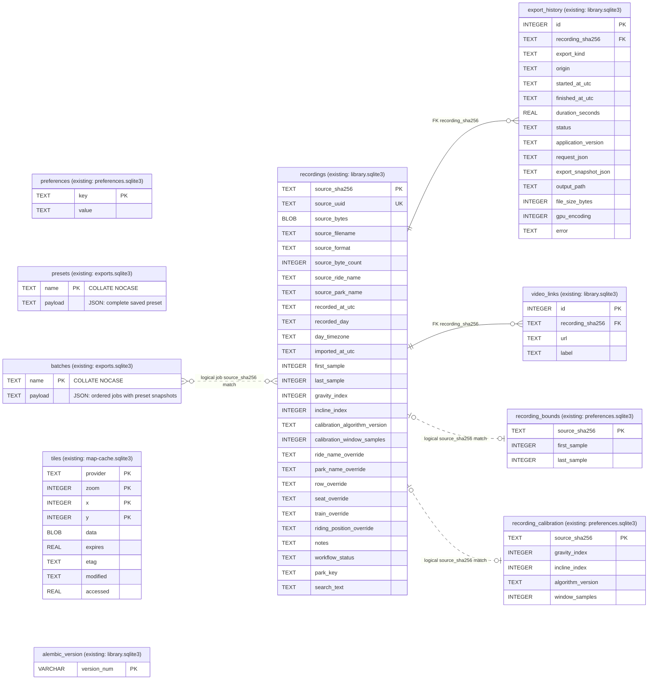

# Library requirements and implementation steps

<!-- cspell:words NFKC -->

Status: LIB-01–08 implemented; LIB-09–14 planned.
This document defines the Library feature
and its verifiable implementation steps. It does not authorize implementation or
Git delivery. Requirements and implementation belong on the same feature branch.

## Purpose and scope

Archive imported ride recordings locally, find them by recording day, ride and park,
retain editable information and markers, track a manual workflow, and keep export
history with reusable settings.
The feature is called **Library** in English, **Bibliothek** in German and
**Bibliothèque** in French, using the existing localization system.

Use the existing Python SQLite support, importer, analysis services, export dialogs
and snapshot serializers. A separate `library.sqlite3` in the existing application
data directory holds three Library tables plus Alembic's migration-version table.
Existing preferences, presets and saved batches keep their current stores.
No database server, ORM, park/ride master-data catalog,
sample tables or separate search service is required.

Use Alembic with SQLAlchemy for Library schema migrations only. Existing application
queries continue to use `sqlite3`; an ORM conversion is not part of this feature.

This is an archive of individual recordings: two recordings of the same ride are
two entries. Original recordings, GPS and unknown source fields remain intact.
Videos remain external files. Backup/restore is a later increment, with its format
outlined here so the initial schema does not prevent it.

## Required behavior

### Import and source ownership

- An explicit Library import accepts one or more recordings in the already
  supported `.forces` and `.zforces` formats through the existing importer.
  Ordinary **Open recording** remains usable without automatically archiving a file.
- Archive the complete original file bytes, original filename, format, byte count
  and SHA-256. Retain compressed input exactly as supplied. Do not rebuild a source
  file from parsed JSON or write changes into the original file.
- The source recording UUID identifies one Library entry across `.forces` and
  `.zforces` exports, independent of filename or path. UUID spelling is normalized
  for comparison without changing the original. Missing, invalid or zero UUIDs
  fall back to exact-byte identity; names and dates never merge recordings.
- Equivalent decoded source objects for the same UUID report **Already in Library**
  and retain the first original bytes. A changed source with the same UUID updates
  that entry's exact bytes, hash, filename and source metadata. First import time,
  Library additions, workflow, markers, links and export history remain intact.
  Incompatible existing markers reject the update without modifying the entry.
  The last explicitly imported changed export becomes the current source; there
  is no source-version history or automatic detection of an older export.
- Store only successful complete imports. A failed file has a visible explanation
  and no partial entry; other selected files may still import.
- Reopening an archived entry reads its stored bytes through the existing import
  and analysis path. Moving or deleting the external original must not break it.
  Archived `.zforces` bytes use the importer's explicit `compressed=True` option
  and the same bounded Raw-DEFLATE path as file imports. No temporary source file
  or JSON reconstruction is used.

`explorer.library.LibraryArchive.import_paths()` imports selected files independently.
`LibraryStore.archive()` inserts successful originals with duplicate protection in one
transaction, recording the first successful import time in UTC and the initial
`imported` workflow state. It initializes bounds and reference choices using existing
source/default and valid saved-preference rules. UUID updates replace only source
fields and reassign related foreign keys atomically. The UUID has a unique index.
The `1_3_identity` migration backfills UUIDs in existing archives and merges duplicates
into the earliest entry, retaining that entry's source and Library choices and all
associated export history and video links. Reimport a changed export to update it.
Normalized effective-name projections are populated on first import and source
updates. The `1_3_search` migration backfills existing rows using metadata only,
including any Library name overrides, without reading original BLOBs.

`LibraryArchive.reopen()` verifies the stored byte count and SHA-256, decodes the
stored format, and uses existing explorer/analysis preparation with the archived
marker recipe. It needs neither the original external file nor a reconstruction of
its JSON. Selecting a Library recording calls this service through the existing
background load lifecycle. Failure explains the problem and preserves the current chart.

### Recording dates and names

- Project the source ride name and park name without changing their spelling.
  Use the existing metadata mapping: `name` for ride and `location` for park.
  Missing values stay missing; UI placeholders are not stored as source values.
- Verify the recording-date epoch, unit and time-zone meaning against original-app
  evidence and authorized fixtures before implementing date conversion.
  `RecordingMetadata.date` retains an exact numeric token without epoch interpretation;
  a file's modification time or import time is not its recording time.
- Retain the raw date/time-zone values in the original bytes. Store a normalized
  UTC instant only when the source contract supports it. Use a valid source time
  zone for the recording day; otherwise explicitly group/display in UTC when the
  instant is known. Never silently use the importing computer's local time zone.
- An unavailable or uninterpretable recording date appears in **Unknown date**
  after the dated groups. The recording remains usable. Import time is captured
  separately in UTC when its archive insertion succeeds.

### User additions

The user can edit the park name, ride name, row (**Row**), seat (**Seat**), train
(**Train**) and riding position (**Seated** or **Flying**), plus notes.
Store these changes as current values in the Library, separate from the original
source. Row, seat and train overrides are optional text labels; source attributes
can contain numbers or strings and must not be forced into an integer-only model.
The riding-position override admits only `Seated`, `Flying` or no override.

An unset override uses the imported source value/provenance; resetting it restores
that value. Do not replace an unfamiliar original riding-position value with a
default. Original metadata remains visible separately and read-only. The recording
date/time, derived recording day/time zone and import time are not user-editable.

The Library list, recording details, opened Library recording and new exports use
effective metadata where applicable, while preserving the distinction between
source and user values. Riding-position changes use the existing Seated/Flying
behavior; they do not introduce a new force transformation or alter sensor data.
Saving replaces the current additions; no metadata edit history, audit table or
version list is required. The separate export history remains unchanged.

**Edit metadata…** opens a separate themed dialog from the selected Library entry.
Empty text editors inherit their displayed source placeholders; the posture selector
offers the imported value (including unfamiliar values) or an explicit supported
override. Save persists the current additions; Cancel discards unsaved input.
Reset removes all additions and notes. Storage failures keep the dialog and input
visible. The Library keeps its original read-only details and lists saved additions
separately; editors do not occupy its narrow panel.

`LibraryStore.update_metadata()` validates only the declared editable fields with
`RecordingAdditions` and updates additions/search projections atomically. It rejects
date/import/source fields and invalid posture overrides before writing. Existing
columns suffice; no schema revision or edit-history table is required.
`ImportSuccess` retains its immutable original recording alongside separate frozen
additions and exposes effective metadata/attributes for views and exports.
Library reopening and byte-identical external opening restore the current additions.
Riding-position overrides carry `user` provenance and affect the existing display
ranges only; scientific force stages retain the original source values.

New video `ExportSnapshot` version 2 captures effective names, row/seat/train,
posture/provenance and notes. Version-1 snapshots without this field remain readable
and retain original-source semantics. New batch jobs capture the current additions;
later Library edits cannot change them. Legacy jobs without additions continue to
use original metadata. JSON data exports use effective metadata and retain source
dates/unknown attributes; original archived files remain unchanged.

Later concrete fields are added by ordinary Alembic migrations.

### Recording markers

Persist the current Start/End sample bounds and Gravity/Incline reference choices
on the Library entry, together with the existing calibration algorithm version and
reference window. Initialize them through the existing source/default and saved
preference resolution on first import. An unset Gravity/Incline override retains
the original source basis; unavailable calibration is not fabricated.

For archived sources, the Library is authoritative for these choices. Reopening
from the Library or opening byte-identical external input restores them. Existing
explorer marker controls save changes back to that Library entry. Non-archived
recordings retain their current preference storage; this is not a consolidation
of the existing databases.

Use the existing validation and analysis path: Start/End are ordered inclusive
indices within the recording; Gravity/Incline references are independent source
indices and may lie outside those bounds. Reset restores the existing source/default
behavior. Keep only the current choices, without an edit history. New exports use
those choices; existing saved jobs and export snapshots retain their captured recipe.
The original recording bytes, recording date and import time remain unchanged.
`LibraryStore.markers()` reads and validates the current recipe without fetching
source bytes; `update_markers()` updates only its existing columns atomically.
`LibraryArchive` routes current marker reads/writes to the Library for archived
hashes and otherwise to preferences. Storage failures do not fall back to stale
preferences. Reset stores original bounds and the default calibration recipe;
source-default bounds resolve without introducing originally absent marker lines.
Fresh batch jobs capture these choices; executing saved jobs does no current-marker lookup.

### Manual workflow status

The approved workflow has six fixed states, presented through the existing
localization system:

1. **Imported** (`imported`): archived and waiting for review.
2. **Markers verified** (`markers_verified`): Start, End, Gravity and Incline have
   been reviewed and adjusted where applicable; unchanged choices can also be
   confirmed as reviewed.
3. **Overlays created** (`overlays_created`): all overlay exports needed for the
   intended video work are ready, whether one or several.
4. **Video ready** (`video_ready`): POV and overlays have been combined in external
   video software and the finished video has been exported.
5. **Uploaded** (`uploaded`): uploaded to YouTube or another platform, possibly
   private, unlisted or scheduled for later publication.
6. **Completed** (`completed`): the intended videos have been released/published
   and the user considers the work finished.

Initialize a new Library entry as `imported`. All subsequent changes are manual,
including moving backwards or repeating work; there are no enforced transition
prerequisites. Marker/metadata edits, successful exports, video links and external
publication never advance or reset this status automatically. Store only its current
value on the entry, without a status history. External editing, uploads and
publication are confirmed by the user.

Only the current workflow icon is permanently visible in each Library entry.
Clicking it shows a horizontal foreground overlay anchored to that icon, with the
six status icons ordered from left to right as listed above. The current status
stays at the clicked position and is highlighted; earlier steps appear to its left
and later steps to its right. Keep the trigger and choices visually icon-only,
without button frames. The overlay adds no list row and shifts no entries.
Give the overlay a contrasting background, border and rounded corners using the
active theme's existing colors; the individual icons remain frameless.
Every status remains selectable, including moving backwards or skipping steps.
Localized tooltips and accessible names identify each icon.

Selecting a status saves it immediately, updates the entry's current icon and
closes the bar. Escape or clicking outside closes it without changing the status.
Use neither a separate menu/dialog nor a Save button. A failed write retains the
previous stored status and icon and provides a visible explanation.
Reuse a themed `QFrame` with `QHBoxLayout`, six checkable `QToolButton` controls and an
exclusive `QButtonGroup`, following existing theme and icon conventions.
`LibraryStore.set_workflow_status()` validates the six admitted values and updates
only the current status in one transaction. It adds neither history nor automatic
transitions; failed writes leave the entry unchanged. `ui.explorer.library_workflow`
owns the icon-only trigger and foreground selector; choosing a status never loads
the source or changes Library selection, chart state or list geometry.

### Video links

Each Library entry can hold multiple links to finished videos, including full-length
videos, Shorts, TikTok posts and other variants or platforms. Links belong to the
recording, not to a single overlay export: one finished video may use several
overlays, and a recording may produce several published variants.

For each link, store its URL and an optional label selected from a user-maintained
dropdown. Initial choices are **YouTube**, **Shorts**, **TikTok**, **Reel**,
**Facebook** and **Instagram**. Manage the list under **Settings → Library**, where
the user can add, rename and remove choices. Saved changes persist across restarts
and are available to video-link editors. Seed defaults only when no saved list
exists; do not replace a customized or deliberately empty list on startup/upgrade.

Store the choice list as JSON in the existing `preferences` table under
`library_video_labels`; no additional label table is needed. Each video link keeps
its selected label text. Renaming/removing a choice changes the dropdown list,
not existing links. An editor must still display and retain a saved label that is
no longer offered, or let the user replace it with a current choice. An unset
selection remains empty. The link editor does not use a free-text label field;
new choices are managed in Library settings.

The user can add, edit and remove links; retain the current list in the Library
without an edit history.
Allow user-supplied HTTP/HTTPS links without restricting them to a platform list
or requiring an external platform API. A link may refer to a private, unlisted
or scheduled upload; its presence does not establish that the video is released
or that all intended variants are complete. Completion remains a manual workflow
status decision.

### Export history and repeat export

- Record exports for archived sources, including when the same bytes were opened
  from an external file. Link by source SHA-256, not by pathname or display name.
  This covers single video exports, individual batch jobs and CSV/JSON exports.
- Each started attempt gets its own history row, including retries. Track start,
  finish, outcome and duration; failed/cancelled attempts are distinguishable from
  completed exports. A skipped batch job that never starts is not an export attempt.
- Capture the requested settings before preparation and the effective snapshot
  once prepared. For video, reuse the existing `ExportSnapshot`, including exact
  frame-rate settings, layout, geometry, bounds, smoothing and analysis recipe.
  For data exports, retain their format, inclusive bounds and existing serialized
  analysis configuration. Do not introduce a second video snapshot format.
- Extend the shared export snapshot with the effective Library metadata used by
  the export, including a riding-position override when present. Repeating an
  export uses those captured values even after later Library edits; it does not
  pick up the entry's current overrides. Older snapshots retain their documented
  original-source semantics instead of receiving newer Library metadata silently.
- Save completion only after the existing exporter successfully publishes its
  output. Retain output path, completed file size and actual GPU/CPU selection
  when available. Duration uses the existing monotonic measurement contract;
  missing results remain unknown. A history-write failure must be reported and
  must not remove a successfully exported file. Leftover running attempts after
  an application crash are shown as interrupted, never completed.
- Editing a preset, user label or current analysis must not rewrite older history
  or snapshots. Exporting must not require the user to locate a batch report later.
- **Repeat export…** opens the existing export review with archived source bytes
  and saved settings. It asks for the destination using the existing save flow;
  it never automatically overwrites the previous output. A new attempt creates a
  new history row. A missing old video does not prevent repeating the export.
- Unsupported snapshot/algorithm versions explain why repetition is unavailable;
  they are not silently replaced with current defaults. Matching saved settings
  do not promise byte-identical output across application versions or encoders.

### Admitted source date contract

The Library projection uses seconds since **2001-01-01 00:00:00 UTC** for
Ride Forces schema 2.2.0. The authorized Manta source retains the exact token
`811347461.3309591` and `America/New_York`. The owner confirmed the original-app
reading as **2026-09-17, 10:18 local time**, Row 3 / Seat 3. Conversion produces
2026-09-17 10:17:41.330959 at that location: agreement within one minute, without
claiming second-level display agreement or a verified rounding policy.
The app developer also identifies recording date/time zone as source data in the
[privacy policy](https://rideforces.com/privacy/); that policy alone does not establish the epoch.

`importers.library_metadata.project_library_metadata()` projects the existing
importer models. It preserves source names, exact date tokens and time-zone text.
The recording day uses the recording location's source zone, regardless of where
the file is later opened. Missing/invalid zones use explicit UTC; missing, invalid
or unrepresentable dates remain unknown. Normalized UTC text uses six fractional
digits and `Z`; original precision remains in the source token and bytes.
The unversioned RFDB profile has no independently confirmed date contract, so its
names are projected but its derived dates remain unknown.

## Library database model

`recordings` has one-to-many relationships with `export_history` and `video_links`.
A recording is identified by its existing source digest; export attempts and
video links use local integer keys.
All timestamps below are UTC ISO 8601 text in one fixed precision/format ending
in `Z`; `recorded_day` is `YYYY-MM-DD`. Nullable fields use SQL `NULL`.

### Complete database overview: existing and planned

The diagram shows all six existing application tables, the three Library tables
and Alembic's version table, with their columns and database ownership.
The Library schema, explicit archive import and reopening service are implemented.
The grouped recording list and read-only source/date/import details are implemented;
park/name filters, metadata/marker editing and manual workflow status are implemented;
remaining workflows are planned.
`PK` marks primary-key
columns; the four marked columns in `tiles` form one composite primary key.
`FK` marks the Library foreign keys. Dashed hash links are optional logical
matches across database files, not SQL foreign keys or a plan to merge the stores.
Existing definitions are maintained in
[preferences](../../src/ride_forces_analyzer/storage/preferences.py),
[exports](../../src/ride_forces_analyzer/storage/exports.py) and
[map tiles](../../src/ride_forces_analyzer/storage/map_tiles.py).

Existing marker/calibration rows and batch jobs can refer to recordings that are
not in the Library. The diagram does not make Library import mandatory for them.
Batch jobs embed complete preset snapshots in `payload`; they do not reference
mutable `presets` rows through a foreign key. Similarly, export history owns its
saved JSON settings and remains independent of later preset or batch edits.
JSON contents and original source fields are not additional relational tables.
`alembic_version` holds technical migration state, not recording or export data.
Nullability and the secondary indexes are specified below.
Library marker columns retain the current choices for archived sources; existing
preference rows remain independent. `workflow_status` is the current manual work
state, not an export result or a history of edits.

### Table: `recordings`

| Field                           | SQLite type / constraint            | Purpose                                                                         |
| ------------------------------- | ----------------------------------- | ------------------------------------------------------------------------------- |
| `source_sha256`                 | `TEXT PRIMARY KEY NOT NULL`         | Current source digest; relationships follow source replacements.                |
| `source_uuid`                   | `TEXT NULL UNIQUE`                  | Canonical source UUID identifying one recording across exports.                 |
| `source_bytes`                  | `BLOB NOT NULL`                     | Exact original `.forces` or compressed `.zforces` bytes.                        |
| `source_filename`               | `TEXT NOT NULL`                     | Original basename; opening the archive does not depend on its old path.         |
| `source_format`                 | `TEXT NOT NULL`                     | `forces` or `zforces`, used to select the decoding path.                        |
| `source_byte_count`             | `INTEGER NOT NULL`                  | Expected original length for integrity checks.                                  |
| `source_ride_name`              | `TEXT NULL`                         | Verbatim source ride name.                                                      |
| `source_park_name`              | `TEXT NULL`                         | Verbatim source park name.                                                      |
| `recorded_at_utc`               | `TEXT NULL`                         | Derived recording instant, only with a verified interpretation.                 |
| `recorded_day`                  | `TEXT NULL`                         | Day used for grouping, derived from the instant and day time zone.              |
| `day_timezone`                  | `TEXT NULL`                         | Valid source time zone, explicit UTC fallback, or unknown.                      |
| `imported_at_utc`               | `TEXT NOT NULL`                     | First successful Library import time.                                           |
| `first_sample`                  | `INTEGER NOT NULL`                  | Current inclusive Start marker resolved through the existing contract.          |
| `last_sample`                   | `INTEGER NOT NULL`                  | Current inclusive End marker, at or after Start and within the recording.       |
| `gravity_index`                 | `INTEGER NULL`                      | Custom Gravity reference; `NULL` retains the original source basis.             |
| `incline_index`                 | `INTEGER NULL`                      | Custom Incline reference; `NULL` retains the original source basis.             |
| `calibration_algorithm_version` | `TEXT NOT NULL`                     | Version of the existing calibration-reference recipe.                           |
| `calibration_window_samples`    | `INTEGER NOT NULL`                  | Reference window required by the existing calibration recipe.                   |
| `ride_name_override`            | `TEXT NULL`                         | Editable replacement; `NULL` uses the source name.                              |
| `park_name_override`            | `TEXT NULL`                         | Editable replacement; `NULL` uses the source park.                              |
| `row_override`                  | `TEXT NULL`                         | Editable Row label; `NULL` uses the source attribute.                           |
| `seat_override`                 | `TEXT NULL`                         | Editable Seat label; `NULL` uses the source attribute.                          |
| `train_override`                | `TEXT NULL`                         | Editable Train label; `NULL` uses the source attribute.                         |
| `riding_position_override`      | `TEXT NULL`                         | Editable `Seated`/`Flying` value; `NULL` retains the imported value/provenance. |
| `notes`                         | `TEXT NOT NULL`                     | Editable free text, initially empty.                                            |
| `workflow_status`               | `TEXT NOT NULL`, default `imported` | Current manual workflow state; one of the six values defined above.             |
| `park_key`                      | `TEXT NULL`                         | Normalized effective park name for filtering.                                   |
| `search_text`                   | `TEXT NOT NULL`                     | Normalized effective ride and park names for search.                            |

Source bytes, identity, original metadata, recording date/day/time zone and first
import time are not editable in Library editors. An explicit changed-source reimport
updates source fields while preserving the first import time. Effective metadata uses overrides when set, otherwise
source values. The user cannot change the date through the Library editor or its
update service. `park_key` and
`search_text` are disposable query projections, updated in the same transaction as
name edits; they are not additional source data. List queries select metadata only,
not every recording BLOB or parsed measurement array.

### Table: `export_history`

| Field                  | SQLite type / constraint | Purpose                                                                          |
| ---------------------- | ------------------------ | -------------------------------------------------------------------------------- |
| `id`                   | `INTEGER PRIMARY KEY`    | Local export-attempt identifier.                                                 |
| `recording_sha256`     | `TEXT NOT NULL`, FK      | References `recordings.source_sha256`.                                           |
| `export_kind`          | `TEXT NOT NULL`          | Video, CSV, app-shaped JSON or Analyzer JSON, using existing format identifiers. |
| `origin`               | `TEXT NOT NULL`          | Single export or batch job.                                                      |
| `started_at_utc`       | `TEXT NOT NULL`          | Attempt start, including preparation.                                            |
| `finished_at_utc`      | `TEXT NULL`              | Completion, failure or cancellation time when known.                             |
| `duration_seconds`     | `REAL NULL`              | Measured attempt duration; excludes queue waiting.                               |
| `status`               | `TEXT NOT NULL`          | Running, completed, failed, cancelled or interrupted.                            |
| `application_version`  | `TEXT NOT NULL`          | Application that created the attempt.                                            |
| `request_json`         | `TEXT NOT NULL`          | Versioned frozen requested settings; available even if preparation fails.        |
| `export_snapshot_json` | `TEXT NULL`              | Versioned effective settings/recipe; required for completed, repeatable exports. |
| `output_path`          | `TEXT NULL`              | Historical destination; video/data bytes remain external.                        |
| `file_size_bytes`      | `INTEGER NULL`           | Completed output size.                                                           |
| `gpu_encoding`         | `INTEGER NULL`           | Observed GPU use, where applicable; unknown before encoder selection.            |
| `error`                | `TEXT NULL`              | Failure/cancellation explanation, if available.                                  |

### Table: `video_links`

| Field              | SQLite type / constraint | Purpose                                                                             |
| ------------------ | ------------------------ | ----------------------------------------------------------------------------------- |
| `id`               | `INTEGER PRIMARY KEY`    | Local link identifier.                                                              |
| `recording_sha256` | `TEXT NOT NULL`, FK      | References `recordings.source_sha256`; several links may belong to one recording.   |
| `url`              | `TEXT NOT NULL`          | User-supplied video URL.                                                            |
| `label`            | `TEXT NOT NULL`          | Selected Library dropdown value; empty if unset, retained if its option is removed. |

Use foreign keys on every connection and validate the admitted formats/statuses,
nonnegative sizes/durations and snapshot/source relationships in the storage/service
boundary. Keep existing Pydantic snapshot validation. There is no presets, batch-run
or per-frame duplication in this database. Removal of Library entries is outside
the initial scope; deleting an original file or output file never deletes history.

### Indexes and query behavior

| Index                          | Fields / order                                                                           | Use                                                    |
| ------------------------------ | ---------------------------------------------------------------------------------------- | ------------------------------------------------------ |
| Primary key                    | `recordings(source_sha256)`                                                              | Exact duplicate lookup and source joins.               |
| `idx_recordings_uuid`          | `source_uuid` (unique)                                                                   | Recording identity across formats and changed exports. |
| `idx_recordings_day`           | `recorded_day DESC, recorded_at_utc DESC, imported_at_utc DESC, source_sha256`           | Day groups and stable newest-first entries.            |
| `idx_recordings_park_day`      | `park_key, recorded_day DESC, recorded_at_utc DESC, imported_at_utc DESC, source_sha256` | Same ordering within a selected park.                  |
| `idx_export_history_recording` | `recording_sha256, started_at_utc DESC, id DESC`                                         | Selected recording's history, count and latest export. |
| `idx_video_links_recording`    | `recording_sha256, id`                                                                   | Lookup and ordering of video links for one recording.  |

The export integer primary key needs no duplicate index. Add no separate indexes
for fields that are only displayed. No persisted SQL views are needed initially;
the views below use ordinary queries and the existing Qt model/view facilities.

Search means case-insensitive text matching across both effective names in one
field. Split whitespace-separated terms and require every term to occur in the
combined ride/park text. Normalize names and query terms consistently with Python
Unicode normalization and `casefold`; preserve the displayed spelling. Parameterize
queries and treat `%`, `_` and escape characters as literal user input.
The metadata queries use parameterized `instr` predicates for literal substring
matching and Python NFKC normalization with `casefold` for both names and terms.
SQLite's default `LIKE` does not provide general Unicode case folding; see its
[documented behavior](https://www.sqlite.org/lang_expr.html#the_like_glob_regexp_match_and_extract_operators).
A contains search scans this small metadata set; these B-tree
indexes do not accelerate it. A dedicated full-text index, ranking and query
language are not required for the requested ride/park search.

## Application views

The chart area takes priority. The Library is a collapsible panel on the left,
collapsed by default and shown or hidden through a Library toggle in the existing
toolbar. Collapsing releases its layout space completely, restoring the existing
chart area at the same window size. Hidden Library content must not increase the
window's minimum size or reserve an empty sidebar.

When expanded, keep the panel compact and its width adjustable. Long names use
elided text/tooltips rather than widening entries or shrinking the chart. Recording
details and export history belong inside this panel, not in further permanent
panes. Collapsing preserves the selection and filters without changing the loaded
recording, chart zoom or analysis.

1. **Library list in the left panel:** park dropdown and one search field above the grouped recording list.
   Day group headers run newest to oldest; entries within each day run newest to
   oldest. Compact entries show the effective ride name in bold, the park beneath
   it, then local clock time and export count. A small workflow icon on the right
   exposes the current stored status through a localized tooltip and opens the
   horizontal foreground selector described above; the current icon
   alone remains permanently visible. Unknown dates form the final group; ties and unknown-date
   entries use import time and source digest for deterministic ordering.
2. **Selected recording:** open it in the existing analysis workspace to the right.
   Selection loads only that source; an import/open failure preserves the current
   chart and explains the problem. Ordinary file opening remains available.
3. **Recording details:** show recording time/time zone and import time read-only,
   along with original metadata and separate saved additions. Open a separate
   **Edit metadata…** dialog for park, ride, Row, Seat, Train, Seated/Flying and notes.
   Saving or resetting additions updates the effective
   entry metadata, list row, park choices and search results. Show the current marker
   choices here; workflow status is selected directly through the entry's icon.
   Reuse the existing explorer controls
   for marker editing instead of adding a second marker editor.
4. **Export history:** show the selected recording's attempts newest first, with
   time, format/layout, status, duration and destination. Selecting an attempt
   exposes its saved settings and **Repeat export…** when supported. This can be
   a section/tab of recording details; it needs no separate window per attempt.
5. **Video links:** list the selected recording's labels and URLs in its details
   panel, with a label dropdown and actions to add, edit and remove individual links.
   Multiple full-video, Short or other platform links can coexist without affecting
   the chart area.
6. **Library settings:** manage the video-label dropdown choices in the existing
   Settings dialog's Library section. Changes follow the existing Save/Cancel flow.

The park dropdown comes from all archived effective park names, initially the
imported source values, rather than a fixed catalog or just the current search
results. Include **All parks** and **Unknown park**. Park and search constraints
combine with AND. Corrected park names become the effective filter choices;
original values remain in recording details. Hide empty day groups after filtering,
show a clear empty result and allow clearing the filters. Reuse existing themed
controls, icons, tooltips and accessible names for new actions.

The current Library queries only list metadata and export counts, grouping by
recording-local day. It uses the specified UTC instant/import time/digest ordering;
unknown dates form the final group. Compact three-line entries show the emphasized ride name, muted park name and
source-local clock/export summary. Names are elided with full tooltips. Workflow
icons show stored status through localized tooltips and open the themed, rounded
foreground selector on click. The current status remains anchored to its original
icon position; all six states can be chosen without adding a row or reloading a source. Selecting
a row loads only that source through the existing worker; day headers are not
selectable. Details show original file/name/recording/import information and
additional source metadata after loading, all read-only. List refresh, language
changes and collapsing preserve selection without reloading the chart.
The park dropdown reads all effective park choices independently of the active
search. Park selection and whitespace-separated search terms combine with AND.
Empty groups disappear; an empty result shows **No matching recordings**. The
search clear action removes its text; the reset icon clears both filters. Filtering
does not open sources or change the chart. Collapsing retains both controls.
Metadata editing uses the separate dialog; existing chart controls persist current
markers to the Library for archived hashes. Later workflows remain LIB-09 onward.

LIB-04 acceptance also checks the default collapsed state, showing/hiding the panel
and restoring the existing chart area and minimum window size. Group these checks
with list selection in the same native window session.

## Schema evolution and future portable backup

Use [Alembic](https://alembic.sqlalchemy.org/en/latest/) for Library schema evolution:

- Maintain one linear chain of small, explicitly written revision scripts. The
  initial revision creates the Library tables and indexes; later revisions add
  concrete fields or change structures as required. Automatic generation is not required;
  any generated proposal must be reviewed before use.
- Revision IDs identify the app **major/minor** version introducing a schema,
  using `major_minor` (initially `1_3` for app 1.3.x). Patch releases share the same
  revision; app version changes without schema changes need no empty migration.
  Released scripts are immutable. A later schema change adds its introducing
  major/minor revision to the linear chain. Additional corrections within the
  unreleased 1.3 feature use a descriptive suffix (`1_3_identity`) in the same chain.
- Alembic's `alembic_version` table stores the applied revision in its `version_num`
  string column. It replaces a custom `PRAGMA user_version` counter for the Library.
  Existing stores retain their current mechanisms until a separately planned
  consolidation; this change does not migrate those databases.
- Apply pending revisions before accessing Library data, then use the existing
  `sqlite3` approach for normal reads/writes. Package migration scripts with the
  application so upgrades work offline without a separately installed command-line
  tool. Alembic and SQLAlchemy are locked runtime dependencies used for migrations only.
- Configure SQLite transaction handling explicitly and verify failed schema/data
  changes roll back without advancing the revision or leaving partial changes.
  Use Alembic's [SQLite batch operations](https://alembic.sqlalchemy.org/en/latest/batch.html)
  when a table must be rebuilt; preserve original bytes, user additions, stored
  export snapshots and relationships through the copy.
- Reject an unknown or newer revision without changing or replacing the database.
  Migration checks cover a fresh database, a populated older revision, reopening
  an up-to-date database and failure rollback. There is no automatic downgrade.

Do not introduce a generic custom-field editor or a custom migration framework.
Rebuild only derived metadata/search projections when needed. Snapshot schema
versions and backup-format versions remain independent of Alembic revisions.

For the later backup increment, use one ZIP with a versioned `manifest.json`,
UTF-8 `recordings.jsonl`, `exports.jsonl` and `video_links.jsonl`, and exact original files under
`sources/<sha256>.forces` or `sources/<sha256>.zforces`. Each JSON Lines entry is
one metadata/history object; originals are binary members, avoiding JSON rewriting
or Base64 expansion. Include original lengths/digests, first import
times, user additions, current markers/calibration choices, workflow status, video
links, history and complete recipes. Local export/link IDs can be
remapped during restore; recording relationships use source digests. The manifest
also records the source database's Alembic revision separately from its backup-format
version, and includes the configured Library video-label list.

This format covers the Library and its video-label choices, not videos, map caches,
unrelated global preferences or the independent preset/batch stores. It is portable through the standard-library
[SQLite](https://docs.python.org/3.14/library/sqlite3.html) and
[ZIP](https://docs.python.org/3.14/library/zipfile.html) facilities; backup/restore
needs no further dependencies beyond the planned migration libraries.
Create backups from a consistent database read and publish the ZIP
only when complete. Restore validates format versions, members, lengths, hashes
and relationships before replacing the active Library. Reject path traversal,
duplicate/unexpected members and unbounded expansion using the existing resource
limit approach. A failed restore preserves the active Library.

Start with explicit full-Library restore and replacement confirmation.
Merging two libraries, conflict resolution, automatic
backup schedules and including exported videos are outside this design.

## Iterative implementation and verification

LIB-01–08 are implemented; LIB-09–14 remain planned.
Implement one increment at a time on the same feature branch;
its acceptance checks must pass before moving to dependent work. Steps 13–14 are
the later backup/restore phase, not a prerequisite for the initial Library.

1. **LIB-01 — Source metadata and recording dates**

   **Status:** Complete (native Windows acceptance verified).

   **Implementation:** Verify source name/date/time-zone contracts; implement the
   small metadata projection with existing importer models.

   **Observable acceptance:** Authorized fixtures establish the admitted date
   conversion and park mapping; invalid/missing dates stay unknown. Recording day
   does not change with the computer's time zone; original tokens/bytes remain intact.

2. **LIB-02 — SQLite store and Alembic revisions**

   **Status:** Complete (native Windows storage acceptance verified).

   **Implementation:** Add the Library SQLite store with Alembic's initial revision,
   the specified tables/indexes, packaged scripts, revision checks and explicit
   SQLite transactions. Retain `sqlite3` for ordinary data access.

   **Observable acceptance:** A fresh database has the expected schema; reopening a
   current database does not recreate or rewrite it. Unknown/newer revisions are
   refused without changes. Migration failure leaves no partial schema or advanced
   revision. Scripts are available through application resources without an external
   Alembic installation. Each later real revision additionally verifies migration
   of populated earlier data and rollback; no artificial application revision is
   required just to exercise an upgrade.

3. **LIB-03 — Archive import and reopening**

   **Status:** Complete (native Windows archive and import-panel acceptance verified).

   **Implementation:** Add explicit archive import, duplicate detection and reopening
   from stored bytes through existing decoding/analysis services. Initialize current
   marker/calibration choices and workflow status without changing source bytes.

   **Observable acceptance:** Both supported formats reopen after the original file
   is moved/deleted. Original lengths/hashes and unknown fields are preserved.
   Reimporting identical bytes preserves the existing entry, first import time,
   additions, markers and status. Both formats of one UUID produce one entry;
   changed exports update that entry without resetting Library data or relationships.
   A failed file
   creates no partial row and does not prevent other selected files from importing.

4. **LIB-04 — Collapsible Library and day groups**

   **Status:** Complete (native Windows list/open/layout acceptance verified).

   **Implementation:** Add the initially collapsed left panel, toolbar toggle and
   newest-first grouped recording list. Open selection in the existing workspace
   and present read-only source/date/import details inside the panel.

   **Observable acceptance:** Day groups, entry ordering, unknown dates and ties are
   deterministic. Selection opens the correct archived source; failure preserves
   the current chart. Showing/hiding the panel restores the existing chart area and
   minimum window size without losing zoom or selection. Long metadata
   does not force a wider window. Related checks share one window session.

5. **LIB-05 — Park filter and ride/park search**

   **Status:** Complete (native Windows filtering, migration and shared-window acceptance verified).

   **Implementation:** Add the park dropdown and combined name search over the
   existing Library list using the documented metadata projections.

   **Observable acceptance:** All/unknown/specific park selection combines correctly
   with search. Unicode case matching, multiple terms and literal wildcard characters
   work. Empty groups disappear, an empty result is clear, and clearing filters
   restores the list without loading all source BLOBs or changing the chart.
   Hiding/showing the Library panel retains the selected filters and search text.

6. **LIB-06 — Editable recording metadata**

   **Status:** Complete (native Windows service, export-compatibility and metadata-dialog acceptance verified).

   **Implementation:** Add a separate Library-backed metadata dialog for park, ride, Row, Seat, Train,
   Seated/Flying and notes, with reset to source values. Apply effective metadata
   to the relevant views/new exports and capture it in the shared export snapshot.

   **Observable acceptance:** Edit/reload/reset preserves the current additions;
   source bytes/hash and original metadata remain intact. Recording/import dates
   are read-only and rejected by the update service. Invalid riding-position
   overrides are rejected. List/filter/search and new exports use effective values;
   older snapshots keep their original semantics. No edit history is created.

7. **LIB-07 — Library-backed recording markers**

   **Status:** Complete (native Windows marker persistence, reset and export-recipe acceptance verified).

   **Implementation:** Connect the existing Start/End/Gravity/Incline controls and
   reset actions to the Library's current bounds and calibration-reference recipe
   for archived source hashes. Preserve existing preferences for non-archived input.

   **Observable acceptance:** Adjust/reload/reset restores the correct choices when
   opening from the Library or a byte-identical external file. Invalid indices are
   rejected; valid Gravity/Incline references outside Start/End remain admissible.
   New exports use current choices; saved jobs/older export snapshots stay unchanged.
   Source bytes/dates and the manual workflow status are unchanged by marker edits.

8. **LIB-08 — Manual workflow status**

   **Status:** Complete (native Windows status persistence and foreground-selector acceptance verified).

   **Implementation:** Make each entry's current workflow icon show a foreground
   overlay of the six approved status icons, anchored at the clicked icon without
   adding a row or moving entries. Render the trigger and choices without visible
   button frames. Keep workflow order from left to right, highlight the current status and identify icons with
   localized tooltips/accessibility labels. Selecting any state saves immediately,
   updates the current icon and closes the bar. Escape/outside click dismisses it
   without changes. Persist only the current choice; initialize new entries as
   `imported`. Reuse themed Qt buttons; no separate menu, dialog or Save action.

   **Observable acceptance:** Only the current icon is visible until clicked. The
   overlay keeps the current status at the clicked icon's position, with earlier
   steps to its left and later steps to its right. No extra row or visible button
   chrome appears. Backwards selection and skipping steps both save immediately
   and persist after reload; no transition rules or status history are introduced.
   Escape/outside click makes no change, and a failed write keeps the old status/icon
   with a visible explanation. The selector follows the active theme and UI language.
   Marker/metadata changes, successful or failed exports, and video-link
   changes neither advance nor reset the status. Reimport retains the current state.
   External video work, uploads and publication require no platform integration.

9. **LIB-09 — Video links and label selection**

   **Status:** Planned.

   **Implementation:** Add the video-link list, per-link add/edit/remove actions and
   label dropdown using the six initial choices and stored Library preferences.

   **Observable acceptance:**
   Multiple labelled video URLs remain associated with the correct recording after
   restart; editing or removing one link preserves the others. Links need no online
   verification and do not automatically mark the workflow complete. Private/scheduled
   upload links and different video variants can coexist. Unset and previously saved
   labels remain usable without a free-text editor.

10. **LIB-10 — Library settings for video labels**

    **Status:** Planned.

    **Implementation:** Add dropdown-list management under Settings → Library using
    the existing Save/Cancel behavior and `library_video_labels` preference.

    **Observable acceptance:** First use offers the six specified choices. Added,
    renamed and removed choices persist after Save/reload; Cancel retains the previous
    list. Existing link labels survive option changes. Customized and deliberately
    empty lists are not replaced by defaults on startup/upgrade.

11. **LIB-11 — Export attempt history**

    **Status:** Planned.

    **Implementation:** Connect history to existing single-video, batch and data-export
    paths for archived sources. Store requested/effective snapshots, results, duration,
    completed file information and interrupted attempts according to the common contract.

    **Observable acceptance:** Multiple completed/failed/cancelled attempts remain
    distinct after reload; skipped jobs do not create attempts. Path-opened identical
    bytes link to the same entry. Completed rows match published outputs and captured
    markers/metadata. Interrupted attempts and history-write failures are represented
    honestly; successful files survive a history-write error. The workflow stays manual.

12. **LIB-12 — Repeat export from saved settings**

    **Status:** Planned.

    **Implementation:** Add saved-settings review and repeat export using archived
    source bytes, captured markers/metadata and existing export services.

    **Observable acceptance:** Removing the original/old output or changing current
    presets, markers, analysis or user metadata does not change the saved recipe.
    A repeat uses the captured values, asks for a destination and creates a new
    attempt. Unsupported versions explain the limitation without overwriting history;
    existing overwrite protection remains effective.

13. **LIB-13 — Portable backup, later**

    **Status:** Planned.

    **Implementation:** Export the versioned portable Library ZIP from a consistent
    database read, including label choices in the manifest.

    **Observable acceptance:** Original bytes/digests, import times, additions,
    markers/calibration, current status, links and export recipes match the Library.
    Unused custom label options are included. Cancelled/failed backups do not publish
    partial archives; old output paths are history, not required restore inputs.

14. **LIB-14 — Full Library restore, later**

    **Status:** Planned.

    **Implementation:** Validate the portable archive and restore the Library after
    explicit replacement confirmation, retaining unrelated application preferences.

    **Observable acceptance:** A fresh Library restores the archived bytes, import
    times, current metadata/markers/status, links, recipes and label choices. Invalid,
    truncated, unsafe or unsupported archives preserve the active Library. Restored
    sources reopen and supported saved recipes remain usable without the original paths.

Use focused native Windows storage/import/export tests for each affected increment.
Group related GUI scenarios in shared window sessions. Retain the configured quality
checks and existing evidence rules; no new percentage target, test environment,
package-build gate or tracked validation diary is introduced by this plan.

When implementing the applicable steps, update the relevant existing
[building-block](../architecture/05_building_block_view.md),
[persistence](../architecture/08_concepts.md#rendering-and-persistence) and
[deployment](../architecture/07_deployment_view.md#local-export-configuration)
descriptions in place: their present statement that recordings stay outside SQLite
describes the current application, not this proposed Library. Keep implementation
logic out of Qt widgets and reuse the existing importer and export boundaries.
