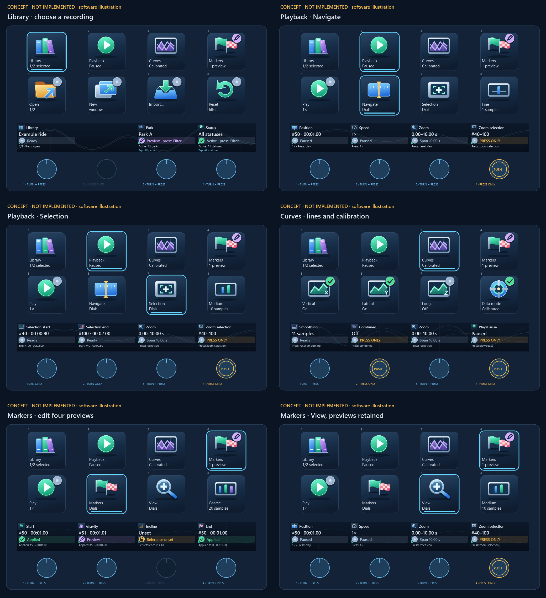

# Stream Deck integration

<!-- cspell:words Elgato streamdeck -->

## Current status

- Implemented: local transport, application routing, versioned plugin, Plus/Neo
  profiles and limited Mobile preview, keys, Plus dials/touch and Neo InfoBar.
- Verified on Windows: automated application/plugin checks, official plugin
  validation, native plugin startup/Analyzer connection and Plus profile import.
- Open: physical Plus operation, native Neo/Mobile import and operation, and all
  native macOS integration checks.
- Distribution: self-contained development folder, three profile archives and an
  officially packed `.streamDeckPlugin` with a separate release checksum. Native
  archive installation remains open.

## Scope and constraints

- Optional control of the current Analyzer Explorer; application processing stays
  offline and independent of Stream Deck. Original recordings remain read-only.
- Reuse existing GUI/service actions, validation, analysis and Library persistence.
  No keyboard simulation, separate force calculations or phone-facing Analyzer service.
- Stream Deck 7.6+ with the official TypeScript SDK and Stream Deck's Node.js runtime.
  Dependencies are locked in the [workspace manifest](../../plugins/stream-deck/package.json)
  and [npm lockfile](../../package-lock.json).
- Manifest platforms: Windows and macOS 15+. Both use the same JavaScript bundle;
  macOS installation, connection, focus handling and device operation are unverified.
- **Enable Stream Deck** defaults to off. Save persists/applies the setting; Cancel
  leaves it unchanged. Startup respects it; disable/shutdown stops the server and
  removes its owned discovery file.
- Plugin versioning is independent of the application and control protocol.
  Development commits share one upcoming version. Changed code/packaged data require
  an increase over the preceding release tag; builds also check package/manifest/lock
  consistency. Documentation/tests alone and app-only releases need no increase.
  See the [version workflow](../../plugins/stream-deck/README.md#independent-plugin-version).
- Export controls, an explicit target-window selector and other device models are
  outside this implementation. Marketplace publication is outside current delivery.

## Model support

| Device             | Prepared controls                          | Native acceptance                                 |
| ------------------ | ------------------------------------------ | ------------------------------------------------- |
| Stream Deck +      | 2×4 keys, four push dials, touch strip     | Windows import verified; physical operation open  |
| Stream Deck Neo    | 2×4 keys, InfoBar, two native Touch Points | Import and physical operation open                |
| Stream Deck Mobile | Reduced 2×3 key preview                    | Import, pairing and phone operation open          |

[User guide](../user/STREAM_DECK.md) and [profile illustrations](../images/README.md)
show the generated assignments. Images are software examples, not hardware evidence.

## Integration and command contract

- Separate connections: plugin ↔ Stream Deck SDK; plugin ↔ Analyzer loopback WebSocket.
- Discovery/authentication version 1; application protocol version 3. Strict typed
  messages identify the target window, recording and generation. Incompatible or
  stale-target commands are rejected rather than redirected.
- Use the active Explorer; never select an arbitrary window or activate Analyzer
  implicitly. Block application commands during background operation, text/number
  editing, open dropdowns/dialogs, missing data or conflicting analysis.
- Native folders, Home, app/website actions and local Step size remain independent
  of Analyzer command availability.
- Feedback follows confirmed GUI/service state. A press or transport acknowledgement
  must not imply that a toggle changed or marker analysis was adopted.
- Disconnect clears actionable/pending state; reconnect requires a fresh snapshot.
  Never queue/replay disconnected commands. Preserve the separate file-open transport.
- Coalesce playback feedback and reuse existing analysis services.

Detailed ownership and wire contracts remain in
[building blocks](../architecture/05_building_block_view.md),
[transport](../architecture/06_runtime_view.md#stream-deck-transport) and
[control contract](../architecture/06_runtime_view.md#stream-deck-control-contract).

## Device controls

### Menu structure

- Plus/Neo Start: native Start app, Library, Explorer and Website actions.
- Plus Explorer: Playback, Curves, Markers and Selection.
- Neo Explorer: Playback, Curves and Markers. Playback adds Position, Smoothing
  and Speed folders; Markers opens the four individual key editors.
- Neo native main pages: Start and Quick controls. Its Touch Points select the
  previous/next native page; the InfoBar action receives no input events.
- Mobile Start: Start app, Library, Playback and Website. Playback opens View.
- Back is key 1 in every folder. Neo Home is key 8 and returns the invoking
  device to Start. Neo Quick controls uses Start-return actions for Back/Home.
  Plus and Mobile deliberately have no Home key.
- Number keys left to right, top row first. Menu changes never apply a marker
  preview or switch the target Explorer.
- Start app uses Elgato Open with the packaged app icon and a user-configured
  desktop EXE/shortcut or Mac `.app`. Website uses Elgato Website, the project URL
  and the bundled globe icon. Neither action requires an Analyzer connection.

### Library navigation

- Plus dial 1: one visible entry per notch; press opens it. Neo/Mobile use
  Previous, Next and Open keys. Import opens the existing file-import dialog.
- Follow visible sorting/filtering and skip hidden entries. Wrap in both
  directions; a single entry stays selected, an empty list cannot be opened.
- Rotation/browsing changes selection only. Open uses the current Explorer and
  never creates another window. The separate New window key opens the selection
  in an additional Explorer through the existing Library action; the current
  Explorer stays unchanged. An already open/loading recording activates its existing
  window instead, without reloading or changing its view. It requires a selection
  and obeys the same locks.
- Library stepping always uses one entry, independent of Step size.
- Keys show short action names and selected index/count. Plus touch/Neo InfoBar
  show the selected name; full names remain available in the Analyzer Library.

### Stepping and playback

- Plus Step size is per device, defaults to fine after plugin startup and survives
  menu changes. Key 6 cycles Position, Selection and marker dials through 1/10/20/1
  source samples per notch. Labels/icons are Fine (one bar), Medium (two), Coarse
  (three); key and touch fields show the current size. Library is unaffected.
- Neo Position/marker editors expose fixed −10/+10 and −1/+1 keys. Mobile exposes
  only −1/+1 position steps.
- Position, Selection and marker adjustments clamp to valid bounds; only Library
  navigation wraps. Display sample index and existing replay-time labels.
- Manual position changes and marker previews pause playback. Apply/Discard do not
  resume it. Play resumes it; view/curve/selection/speed changes leave it running.
- Smoothing moves through existing odd windows 1–51, stops at both ends and resets
  to 11. Raw mode retains unfiltered source values and disables smoothing.
- Speed uses existing playback settings; reset returns to 1×. Zoom/reset reuse
  existing chart navigation.

### Plus profile

Back occupies key 1 in submenus; no Home key is assigned. Blank positions are unassigned. No duplicate
keys/editors for dial functions, except the dedicated Play/Pause and Library Open keys.

| Page      | Other assigned keys                          | Dials, left to right                  |
| --------- | -------------------------------------------- | ------------------------------------- |
| Start     | 1–4 menus; 5–8 Library actions               | 1 Browse/Open                         |
| Library   | 5 Open; 6 New; 7 Import; 8 Reset filters     | 1 Browse/Open                         |
| Explorer  | 2 Playback; 3 Curves; 6 Markers; 7 Selection | None                                  |
| Playback  | 5 Play/Pause; 6 Step size                    | 1 Position; 2 View; 3 Speed; 4 unused |
| Curves    | 2/3/4 directions; 5 Data mode; 7 Combined    | 1 Smoothing                           |
| Selection | 5 Zoom to selection; 6 Step size             | 1 Selection Start; 2 Selection End    |
| Markers   | 6 Step size                                  | 1 Start; 2 Gravity; 3 Incline; 4 End  |

Position press toggles playback; View press resets the view; Speed press resets
to 1×; Smoothing press resets to 11. Selection press/touch are unassigned.
Marker press/touch follow the [marker contract](#plus-marker-page).
Start and Library share the bottom-row order Open, New window, Import, Reset filters.
Reset filters invokes the existing park/status/search reset, also for empty results,
without opening a recording or changing manual workflow status.

### Selection bounds

- Adjust the inclusive Inspector Select range immediately, independently of ride
  Start/End markers. Start clamps between zero and End; End between Start and the
  last source sample. No wraparound or preview/apply phase.
- GUI changes and recording/target changes publish current bounds.
- No replay seek, pause, analysis recalculation or Library marker write. Existing
  selection-based views/exports use the same GUI range.

### Plus marker page

| Dial | Marker  | Admitted samples                                      |
| ---- | ------- | ----------------------------------------------------- |
| 1    | Start   | Zero through effective End                            |
| 2    | Gravity | Any valid source sample, independent of ride bounds   |
| 3    | Incline | Any valid source sample, independent of ride bounds   |
| 4    | End     | Effective Start through last source sample            |

- Rotate: preview only that marker. Press: apply only its preview. Touch: discard
  only its preview and restore the applied value. Other previews remain untouched.
- Preserve previews across menus; discard them on recording/target changes.
  Never apply a preview to a different recording/window.
- Only successful analysis adoption atomically persists current Library marker
  choices. Concurrent confirmations must not overwrite newer adopted state.
- Show each marker preview in the Explorer chart as a dotted, theme-coloured line
  with an explicit preview label, alongside the unchanged applied marker.
  Discard/apply and recording/target changes remove the corresponding preview.
- Show preview/pending/failed values separately from the last applied value.
  Unsuccessful or interrupted adoption must not appear applied.
- Unset calibration references require initial placement through the GUI. There
  is no device action for initial placement or resetting markers to source values.
- Applied Start/End changes use existing viewport/replay-label behavior. Follow the
  [Explorer marker contract](../implementation/RAW_EXPLORER.md#time-zoom-and-selection).

### Proposed Plus navigation — concept

**Status: proposed; not implemented or physically verified.** This replaces only
Plus navigation if accepted. Current assignments above, Neo/Mobile profiles and
installed user profiles remain unchanged. These images are design illustrations,
not screenshots of an implemented profile or evidence of hardware usability.

#### Workflow and fixed menu row

Use **Library → Playback → Curves → Markers**, then **Playback → Selection**
when choosing an export interval. Four top-row keys stay in the same positions
in every view. Explorer is the controlled application window, so an extra Explorer
landing page is unnecessary. Start app, Website, Back and Home are omitted.

| Key | Group    | App status in the second caption line                                      |
|-----|----------|----------------------------------------------------------------------------|
| 1   | Library  | Selected visible index/count; no implicit recording open                   |
| 2   | Playback | Playing or Paused                                                          |
| 3   | Curves   | Actual Raw or Calibrated mode                                              |
| 4   | Markers  | Failed, then Pending, then outstanding preview count; otherwise No preview |

A cyan outline/underline identifies the visible group and active dial subgroup.
It is a **local navigation selection**, not an application-success indicator.
Marker warnings remain visible on key 4 while visiting another group. Selecting a
menu changes only device controls; it never changes the recording, playback,
analysis, selection or saved markers.

#### Context row: keys 5–8

| Group / view         | 5               | 6                       | 7                        | 8              |
|----------------------|-----------------|-------------------------|--------------------------|----------------|
| Library              | Open            | New window              | Import                   | Reset filters  |
| Playback / Navigate  | Play/Pause      | Navigate — selected     | Selection — switch dials | Step size      |
| Playback / Selection | Play/Pause      | Navigate — switch dials | Selection — selected     | Step size      |
| Curves               | Vertical On/Off | Lateral On/Off          | Longitudinal On/Off      | Raw/Calibrated |
| Markers / Markers    | Play/Pause      | Markers — selected      | View — switch dials      | Step size      |
| Markers / View       | Play/Pause      | Markers — switch dials  | View — selected          | Step size      |

Keys 6/7 select mutually exclusive dial groups on Playback and Markers; they are
not action buttons. Key 5 remains Play/Pause and key 8 remains the shared step-size
cycle on both groups. This gives inspection and marker work the same lower-row
pattern. Curves reserves the row for its four most frequent display toggles.
Direction captions follow the current Explorer's curve labels, including raw-axis
labels in Raw mode; the illustrations show calibrated direction names.

Enter Library initially. The initial Playback subgroup is Navigate, and the
initial Markers subgroup is Markers. Remember the last subgroup for each group
on this Plus for the current plugin session; pressing an already selected group
or subgroup does nothing. No hidden long press, double press or extra menu level.

#### Dials and aligned touch fields

Number dials left to right. Every field describes the control directly below it.
For ordinary dials, show the current value, meaningful availability and press
function. **Zoom stays on dial 3** across Navigate, Selection, Curves and Markers/View.
The four-marker group retains its established Start/Gravity/Incline/End order.

| View                 | Dial 1                            | Dial 2                          | Dial 3                       | Dial 4                      |
|----------------------|-----------------------------------|---------------------------------|------------------------------|-----------------------------|
| Library              | Browse; press Open                | Unassigned                      | Park choice; press Filter    | Status choice; press Filter |
| Playback / Navigate  | Position; press Play/Pause        | Speed; press 1×                 | Zoom; press Reset view       | Press only: Zoom selection  |
| Playback / Selection | Selection Start; press unassigned | Selection End; press unassigned | Zoom; press Reset view       | Press only: Zoom selection  |
| Curves               | Smoothing; press Reset to 11      | Press only: Combined On/Off     | Zoom; press Reset view       | Press only: Play/Pause      |
| Markers / Markers    | Start preview; press Apply        | Gravity preview; press Apply    | Incline preview; press Apply | End preview; press Apply    |
| Markers / View       | Position; press Play/Pause        | Speed; press 1×                 | Zoom; press Reset view       | Press only: Zoom selection  |

**Press-only overflow:** an unused rotation can carry one existing action, shown
persistently in its touch field with function, current state and **PRESS ONLY**.
A double-ring illustration identifies it in the concept. Turning or touching that
field does nothing. Combined is Off/On; Play/Pause shows the actual play state;
Zoom selection shows the current Select interval. Library leaves dial 2 empty;
dials 3/4 select its existing Park/Status filters.
Dial 2 has no input function or alert. A display-only encoder assignment may render
its background tile so the panorama continues across this otherwise empty field.

**Library filters:** turning chooses a proposed value; pressing **Filter** applies
only that filter. Show the proposed value and the separate active value in its
touch field. Use the same options and order as the application dropdowns, including
All parks, Unknown park and All statuses. Stop at either end of the option list;
recording browsing on dial 1 remains cyclic and always moves one visible entry.
Each filter notch selects one option, independently of Fine/Medium/Coarse.
Park and Status combine with each other and the existing search. Applying a filter
updates the shared Library view without opening a recording or changing its manual
workflow status. Filter controls remain available when no recordings match.
Tapping the Park touch field immediately applies **All parks**; tapping Status
immediately applies **All statuses**, without an additional dial press. Each tap
also clears that filter's proposal and preserves the other filter and search.
Show this reset action in the corresponding touch field.

Show a value as active only after application confirmation. GUI changes synchronize
the corresponding field and discard its stale proposal; leaving Library discards
unapplied filter proposals. Reset filters clears park/status/search and both
proposals. Recording/target changes and connection loss also discard proposals;
never carry a proposed filter into another Explorer. Existing focus, dialog,
background and connection locks also apply.

Marker rotation creates only that marker's preview. Press applies it; touch
discards only that preview. Apart from Park/Status resets, other touch fields have
no new touch action. Step size
is shared across Position, Selection and Markers: Fine/Medium/Coarse means
1/10/20 samples. Library remains one entry; smoothing, zoom and speed retain their
existing increments. Views in the images deliberately demonstrate different
example step sizes; the real device would share a single current size.

#### Individual view illustrations

| View                 | Purpose                                                               | Illustration                                                      |
|----------------------|-----------------------------------------------------------------------|-------------------------------------------------------------------|
| Library              | Choose/import recordings; Park/Status filters beside the browse dial  | [Library](../images/stream-deck-plus-concept-library.png)         |
| Playback / Navigate  | Inspect time, speed and zoom without leaving playback                 | [Navigate](../images/stream-deck-plus-concept-playback.png)       |
| Playback / Selection | Adjust interval bounds next to zoom; press dial 4 to frame it         | [Selection](../images/stream-deck-plus-concept-selection.png)     |
| Curves               | Three force toggles and data mode together; Combined beside Smoothing | [Curves](../images/stream-deck-plus-concept-curves.png)           |
| Markers / Markers    | See/edit all four previews together; commit or discard independently  | [Markers](../images/stream-deck-plus-concept-markers.png)         |
| Markers / View       | Inspect another position or zoom while retaining marker previews      | [Marker view](../images/stream-deck-plus-concept-marker-view.png) |

#### State feedback and locks

Use a quiet, static touch-strip panorama for the selected menu: coaster rails for
Library, a track with a time scale for Playback, force-like curves for Curves and
reference guides for Markers. Subgroups keep their parent menu's background.
Use low-contrast blue-gray artwork, with a continuous dark translucent layer behind content;
text and status bands remain prominent. Decorative motifs carry no live data,
availability or success meaning, and do not use reserved status colors. The four
dial regions share one coordinated 800×100 design.

[Background examples](../images/stream-deck-plus-concept-backgrounds.png) show the
motifs without controls; the view illustrations show their subdued content overlay.

Touch fields use a separate, full-width status band with a large standalone symbol
and explicit state text. Do not shrink an upper-right status badge together with
the function icon: touch-field function artwork has no embedded badge. The concept
uses a 26-pixel status symbol beside 14-pixel text, a tinted band and matching text
color; color alone never carries meaning. Keep proposed/current values and action
hints outside that band. Show the shared step size on its dedicated key rather
than repeating it in every status line. Illustration coordinates are not native
layout coordinates: each dial has only 200×100 pixels within the 800×100 strip.
Fit and verify all text, status and touch hints at that actual size, including the
five Library lines. Physical legibility remains open.

| Information                                           | Visible feedback                                             | What it confirms                                         |
|-------------------------------------------------------|--------------------------------------------------------------|----------------------------------------------------------|
| Selected group / dial subgroup                        | Cyan frame and underline                                     | The device page that actually appeared                   |
| Curve or Combined On/Off                              | Green check / gray dot and explicit text                     | Confirmed application toggle state                       |
| Fine / Medium / Coarse                                | One/two/three-bar icon and 1/10/20 samples                   | Device-local step size, independent of connection        |
| Marker preview                                        | Violet Preview, preview value and separate Applied value     | Proposed value only; no saved change                     |
| Marker apply in progress                              | Blue Pending/clock; Applied value retained                   | Analysis has started, not completed                      |
| Marker apply failed                                   | Red Failed; previous Applied value retained                  | No successful replacement; group key 4 keeps the warning |
| Marker applied                                        | Green Applied and adopted value                              | Application analysis adoption succeeded                  |
| Library filter choice                                 | Violet Preview; separate Active value; press Filter          | Proposed option only until application confirmation      |
| Input focus, dialog, background, busy or missing data | Amber lock/reason; app actions disabled                      | Existing application availability rules                  |
| Disconnected                                          | Gray disconnected symbol, Offline and cleared program values | No actionable snapshot; no replay on reconnect           |

[Mixed marker feedback](../images/stream-deck-plus-concept-feedback.png),
[input-focus lock](../images/stream-deck-plus-concept-locked.png) and
[offline Library](../images/stream-deck-plus-concept-offline.png) illustrate these
cases. Menus, subgroup selection and the local step cycle remain usable while
app actions are locked. No command is queued for later execution. A click or
sent command never fabricates an applied value or a manual workflow status.

Recording/target changes clear marker previews. Switching groups or between
Markers and View retains them. Changing the step size also retains them. Open
uses the addressed Explorer; New window activates the existing recording window
when already open. Reset filters clears park/status/search without loading data.
Source bytes, stored dates, metadata, manual workflow and exports are unaffected
by device navigation.

#### Feasibility and remaining validation

Use **six native main pages**, not nested folders: Library, Playback/Navigate,
Playback/Selection, Curves, Markers/Markers and Markers/View. Each page repeats
the same top menu. This avoids Stream Deck's forced folder Back on key 1.
The installed SDK exposes page-index selection through
`switchToProfile(deviceId, profile, page)` for bundled profiles; the existing Home
action already uses this API. Page indices start at zero; the promise confirms
only that the request was sent. The SDK cannot address arbitrary user-defined
profiles. Verify native import and switching when older copies of the bundled
profile exist before relying on profile-name resolution. The proposed actions need
implementation. Highlight only the page confirmed by its appearance event, not
merely a switch request. Preserve all user profiles.

Most controls remap existing commands. Park/Status dials additionally require
filter-option/current-value feedback and commands using the existing Library
filter setters; do not duplicate filtering logic or hard-code the option lists.
Device navigation and push-only bindings also need implementation. Native import,
page switching/last-subgroup recall, menu highlighting, filter choice/application,
push-only discoverability and all locks still require physical Plus acceptance.
The screen designs establish visual consistency, not proven operating speed.

#### Plus redesign implementation stages

All stages are **Planned**. Implement them in order on this feature branch, reusing
the existing plugin, profile builder, application actions and screenshot generator.
Complete and validate the application contract and its matching TypeScript consumer
first; existing controls use that contract before the new pages and dial bindings
are introduced.
The assignments above define scope; these stages do not introduce more controls.
Neo/Mobile keep their current layouts and behavior. Shared protocol consumers must
still accept the updated contract. Keep plugin version **0.2.1 / 0.2.1.0** throughout
this development unless a release changes the version baseline.

1. **PLUS-01 — Library filter contract and application routing**
   - **Status:** Planned.
   - **Implementation:** Extend `LibraryState` with Park/Status options, display
     labels and confirmed current values in dropdown order. Preserve null for All
     and the empty park string for Unknown park; identify choices by value, not
     index or translated label. Add one typed filter-set command selecting Park or
     Status, validate against current choices and invoke the existing filter setter.
     Publish both dropdown changes and option-list changes, including changes that
     leave the visible count unchanged. Update Python/TypeScript models, decoder,
     action availability and shared examples together; advance application protocol
     3 to 4 once, with discovery/authentication unchanged at 1.
   - **Acceptance:** Contract and grouped application/UI tests reject invalid values,
     coercions, incompatible versions and stale targets. Applying one filter retains
     the other and search, synchronizes existing shared Library views, opens nothing
     and leaves manual workflow state unchanged. Empty results still allow filters
     and Reset filters. GUI edits publish correct options/current values. Existing
     plugin controls remain usable with the updated contract and current layouts.

2. **PLUS-02 — Native pages and fixed navigation**
   - **Status:** Planned.
   - **Implementation:** Extend `build-profiles.mjs` and the existing SDK action
     registration with a Plus-only navigation action. Define native page indices
     0 Library, 1 Playback/Navigate, 2 Playback/Selection, 3 Curves,
     4 Markers/Markers and 5 Markers/View. Repeat keys 1–4 on every page; keys 6/7
     switch the two Playback/Markers subgroups. Start on Library, remember subgroups
     per device for the plugin session and confirm selection through appearance
     events, including native swipes. Retain Neo's existing Home action.
   - **Acceptance:** Generated profile tests verify all six reachable main pages,
     fixed menu positions and no Plus Back/Home/App/Website assignments. SDK-host
     tests cover device isolation, repeated selection and failed page requests.
     A native Plus import/switch check must resolve the bundled-profile/copy
     limitation without replacing user profiles. Unobserved native behavior stays open.

3. **PLUS-03 — Context keys and existing dial functions**
   - **Status:** Planned.
   - **Implementation:** Map each context row and dial group exactly as specified
     above using `device-controls.ts`, `dial-action.ts` and existing command/feedback
     helpers. Add press-only bindings for Zoom selection, Combined and Play/Pause;
     ignore their rotation/touch. Keep Library dial 2 input-free. Use the existing
     shared 1/10/20 step size and publish the actual curve/mode/playback state.
     Menu captions show the current Library selection/count and playback/data mode;
     the Markers key keeps the Failed/Pending/preview priority across all pages.
   - **Acceptance:** Focused plugin tests cover every key/gesture mapping, command
     availability for press-only controls and no commands/alerts from unused gestures.
     Library stays at one entry; Position/Selection/Markers use the chosen step;
     smoothing and bounds clamp. Marker order, apply/discard, unset-reference rules
     and previews across menu changes retain their existing semantics.

4. **PLUS-04 — Filter dial choices, confirmation and touch reset**
   - **Status:** Planned.
   - **Implementation:** Bind Park to dial 3 and Status to dial 4. Keep bounded,
     device-local proposals from the received options; rotation sends no filter
     command. Press applies that choice; touch immediately requests All for that
     field. Render proposed and confirmed values separately. Apply the documented
     proposal reset rules on GUI/options, page, target and connection changes;
     Reset filters discards both proposals and reuses the existing reset command.
   - **Acceptance:** Plugin tests cover individual/multiple notches, both endpoints,
     All/Unknown park, all workflow choices and long labels. A press/touch affects
     only its filter; failures do not fabricate confirmation. Test empty/single-entry
     results, GUI updates, removed options, locks, disconnect/reconnect and independent
     device proposals. No proposal or command is replayed into another target.

5. **PLUS-05 — Native touch-strip layout, status and backgrounds**
   - **Status:** Planned.
   - **Implementation:** Adapt `devices/layouts/plus.json` and Plus feedback to real
     200×100 fields. Separate function artwork from large status symbols/text bands;
     keep values, adopted values and action hints readable. Put the approved menu
     motifs into plugin assets as four coordinated background tiles per menu,
     including the display-only Library tile. Subgroups share their menu's artwork.
     Use existing graphics helpers; move rendering out of temporary concept scripts
     into the existing production/reference flow.
   - **Acceptance:** Layout/feedback tests and native-size illustrations cover every
     view, Preview/Pending/Failed/Applied, missing references, locks, no Explorer,
     no recording and offline states. Values and status meanings come from confirmed
     state; no embedded tiny status badges or decoration masquerading as live data.
     Verify five-line Library fit, long-value elision and continuous backgrounds;
     physical readability remains open until observed on Plus.

6. **PLUS-06 — Integrated Windows and Plus acceptance**
   - **Status:** Planned.
   - **Implementation:** Exercise the complete existing workflow after the final
     bindings, filter contract and visuals are connected. Add regressions for actual
     failures and run affected Windows lint/type, app, plugin and reference checks;
     reuse valid unchanged evidence. Keep application/UI tests in their domain and
     SDK/profile/reference tests in the plugin workspace; use the existing transport
     interoperability test only where affected. Reuse grouped application fixtures.
   - **Acceptance:** Native logs confirm actual plugin start/connection. Physical
     Plus observation covers menus/swipes, all active keys/dials/touches, filters,
     overflow discoverability, bounds, locks, recording/window changes and recovery.
     GUI changes reach the device; proposals retain/discard correctly; no unconfirmed
     success or replay appears. Record software and hardware results separately;
     untested observations remain open and do not make this stage complete.

7. **PLUS-07 — Current documentation and profile handover**
   - **Status:** Planned.
   - **Implementation:** Update current Plus assignments and verification status in
     this requirement, relevant runtime contracts, the plugin README and end-user
     guide. Consolidate superseded concept/current descriptions when implemented.
     Generate the actual six-page Plus illustrations and README close-up with the
     existing screenshot workflow; update the image guide and relevant captions.
     Keep user guidance operational and development details in developer documents.
     Describe importing the updated Plus profile while retaining existing profiles.
   - **Acceptance:** Final documentation/link checks pass; image metadata and labels
     match the built profile, and Neo/Mobile behavior stays unchanged. Requirements
     distinguish implemented software from open hardware acceptance. Review all stage
     criteria before marking completion. This plan authorizes neither Git delivery
     nor a release; those remain separately requested operations.

### Neo profile

Back/Home occupy keys 1/8 in submenus. Start matches Plus; Quick controls is a
second native main page. No dials or custom Touch Point command handlers.

| Page                  | Other assigned keys                                                 |
| --------------------- | ------------------------------------------------------------------- |
| Quick controls        | 2 Play; 3/4 Zoom −/+; 5 Reset view; 6 Zoom selection; 7 Reset speed |
| Library               | 2 Previous; 3 Next; 4 Open; 5 Import                                |
| Explorer              | 2 Playback; 3 Curves; 6 Markers                                     |
| Playback              | 2 Play; 3 Smoothing; 6 Position; 7 Speed                            |
| Position              | 2/3 −10/+10; 6/7 −1/+1                                              |
| Smoothing / Speed     | 3 Reset; 6/7 −/+                                                    |
| Curves                | 2/3/4 directions; 5 Data mode; 6 Combined; 7 Reset view             |
| Markers               | 2 Start; 3 Gravity; 6 Incline; 7 End                                |
| Individual marker     | 2/3 −10/+10; 4 Apply; 5 Discard; 6/7 −1/+1                          |

Marker editors use the same bounds, preview lifecycle and persistence as Plus.
InfoBar feedback is contextual: Library name/index, playback position/state/speed,
curve visibility, smoothing or markers. A marker editor separates name/state,
preview/adopted position and last applied value across three lines. Disconnect
clears program values; native paging remains separate from feedback.

### Limited Mobile preview

Four six-key pages designed for landscape, three columns and two rows; no Home, dials or InfoBar.
Back is key 1 in folders. Pairing is handled by Stream Deck; the Analyzer keeps
its existing desktop loopback interface. Full Mobile hardware acceptance remains open.

| Page     | Key 1     | Key 2    | Key 3      | Key 4      | Key 5          | Key 6      |
| -------- | --------- | -------- | ---------- | ---------- | -------------- | ---------- |
| Start    | Start app | Library  | Playback   | Website    | Unassigned     | Unassigned |
| Library  | Back      | Previous | Next       | Import     | Open           | New window |
| Playback | Back      | Play     | View       | −1 sample  | +1 sample      | Reset view |
| View     | Back      | Zoom −   | Zoom +     | Reset view | Zoom selection | Play       |

Recommend landscape with Mobile layout orientation set to None or Fixed so the
3×2 grid keeps native Back at the top left. This is a user setting, not a profile
orientation lock. No separate portrait profile is provided.

No curve/smoothing/speed editors, markers or manual selection-boundary editing.

## Feedback and assets

- Use shared filled/color function artwork and separate badges for inactive,
  active, preview, pending, failed, unavailable and disconnected states.
- Drive toggles from confirmed snapshots; disable automatic key-state toggling.
  Honor native user icon/title overrides. Encode runtime SVG image data.
- Key captions: at most two lines of eleven characters. Use action labels rather
  than recording names on Library keys. Elide long variable labels within bounds.
- Plus fields retain actual values/mode, selected name/count, viewport span,
  smoothing or speed. Marker fields retain adopted values beside proposed state.
- Neo InfoBar is display-only. All text fields elide overflow; unavailable values
  and disconnected state must not show fabricated/current-looking data.
- Assets are bundled; runtime operation requires no image download. White-only
  graphics apply to action-list/category icons, not device displays.

| Asset                     | Contract                                        |
| ------------------------- | ----------------------------------------------- |
| Key / dial preview        | SVG or PNG 72×72 and 144×144                    |
| Action-list / category    | White transparent SVG/PNG; 20×20 / 28×28        |
| Plugin preferences        | PNG 256×256 and 512×512                         |
| Plus field / Neo InfoBar  | JSON layouts bounded to 200×100 / 232×50        |

[Generated profiles](../../plugins/stream-deck/scripts/build-profiles.mjs),
[feedback](../../plugins/stream-deck/src/feedback.ts) and
[layouts](../../plugins/stream-deck/devices/layouts) define the current device data.

## Implementation steps

**Implemented** means code and automated Windows checks exist; it does not imply
physical device or macOS acceptance. **Partial** identifies outstanding delivery
or acceptance work. Native acceptance is tracked explicitly in steps 6 and 12.

1. **Agree scope**
   - **Status:** Complete.
   - **Acceptance:** Devices, actions, target rule and foreground behavior are defined above.

2. **Verify WebSocket transport**
   - **Status:** Implemented; Windows transport acceptance verified.
   - **Acceptance:** Authenticated Qt/Node exchange, limits, access checks and reconnects;
     native macOS exchange remains open.

3. **Define control contract**
   - **Status:** Implemented; shared Python/TypeScript contract checks pass.
   - **Acceptance:** Explicit targets, strict versions/shapes, request results and full
     state snapshots; file-open requests remain independent.

4. **Connect application actions**
   - **Status:** Implemented; automated Windows application acceptance verified.
   - **Acceptance:** Existing GUI/service routing, focus/dialog/background locks,
     target changes, marker adoption/persistence and saved server opt-in lifecycle.

5. **Add Stream Deck plugin**
   - **Status:** Implemented; Windows build, official validation and SDK-host checks pass.
   - **Acceptance:** Bundled runtime, confirmed key feedback, recovery without replay,
     independent version enforcement; macOS is enabled but native checks remain open.

6. **Add device menus and profiles**
   - **Status:** Implemented; native Plus import verified.
   - **Acceptance:** Plus/Neo/Mobile layouts, fixed Back/Home rules, native launch/website
     actions and Neo main pages; native Neo/Mobile import remains open.

7. **Add Library controls**
   - **Status:** Implemented; automated Windows application/SDK checks pass.
   - **Acceptance:** Visible order/filtering, one-entry cyclic stepping, empty/single-entry
     cases, explicit current-window Open, Import and confirmed feedback. Device checks remain open.

8. **Add navigation controls**
   - **Status:** Implemented; automated Windows application/SDK checks pass.
   - **Acceptance:** Plus position/view/speed/smoothing and independent Selection bounds;
     Neo key alternatives and reduced Mobile navigation, clamping, mode and playback rules.

9. **Add Plus marker controls**
   - **Status:** Implemented; automated Windows application/SDK checks pass.
   - **Acceptance:** Start/Gravity/Incline/End order, per-marker preview/apply/discard,
     bounds, lifecycle and adopted-value feedback. Physical dial/touch checks remain open.

10. **Add Neo marker controls**
    - **Status:** Implemented; automated Windows key-handler/profile checks pass.
    - **Acceptance:** Four editors, coarse/fine pairs, Apply/Discard and shared marker
      rules. Native Neo import and physical operation remain open.

11. **Add Neo InfoBar feedback**
    - **Status:** Implemented; automated Windows SDK-host/layout checks pass.
    - **Acceptance:** Contextual confirmed values, separate marker state/adopted value,
      overflow and disconnect handling, no input handlers. Native Neo display checks remain open.

12. **Validate and document**
    - **Status:** Partial.
    - **Verified:** Automated Windows checks, native plugin startup/connection and Plus
      profile import; requirements, user guide and generated profile illustrations exist.
      Windows developer mode is enabled; native SDK logs and the installed plugin's
      established connection to the current Analyzer endpoint confirm its running state.
    - **Open:** Physical Plus keys/dials/touch, Neo import/keys/Touch Points/InfoBar,
      Mobile import/pairing/phone operation, and native macOS integration.
      Available access is Windows remote control without physical device input.
      See the [native acceptance checklist](#native-acceptance-checklist).

13. **Package and release plugin**
    - **Status:** Partial.
    - **Implemented:** Self-contained `.sdPlugin` folder, three bundled profile archives,
      license notices, official offline validation/packing and archive-content checks;
      local link/restart workflow. The [pack command](../../plugins/stream-deck/README.md#installable-archive)
      prepares the `.streamDeckPlugin` release asset without installing or publishing it.
      Release CI retains the tested archive and checksum; the publication job verifies
      and attaches both to the application release.
    - **Open:** Native archive-install/update acceptance.
      Marketplace publication is not part of this step.

## Acceptance gates

- Windows software checks must cover GUI parity, target changes, state feedback,
  locks, fixed stepping/clamping, persistence, analysis adoption and recovery.
- Native logs must confirm SDK startup and Analyzer connection; CLI success alone
  is insufficient. Software preview/configuration clicks are not physical-input evidence.
- Hardware acceptance requires actual observation or user confirmation for each
  device/input type. Software illustrations and SDK mocks cannot establish it.
- Native macOS installation, connection, focus handling and device behavior require
  execution on macOS before verified support can be claimed.
- Public delivery requires a validated installable archive and explicit release
  authorization. Existing user profiles/settings must survive installation/updates;
  changed profile layouts require separate import.

### Native acceptance checklist

Each row requires actual observation or user confirmation on the named device.
The Windows automated checks cover the corresponding software contracts; they
do not close these rows. Preserve existing profiles and original recordings.

| Device / area                    | Required observation                                                                                                                                                                                    | Status |
| -------------------------------- | ------------------------------------------------------------------------------------------------------------------------------------------------------------------------------------------------------- | ------ |
| Plus menus / keys                | Navigate Start, Library, Explorer and submenus; Back is key 1, no Home key; Play/Pause and key alternatives work.                                                                                       | Open   |
| Plus Library                     | Dial follows visible order/filtering, wraps both ways and handles empty/single-entry lists; rotation only selects, press opens in the current Explorer; Import opens the existing dialog.               | Open   |
| Plus navigation / selection      | Position, zoom, speed and smoothing presses work; Step size cycles 1/10/20 samples; Library stays at one entry; smoothing and selection bounds clamp.                                                   | Open   |
| Plus markers                     | Start/Gravity/Incline/End rotate to preview, press to apply and touch to discard independently; bounds and adoption feedback are correct; menus preserve previews, recording/target changes clear them. | Open   |
| Plus feedback / locks / recovery | GUI changes reach the device; text focus, dialogs and background operation block app commands; disconnect/reconnect and Explorer changes clear stale state without replay or false confirmation.        | Open   |
| Neo                              | Import on an actual Neo; verify folder keys/editors, both native Touch Points and contextual InfoBar values, marker states, overflow and disconnected display.                                          | Open   |
| Mobile                           | Pair the phone, select six keys and import on Mobile; verify all four pages, Back without Home, commands, confirmed feedback and reconnection.                                                          | Open   |
| macOS                            | Install/start natively; verify discovery/authentication, app connection, focus/dialog/background locks, recovery and operation of each device claimed as verified.                                      | Open   |

## References

- [User guide](../user/STREAM_DECK.md), [plugin build/install/version workflow](../../plugins/stream-deck/README.md).
- [Transport and control architecture](../architecture/06_runtime_view.md#stream-deck-control-contract).
- [Elgato SDK manifest](https://docs.elgato.com/streamdeck/sdk/references/manifest/),
  [keys](https://docs.elgato.com/streamdeck/sdk/guides/keys/),
  [dials](https://docs.elgato.com/streamdeck/sdk/guides/dials/),
  [Neo InfoBar](https://docs.elgato.com/streamdeck/sdk/guides/neo-infobar/).
- [Native folders](https://help.elgato.com/hc/en-us/articles/360027957912-Elgato-Stream-Deck-Using-Folders),
  [profiles](https://docs.elgato.com/stream-deck/profiles/getting-started/),
  [plugin packaging](https://docs.elgato.com/streamdeck/cli/commands/pack/).
