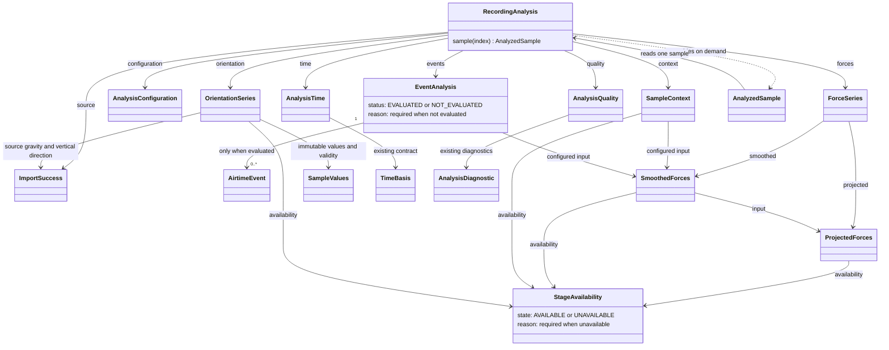
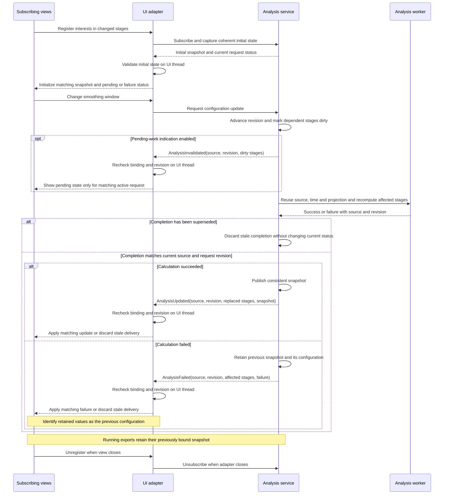

# Unified recording analysis requirements

Status: target requirements with an initial data-model skeleton in
[`analysis.recording`](../../src/ride_forces_analyzer/analysis/recording.py).
Typed frozen containers and explicit structural snapshot validation exist.
Preparation, sample access and reconfiguration raise `NotImplementedError`. The
[`analysis.service`](../../src/ride_forces_analyzer/analysis/service.py) interface
also exists as explicit stubs. Operational subscriptions, cache and
application/export integration remain planned. The skeleton does not
change the current runtime [architecture](../architecture/README.md).

## 1. New data model as a parallel class structure

Introduce a typed, immutable `RecordingAnalysis` model alongside the existing
import, analysis and presentation classes. Reuse existing contracts where suitable;
keep the model independent of Qt, layouts, storage and encoding.

| Model                   | Required contents                                                                                                             |
| :---------------------- | :---------------------------------------------------------------------------------------------------------------------------- |
| `RecordingAnalysis`     | Original import result, configuration, time basis, forces, context, events and quality information                            |
| `AnalysisConfiguration` | Algorithm identities/versions, projection, smoothing and context parameters, declared input stage for each calculation        |
| `AnalysisTime`          | Source sample indices, effective sample rate, recording/replay origin and explicit measured/inferred time provenance          |
| `ForceSeries`           | Calibrated force arrays before and after smoothing, axis names, units and validity                                            |
| `OrientationSeries`     | Source-gravity tilt relative to the stored vertical direction, with independent availability and validity                     |
| `SampleContext`         | Stable vertical-context category per sample, using language-independent identifiers                                           |
| `StageAvailability`     | AVAILABLE/UNAVAILABLE state with an explicit reason when unavailable                                                          |
| `EventAnalysis`         | Evaluation status, event collection and reason when not evaluated                                                             |
| `AirtimeEvent`          | Source start/end indices, duration, minimum vertical force and onset information; explicit event rules and provisional status |
| `AnalysisQuality`       | Capabilities, missing/invalid values, diagnostics and scientific limitations                                                  |
| `AnalyzedSample`        | Immutable view of one sample: index, time, raw values, projected/smoothed forces, context and quality                         |

### Reuse of existing contracts and independent orientation

Compose the new product-facing classes from the existing
[analysis contracts](../development/ANALYSIS_MODELS.md), rather than maintaining
competing representations of time, arrays, quality or provenance:

- `AnalysisTime` reuses `TimeBasis` and source-index contracts; recording/replay
  origins supplement them without changing inferred/verified time semantics.
- Force and orientation payloads reuse `SampleValues` ownership and validity
  contracts, including immutable numerical buffers and explicit missing rows.
- `AnalysisQuality` aggregates existing `AnalysisDiagnostic`, `CapabilityState`
  and channel/unit evidence. `StageAvailability` summarizes payload availability
  without replacing scientific capability states: an available result may still
  be provisional, and INVALID must not become valid merely through adaptation.
- Configuration/provenance reuse `AnalysisProfile`, `AnalysisProvenance` and
  source identity where compatible. Reused stages retain their own algorithm,
  parameters and calculation provenance when a later stage is recalculated.
- `RecordingAnalysis` composes compatible existing `AnalysisResult`/channel
  outputs and the separate source-app projection results. It must not silently
  reinterpret source-app calibrated channels as qualified physical rider-frame
  results or weaken existing validation to fit the new container.

Add `OrientationSeries` as an independent derived stage using the existing
`analysis.orientation.orientation_degrees` contract: tilt in degrees between
source gravity and the stored vertical direction, not yaw or track heading.
Its dependencies are the applicable source data and orientation parameters, not
projected or smoothed force channels. Reuse the same orientation stage when only
force smoothing or context parameters change.

Preserve missing/zero gravity as invalid samples and unavailable prerequisites
as an unavailable stage with a reason. Retain source indexing and documented
alignment without inventing gravity or silently resampling. Include orientation
and its availability in the sample view where a valid source correspondence
exists. UI/export consumers use this prepared stage instead of recalculating
orientation independently.

### Shared stage data and availability

Store numerical values in immutable parallel arrays. All arrays on the force
sample axis must have matching lengths and source-index/time correspondence.
Independent gravity/GPS sequences retain their own indexing; do not implicitly
align or fabricate samples. Expose `analysis.sample(index)` to assemble a sample
view without persistently duplicating the arrays.

Compose `ForceSeries` from separate immutable `ProjectedForces` and
`SmoothedForces` objects. `SmoothedForces` references its input projection and
smoothing parameters; context and events reference their actual input stage and
parameters. Keep quality information and provenance attributable to each stage.
`RecordingAnalysis` assembles references to these results rather than copying
their arrays. A new snapshot may therefore share unchanged stage objects with
the previous snapshot.

Projection, smoothing, orientation and context each carry `StageAvailability` and an optional
payload. AVAILABLE requires a payload; UNAVAILABLE requires an explicit reason
with a stable code and no calculated payload. Missing prerequisites propagate
unavailability to dependent stages with a reason. Do not substitute empty arrays,
zeros or normal-load labels for unavailable results. Within available arrays,
retain per-sample validity separately from whole-stage availability.

Wrap domain events in `EventAnalysis` with explicit EVALUATED/NOT_EVALUATED status:
EVALUATED contains a tuple of events, which may legitimately be empty;
NOT_EVALUATED has no event collection and requires a reason, such as unavailable
input or event rules not yet implemented. An empty evaluated collection means
no events were detected under the stated rules within valid input coverage;
it does not establish absence of events in missing data. Retain input quality
and coverage limitations with the result.

`AnalyzedSample` must expose raw values even when calculated stages are
unavailable, with their availability/reasons instead of fabricated force/context
values. Raw display remains a presentation choice and does not change stage
availability. Keep these result states separate from dirty/pending request state
owned by the service.

`RecordingAnalysis.validate()` checks the complete assembled snapshot explicitly;
constructors still store references without validation. It rejects incompatible
types/mutable collections, inconsistent availability/payload/reason combinations,
wrong channel shapes, mismatched sources/provenance/configuration and stale stage
dependencies. It preserves existing scientific capability states without
certifying numerical calculations or physical interpretation.

The implemented force axis retains every original acceleration index in order,
with scalar buffers and labels of matching length. Replay origin must match the
source start marker; a supplied rate must retain its source value and default/
source provenance. Index-only time may omit a rate. Gravity/GPS keep their original
independent contracts. Missing vertical samples cannot carry valid context or an
event minimum, and zero gravity cannot produce a valid orientation sample.

The proposed classes share immutable stage results through references:

The context/event arrows illustrate the current smoothed-input policy; a different
declared input stage must be reflected in the actual dependencies. Separate
analysis snapshots can reference the same `ProjectedForces` instance while
holding different `SmoothedForces`, context and event results.

Keep original bytes, unknown fields and metadata unchanged. Missing data must
remain distinguishable from valid zero. Context labels and event intervals are
separate results: define event boundaries and treatment of short interruptions
explicitly rather than equating events with contiguous display colors.

### Separate domain contract for airtime events

The model may provide `AirtimeEvent` and `EventAnalysis` before event detection
is implemented. Concrete detection rules require a separate, versioned domain
contract before evaluation is enabled. That contract must define:

- The input force stage, validity requirements, thresholds and event categories.
- Start/end criteria, boundary-index inclusion, duration calculation from the
  declared time basis, and events cut off by recording or selection boundaries.
- Minimum event duration, independently of display-label confirmation times.
- Whether short valid interruptions split or join events, the permitted duration
  and whether such interruptions contribute to the reported event duration.
- How missing/invalid samples terminate or interrupt evaluation, how incomplete
  events and coverage are reported, and how unsupported inference across gaps
  is prevented.
- How minimum force and onset information are calculated and attributed to an
  event, with algorithm/configuration identity and provisional scientific status.

Context hysteresis and label confirmation serve presentation stability; neither
defines a physical event's minimum duration or automatically establishes event
boundaries. Do not derive events solely from contiguous context labels/colors.
Changing only display-label stabilization must not change domain events unless
the separate domain contract explicitly declares that dependency.

This requirement assigns no new numerical thresholds or event rules. Until a
complete rule contract is specified and implemented, return NOT_EVALUATED with
an explicit reason. Continue preparing sample context independently where usable.

## 2. Import integration

Preserve the lossless [import service](../development/IMPORT_SERVICE.md) and its
public success/failure contracts. Keep parsing separate from numerical analysis.
After successful import, an application service prepares one analysis snapshot:

1. Establish the documented time basis and data quality.
2. Apply source-contract axis/unit interpretation and calculate projected forces.
3. Smooth the projected channels using the selected configuration.
4. Calculate sample context from explicitly selected inputs; evaluate temporal
   events only under an implemented domain contract, otherwise report NOT_EVALUATED.
5. Prepare orientation independently from source gravity and vertical direction.
6. Publish the immutable result with source identity and calculation provenance.

Reuse the existing numerical services and their scientific contracts. The new
model must not silently introduce new thresholds, physical interpretations or
filter behavior. Unavailable calibration retains usable raw data with a reason;
a failed import retains the previously opened recording.
An expected unavailable stage still permits a consistent raw-capable snapshot
and `AnalysisUpdated`; it is not itself an `AnalysisFailed` recalculation failure.

Recompute from the earliest affected stage, outside widgets. In particular,
changing the smoothing window must reuse the original import, time basis,
projection and their arrays without copying or recalculating them. Recalculate
smoothed forces from the unchanged projection, never from previously smoothed
values; then recalculate context, events and any other results that depend on
the changed smoothed forces. Results based only on unchanged inputs remain valid.
In particular, retain the existing orientation stage and its arrays unchanged.

Publish a new consistent `RecordingAnalysis` snapshot referencing both reused
and newly calculated stage objects. Never mutate an existing snapshot or combine
new forces with old context/events. Reuse matching stages already retained for
identical inputs and parameters; a context-only parameter change must retain
the force stages. A previously released result may be calculated again if its
configuration is requested later.
Use explicit stage dependencies without introducing a generic cache framework.
The core workflow requires no persistent analysis cache, new recording format or
ride database. Optional database caching is specified separately below.

### Snapshot lifetime and memory ownership

Reuse does not require retaining every configuration or smoothing window ever
requested. The service retains its current completed snapshot, including the
fallback used during pending/failed work, and references needed by active work.
Older snapshots remain alive only while an active consumer, such as a running
export, still needs them. Consumers release snapshot references when replaced,
closed or finished; shared upstream stages remain alive while still referenced.

Do not accumulate historical snapshots in configuration maps, notification
histories or subscriber lists. Queued deliveries release their references after
processing or being discarded, and completed/superseded workers release results
when no longer needed. Normal reference lifetime manages reclamation; no custom
cache eviction framework or permanent configuration history is required.

### Optional database cache

A later implementation may optionally persist completed analysis stages in a
local database such as SQLite. This is a disposable performance optimization,
not a recording library or authoritative source. The application must support
the same offline analysis with caching disabled or unavailable. The optional
cache does not change the in-memory lifetime rules above.

Use the SHA-256 of the complete original file bytes as source identity, not its
path, name or modification time. Source hash alone is insufficient: each stage's
cache key must also identify its algorithm/version, compatible result schema,
effective parameters and input-stage identities. Include effective time/unit/
axis policies where relevant. Use deterministic configuration encoding; exclude
UI revisions, calculation timestamps and presentation-only settings from keys.
For example, changing smoothing may reuse cached projection/orientation stages
while requiring different smoothing/context/event entries.

Read cached results through a storage adapter outside domain models and widgets.
Reattach them only to a successfully imported matching source and validate their
schema, source-index correspondence, units, availability and validity before
constructing the immutable stage models. Preserve original calculation provenance
separately from the current request revision. Publish restored results through
the same consistent snapshot and notification flow as newly calculated results.

Missing, incompatible or invalid entries cause recalculation of the affected
stages. Cache read/write failures must not turn a successful analysis into a
failure; writes publish complete entries atomically. Cache deletion must leave
original recordings and export definitions intact. Before implementation, define
a bounded retention/size policy and a way to clear the cache; do not retain all
historical configurations indefinitely. Store only derived results and necessary
provenance, without copying original recording bytes into the cache.

### Change notifications and subscriptions

The analysis service owns subscriptions and dirty-stage tracking; immutable
data models contain no mutable subscriber lists or Qt signals. Keep technical
change notifications separate from domain events such as `AirtimeEvent`.

`AnalysisService` reserves `get_state`, `subscribe`, `unsubscribe`,
`request_analysis`, `request_configuration`, `request_smoothing` and `close`.
Subscription callbacks accept an initial `AnalysisState` followed by technical
notifications; `AnalysisSubscription` identifies one registration for removal.
Optional stage interests filter notifications while preserving matching terminal
request status. Request methods reserve service-assigned revisions. All these
methods currently raise `NotImplementedError`; no callbacks or calculations run.

- `AnalysisUpdated` is emitted after a new consistent snapshot is published.
  It carries source identity, analysis revision, replaced stages and access to
  the new snapshot. Subscribers refresh only when their inputs are affected.
- `AnalysisInvalidated` is optional for a later implementation that displays
  pending work or temporarily disables actions. It identifies the requested
  revision and dirty stages, including dependent stages. The last completed
  snapshot remains readable; invalidation does not mutate or replace its data.
- `AnalysisFailed` terminates a failed recalculation and carries source identity,
  the requested revision, affected stages and structured failure information.
  Subscribers clear pending state and restore temporarily disabled actions only
  for the matching current request, then present the failure. The previous
  snapshot remains readable with its original configuration and revision clearly
  identified; it must not be presented as satisfying the failed configuration.

A current request must leave pending state through either `AnalysisUpdated` or
`AnalysisFailed`. Failed work publishes no partial snapshot. Failures from
superseded requests must not clear the pending state or replace the displayed
status of a newer request.

Provide explicit methods to subscribe and unsubscribe, including cleanup when a view
closes. Source identity and monotonically increasing request revisions must allow
consumers to reject stale work. A superseded background calculation must not
replace the current result or announce itself as the current `AnalysisUpdated`.
The UI adapter delivers notifications to Qt consumers on the appropriate UI
thread. Keep the service independent of Qt; no general event bus or per-field
notification framework is required.

Subscription must immediately supply a coherent initial state: source identity,
the latest completed snapshot with its own configuration/revision (or explicit
absence), the current request revision and status, and any dirty stages or current
failure. A newly opened view must not wait for the next change notification.
Registering the subscription and capturing this state must be coordinated so no
update is lost between them. Deliver initial state before subsequent notifications
for that subscription, with the same stale-delivery checks as later updates.
A retained older snapshot during pending/failed work remains explicitly identified
as belonging to its previous configuration.

Recheck source identity, request revision and active subscription on the UI thread
when processing each queued delivery, not only when the worker completes or the
notification is queued. Discard deliveries superseded by a newer request, source
switch or closed subscription before changing values, pending state or errors.
An older initial state must not overwrite a newer applied state; a delayed pending
notification must not restore pending state after that same revision has completed.

The proposed notification flow keeps subscriptions in the service and UI-thread
delivery in the adapter. Views represent the chart, context strip, sample cards,
technical details, extrema and an optional following export preview:

## 3. Application output

Make `ExplorerData` a presentation adapter over `RecordingAnalysis`. Charts read
the shared arrays; current-value cards and technical details use the sample view.
The context strip reads prepared categories, and extrema use the same force data
and visible interval. Keep localized text, colors and view state in presentation.

Cursor movement, zoom, appearance and language changes must not recompute the
analysis. Changing smoothing replaces only the affected stages and refreshes
dependent charts, context and extrema from the new consistent snapshot.
Retain existing selections, time notation, raw-mode fallback and provisional
[airtime limits](../implementation/AIRTIME.md). Context stabilization must not
apply an additional filter to numerical graph values.

Potential subscribers for a later implementation are:

- The chart and context strip, refreshing changed force/context stages.
- Current-value cards and technical details, refreshing the selected sample view.
- The visible-range extrema display, recalculating only when its force inputs
  change; viewport changes remain a separate presentation action.
- The export preview, refreshing when its selected source and analysis
  configuration follow the updated workspace snapshot.
- A calculation-status indicator, using optional invalidation notifications to
  show pending work and clearing that state on update or failure only for the
  matching current request.

These subscriptions describe planned consumers, not implemented behavior.

## 4. Export integration

Adapt export preparation and layouts to consume the shared analysis model instead
of deriving their own force/context results from presentation objects. Reuse the
workspace snapshot when source identity and analysis configuration match.
Otherwise reuse compatible upstream stages and prepare only the affected stages
for the requested export configuration. An export already using a snapshot must
remain independent of subsequent workspace smoothing changes.
Running exports must not subscribe to updates that replace their bound snapshot;
only an explicitly following preview may adopt a newer compatible result.
The orientation panel consumes the prepared `OrientationSeries`; force smoothing
changes must not trigger orientation recalculation.

Keep the complete available source history for analysis; apply the selected
export interval afterward. Frame generation samples the prepared result on the
independent video clock. Seeking, frame rate, resolution, layout and language
must not change source-sample classifications or trigger per-frame analysis.

Preserve separate RGBA generation and encoding, transparent/opaque outputs, and
the existing numerical interpolation and context lookup rules. Saved presets and
batch snapshots must identify the required analysis configuration; batches retain
source-path/hash verification. Preset and batch definitions do not contain
recording bytes or analysis arrays. If optional database caching is implemented,
derived arrays belong to separate disposable cache records under its contract.

## 5. Implementation steps

Each step includes focused behavior tests and the configured coverage gate.

1. Model validation, availability states and source/time correspondence: implemented
   through explicit snapshot validation. Constructors do not validate automatically.
2. Prepare projection, independent orientation, smoothing, context and sample views.
3. Implement partial recalculation with shared stages and bounded snapshot lifetime.
4. Implement service state, subscriptions, initial delivery and revision/error handling.
5. Connect import and explorer through the service and UI-thread adapter.
6. Adapt export, previews and batches to consistent shared analysis snapshots.
7. Define the separate event-rule contract, then implement event detection.
8. Optionally add the source/configuration-bound database cache and retention policy.
