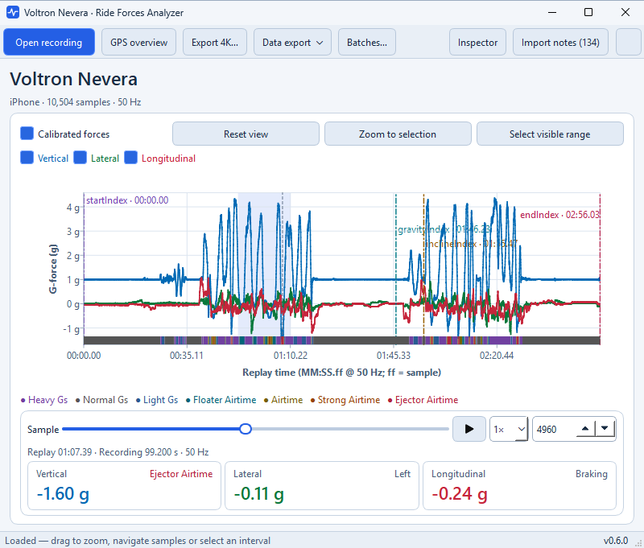
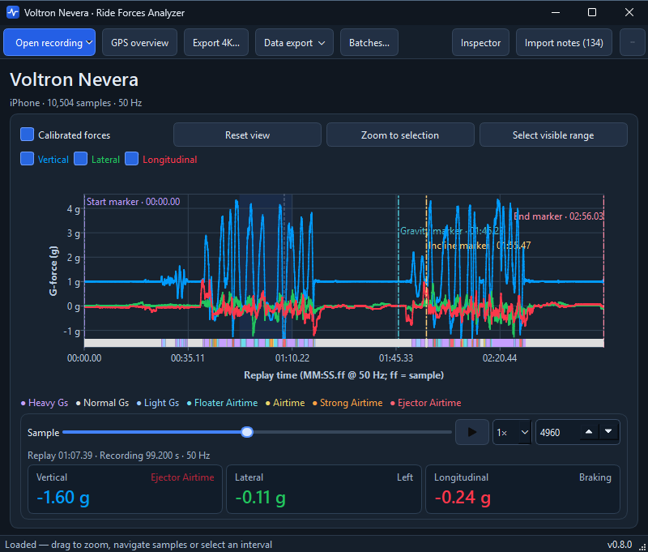
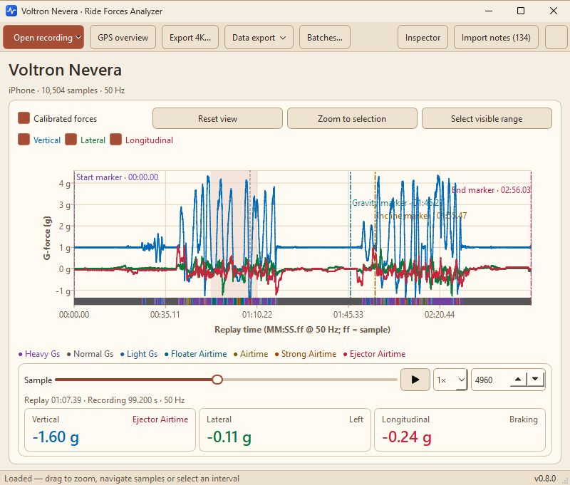
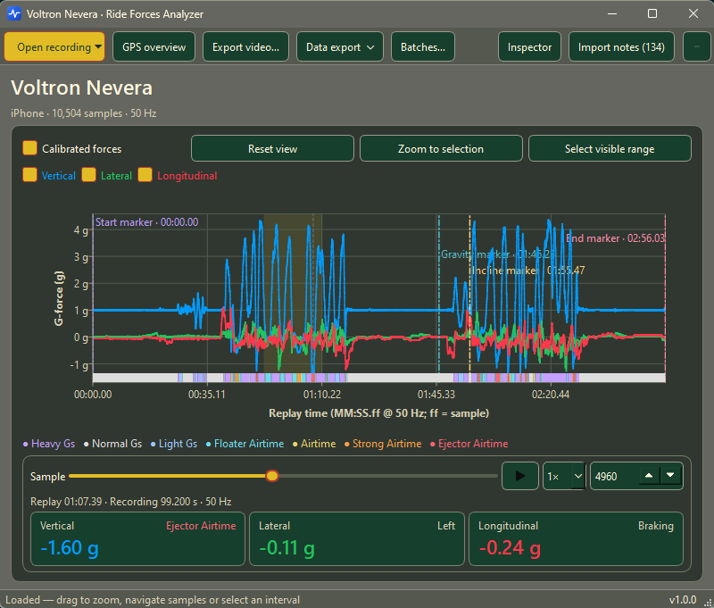
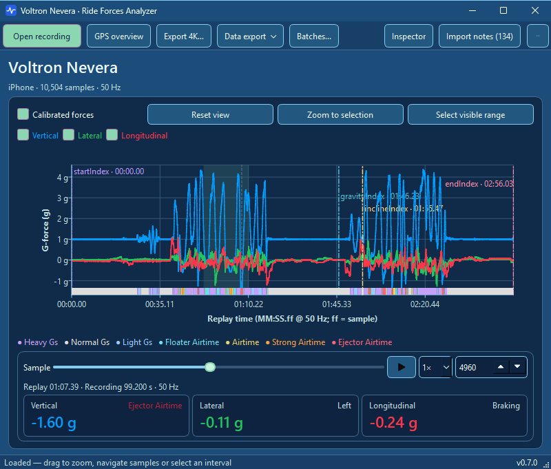
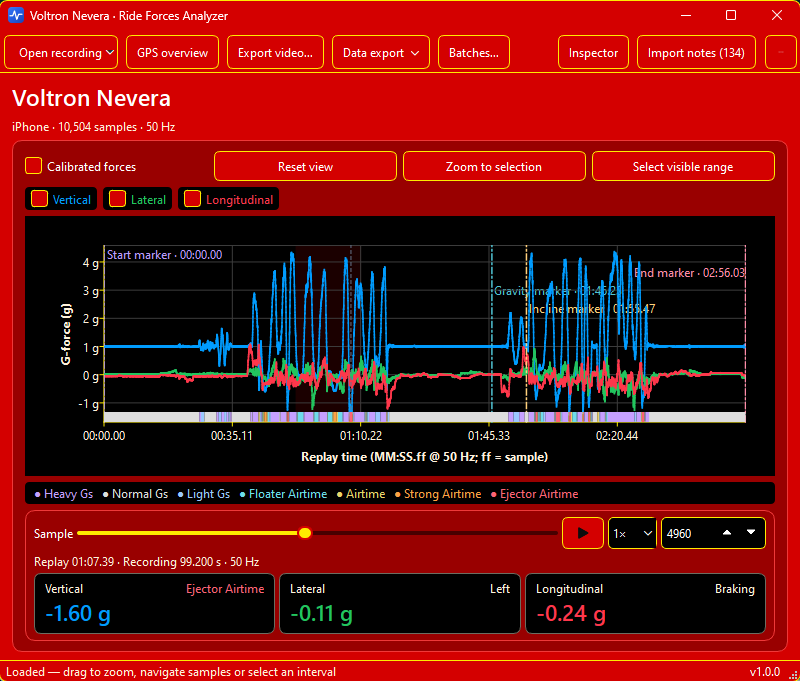
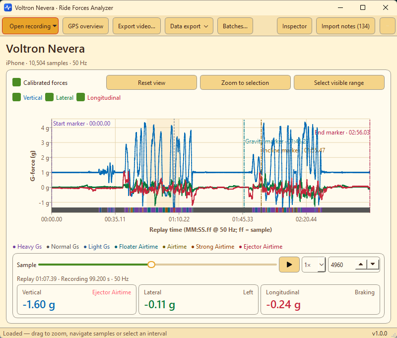
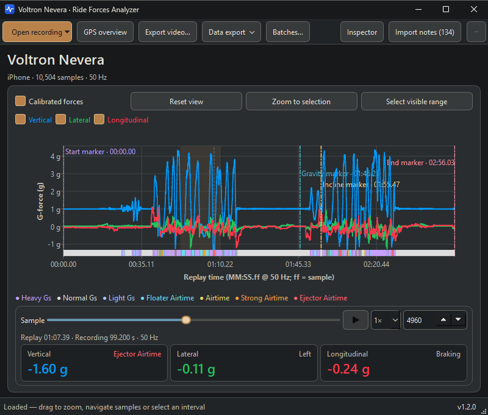
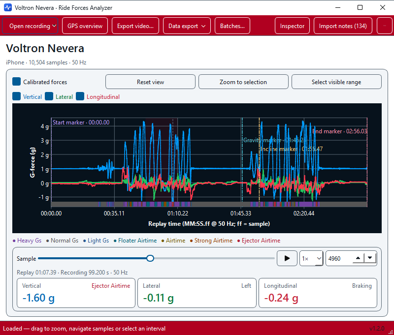
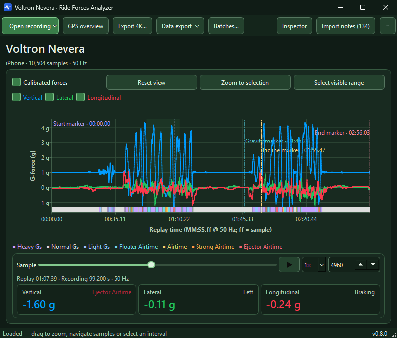

# Choose your appearance

Give your workspace a look you enjoy: a simple light or dark style, natural colors
or a theme inspired by a roller coaster.
The instructions below use the English interface labels.

## Try a theme

1. Open **Settings → Application**.
2. Choose a theme under **Appearance**. The application changes immediately,
   so you can see how your recording looks with it.
3. Try other themes until you find your favorite.
4. Click **Save** to remember your choice for the next launch.

**Cancel**, Escape or closing the settings window brings back your previous theme.
Trying a theme keeps your recording, selection, zoom and smoothing in place.
File-open, save and folder-selection dialogs also follow the chosen theme.

## Find your style

| Theme               | What to expect                                                                                              |
| ------------------- | ----------------------------------------------------------------------------------------------------------- |
| **System**          | Follows your computer's light or dark appearance, including when it changes.                                |
| **Light**           | A bright workspace with white surfaces and blue accents.                                                    |
| **Dark**            | Deep blue-grey surfaces with light text.                                                                    |
| **Falcons Flight**  | Light sand and cream with warm terracotta accents.                                                          |
| **Loch Ness**       | Grey inspired by the ride's supports, bold yellow highlights, dark green and red details.                   |
| **Manta**           | Deep blues with mint highlights and touches of violet.                                                      |
| **Red Force**       | Bold red and white with yellow accents. Black charts and value cards complete the look.                     |
| **Slinky Dog Dash** | A cheerful mix of cream, honey yellow and brown, with red and green details.                                |
| **Taron**           | Dark rock and charcoal tones, warm copper accents and light stone-colored text.                             |
| **Top Thrill 2**    | Strong contrasts: white surfaces, a red toolbar, metallic-blue accents and a dark chart with bright curves. |
| **Verbolten**       | Dark woodland greens with soft green highlights.                                                            |

**System**, **Light** and **Dark** appear first in the list. The remaining themes
are sorted alphabetically by their displayed name. Switching language keeps
your chosen theme.

## Preview the themes

Every image shows the same moment in a Voltron Nevera recording, so you can
compare the styles directly. The previews show a compact window with its title
bar.
**System** follows Light or Dark and has no separate preview.

### Light

### Dark

### Falcons Flight

### Loch Ness

### Manta

### Red Force

### Slinky Dog Dash

### Taron

### Top Thrill 2

### Verbolten

## Your exports

Your workspace theme does not change exported videos. Choose their look separately
in the export assistant; see [Choose an export layout](EXPORT_LAYOUTS.md).
Force and airtime colors keep their meaning across workspace themes; see
[Understand forces and airtime](FORCES_AND_AIRTIME.md).

[Explore a recording](EXPLORER.md) · [Documentation](../README.md)
