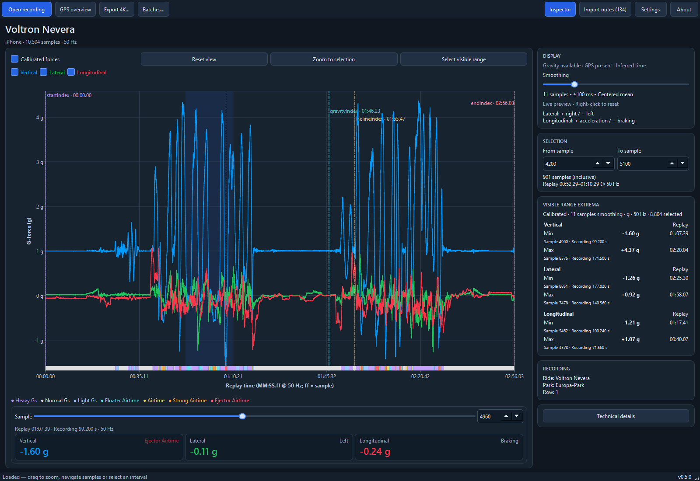

# Explore a recording

Open a `.forces` or compressed `.zforces` file with **Open recording**, or **Ctrl+O** (**⌘O** on macOS).
Both formats appear in the same file dialog; no manual extraction is needed.
The application reads the recording without changing the original file.
The instructions below use the English interface labels.

## Find a moment

- Left-click inside the chart to select the nearest sample. The cursor, sample
  control and value cards move to that moment.
- Use the slider or **Sample** number below the chart to move through the recording.
- Drag across the chart to zoom into a time interval. The mouse wheel zooms
  around the pointer. **Reset view** returns to the recording's start/end markers,
  or the available recording boundaries when markers are absent.
- Show or hide individual force curves using their controls.

Click the **Play** icon to the right of the sample slider to follow the recording at
**1×** speed by default. The dropdown beside it selects **0.5×**, **1×** or **2×**;
you can change speed while playing or paused without jumping to another moment.
Opening a recording resets the speed to **1×**.
Play changes to a **Pause** icon; click it to hold the current moment.
Hover over the button for its description.
When zoomed in, the chart slides along as the cursor reaches the middle, keeping
the same zoom level. Scrolling stops at the recording's end.
Moving the slider, editing Sample or clicking the chart while playing continues
from the new position. Playback works in raw and calibrated views, stops at the
last sample and restarts at sample 0 if you press Play there. It follows the whole
recording rather than the From/To export selection. Opening another recording or
the export assistant pauses playback. Closing the window stops it.

Zoom changes the visible time interval; the force scale stays fixed. A click
selects a moment, while a drag changes the view.

## Choose an interval

The inspector's **SELECTION** section contains **From sample** and **To sample**.
Both endpoints are included. Editing them highlights that interval in the chart.
Holding an up/down arrow repeats the change and gradually increases the step;
releasing it returns to single-sample steps.

- **Zoom to selection** makes the selected interval visible.
- **Select visible range** copies the current chart interval into the selection.
- Exporting **Current selection** uses these sample fields.
- **Data export → Export CSV…** saves these samples as a data table; see the
  [CSV guide](CSV_EXPORT.md).
- **Data export → Export JSON…** saves parallel sample arrays and metadata; see the
  [JSON guide](JSON_EXPORT.md).
- **Data export → Export Analyzer JSON…** saves grouped measurement arrays with
  shared time, quality and calculation settings; see the [JSON guide](JSON_EXPORT.md).

The selected sample, selection interval and visible chart interval are separate.
Zooming alone does not change the export selection.

## Read the inspector

**VISIBLE RANGE EXTREMA** shows each channel's minimum and maximum within the
currently visible chart interval, including hidden curves. Zooming changes these
results; moving only the cursor or editing From/To does not. Results use the
active display mode and smoothing.

**RECORDING** shows available ride, park, train, row and seat information. Missing
information is omitted. **Technical details** provides source information,
processing settings and current-sample details; **Import notes** opens diagnostic
information when you need to understand unavailable data.

Replay time is relative to the recording's start marker. At an integer sample
rate, `MM:SS.ff` ends with a sample counter, not hundredths: at 50 samples per
second, `01:31.47` means 91.94 seconds. Recording time counts from the file's
first sample, so it can differ from replay time.

## Adjust smoothing and display

**Smoothing** averages nearby samples to reduce fluctuations. **1 sample** turns
it off; the default is **11 samples**. Larger settings can reduce short peaks
and change the airtime context. Right-click the slider to restore the default.
Your original measurements remain unchanged.

**Calibrated forces** shows directional forces when usable calibration directions
exist. Otherwise, raw x/y/z values remain available, with unknown units and no
left/right or airtime interpretation. See [forces and airtime](FORCES_AND_AIRTIME.md).

Use **Inspector** to access the side panel; in narrow windows it switches between
the chart and inspector views. Under **Settings → Application**, choose English
or German and Dark, Light or System appearance. **Save** applies and remembers
the choices; **Cancel** keeps the previous settings. Changing appearance or
language preserves your current recording, selection, zoom and smoothing.

Enable **Settings → Application → Restore last file** to reopen your last successfully
loaded `.forces` or `.zforces` recording at the next launch. This option is off by
default. The application remembers the file's path; the original file must remain
there. Missing files are skipped. **Save** applies the option; **Cancel** leaves it
unchanged. Disabling it starts with an empty workspace.

## Open the GPS overview

When usable positions exist, open **GPS overview** for an offline route view.
Gaps in the coordinates can break the route into sections.
GPS is independent of force samples and does not move the chart selection.
It provides approximate location context, not a force or speed measurement.

Click **Load map background** to place an OpenStreetMap map behind the track.
Only the visible area is requested, without an account or API key. This action
contacts OpenStreetMap: it reveals your IP address and the requested geographic
area, but does not upload the GPS track, timestamps or recording file.

The map is static. After enlarging the window, click the button again to load
more detail for its new size; enlargement alone only scales the existing image
and does not contact the service. Map resolution accounts for display scaling,
up to 2048 pixels per dimension. The visible OpenStreetMap
credit links to its copyright information. Previously viewed tiles are cached in a
local database to avoid repeated downloads. The cache keeps up to 100 MiB of images
and removes the least recently used tiles when full. Network failures leave the track usable, and a map is
not required for any recording analysis or export. Polar coordinates outside the
map's coverage retain the offline route view.

Use **Settings → Application → Clear map cache** to delete all cached map tiles
immediately, independently of Save or Cancel. The button shows the stored tile count
when settings open and is disabled when the cache is empty. After deletion, its
text confirms that the cache was cleared; errors also appear in the button text.
An already displayed background remains visible; subsequent map loading fills the
cache again as needed.

## Common questions

- **Why are calibration or export unavailable?** The file may lack usable
  calibration directions. Check **Import notes**; raw values can still be viewed.
- **Why do extrema stay unchanged?** Change the visible chart interval. Selecting
  another sample or changing From/To alone does not change the extrema interval.
- **Why is the airtime strip hidden?** It requires calibrated vertical data and
  follows vertical-channel visibility. See the [airtime guide](FORCES_AND_AIRTIME.md).
- **Why is GPS unavailable?** The recording needs usable coordinates. Positions
  are not reconstructed from forces or filenames.
- **Opening failed:** check the message and import notes. The last usable
  recording remains available; an error does not overwrite the original file.

[Installation](INSTALLATION.md) · [Video export](VIDEO_EXPORT.md) ·
[Technical explorer reference](../implementation/RAW_EXPLORER.md)
