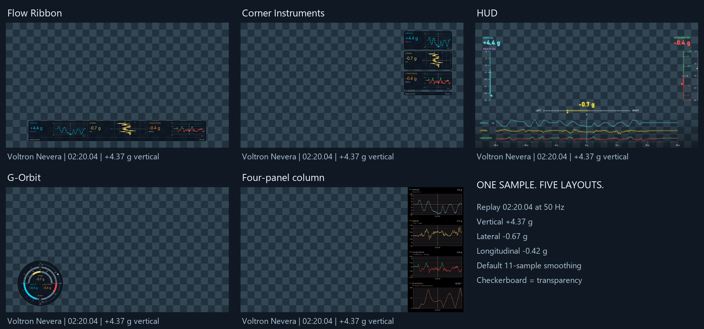
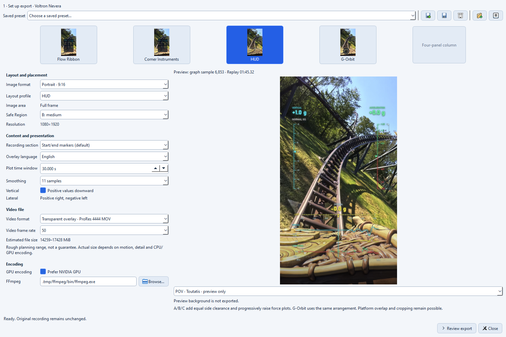

# Choose an export layout

All five layouts show the same ride data in different arrangements. Choose the
one that leaves the important parts of your footage visible and makes the forces
easy to read.

Lateral scales in all five layouts start at **±1.25 g** and expand equally on
both sides in **0.25 g steps** when your selected interval contains stronger forces.
The scale stays fixed throughout the video. HUD's force curves use their own
automatically fitted ranges.
Acceleration/braking scales use the same rule with a **±1 g** minimum and
**0.25 g steps** in all layouts.

All five layouts use **1 g as the vertical reference**, including Flying recordings.
Vertical force curves use 1 g as their reference; HUD fits the reference line
within its selected minimum and maximum. HUD and G-Orbit hold both stronger
loading and unloading relative to 1 g. Readouts remain absolute: 1 g reads 1 g,
and 0 g still reads 0 g. This display reference does not change the recorded values.

G-force numbers use one decimal place to reduce distracting digit changes.
Curves and pointers retain their full precision.

## Compare the layouts

| Layout                 | Default position            | Useful when you want to…                                      |
| ---------------------- | --------------------------- | ------------------------------------------------------------- |
| **Flow Ribbon**        | Along the bottom            | Follow all three force curves together in a wide strip.       |
| **Corner Instruments** | Upper right                 | Read separate force cards while keeping the center clear.     |
| **HUD**                | Full screen                 | Follow frameless edge gauges and three force plots.           |
| **G-Orbit**            | Lower left                  | Follow current forces and recent peaks on circular gauges.    |
| **Four-panel column**  | Right side                  | Compare force plots and a separate orientation curve.         |

Flow Ribbon is selected when you first open the export assistant.
The comparison above shows Full-frame output at each layout's default position;
assistant thumbnails follow your export area and position choices.
[Open the larger detail views](EXPORT_LAYOUT_GALLERY.md) to inspect each layout.

## Export area and video size

**Full frame** keeps the selected placement on a complete video frame. HUD uses
1920×1080 landscape or 1080×1920 portrait; the other layouts use 3840×2160 or
2160×3840. Four-panel column supports landscape only.

**Content area** exports the complete smaller layout image, including any empty
space already around its instruments. It does not crop or stretch the design.
Place this clip where you want it in your video editor: your Full-frame position
is remembered in the assistant, but is not included as empty video space.
HUD always uses Full frame.

| Layout             | Landscape Content area | Portrait Content area |
| ------------------ | ---------------------- | --------------------- |
| Flow Ribbon        | 3072×360               | 840×1120              |
| Corner Instruments | 840×1120               | 840×1120              |
| G-Orbit            | 800×800                | 800×800               |
| Four-panel column  | 960×2160               | Unavailable           |
| HUD                | Full frame only        | Full frame only       |

**Image format** chooses the arrangement; Content-area video need not be 16:9 or
9:16. **Resolution** and **Review export** show the actual video size.
Changing the area refreshes previews and the rough file-size estimate. Smaller
dimensions do not guarantee a proportionally smaller video.

## Portrait Safe Region

With **Portrait · 9:16** and **Full frame**, **Safe Region** offers four arrangements:

- **Off:** keep the original layout.
- **A: light:** add side clearance and a light lift of the force plots.
- **B: medium:** use the same side clearance with a medium lift.
- **C: higher:** use the same side clearance with a higher lift.

HUD, Flow Ribbon and Corner Instruments have distinct lifts. G-Orbit has no force
plots, so A/B/C use the same arrangement. Available positions remain selectable;
top-anchored layouts may still meet upper platform controls. These are placement
choices, not increasing guarantees of protection.

The full video canvas stays **1080×1920 for HUD** and **2160×3840 for the other
Portrait layouts**. Four-panel column supports landscape only. Landscape and
Content area use effective Off; the inactive selector retains your choice for a
return to Portrait Full frame. This option changes the overlay arrangement; it
does not compensate for every phone crop or app control.

*Portrait HUD with B: medium and a 30-second plot window. The video retains its
1080×1920 canvas; the Toutatis photograph is preview-only.*

Lower force plots, right-side instruments or G-Orbit can still meet action buttons,
captions or temporary cards. HUD also keeps its full-width bottom shading, which
moves upward with the plots. Check the open view of your footage as well as the
instruments; no arrangement guarantees a clear area in every app or on every device.

## Try a layout with your recording

1. Open a recording. To export only part of it, set **From sample** and **To sample**
   in the inspector first.
2. Click **Export video…** and choose landscape or portrait under **Image format**.
3. Choose a layout thumbnail or **Layout profile**. Four-panel column supports
   landscape only and fills the complete 4K frame height. Other layouts adapt to
   both formats. Unsupported layouts are unavailable in the selector and thumbnails.
4. Choose **Full frame** or **Content area** under **Image area**. Content area
   exports the smaller layout image for placement in your video editor and hides
   Position. HUD always uses Full frame. Check **Resolution** for the video size.
5. In Full frame, choose **Position**. Ribbon offers top or
   bottom, Column left or right, and Corners and G-Orbit all four corners.
   HUD uses the whole frame and hides Position. Its native
   1920×1080 or 1080×1920 output can be scaled to a 4K timeline in your editor.
   The assistant remembers each layout's position while open and keeps a similar
   placement when you switch layouts. Check the preview after switching.
6. Check whether the labels and curves will be readable at your video's viewing
   size, and whether the chosen position leaves the action clear.
7. Choose a light, dark or checkerboard preview background to check visibility.

Before export, the thumbnails and large preview show the sample at 60% of the selected
export range, rounded to a sample. Changing the range
recalculates that moment without moving the workspace cursor. No FFmpeg installation
is needed to compare layouts. During export, the large preview follows already
rendered frames approximately every two video seconds.

Layouts provide preset positions and styling. The assistant does not offer dragging,
resizing, custom fonts or custom colors. You can choose the layout, export area,
position, layout format and overlay language. For the remaining export steps, follow the
[video export guide](VIDEO_EXPORT.md).

## Read the instruments

- **Vertical:** loading into the seat or lifting away from it. By default,
  positive loads point downward and negative loads upward. The **Vertical**
  checkbox can reverse the display direction; the signed numbers stay the same.
- **Lateral:** sideways forces. Positive values mean right, negative values mean
  left. The diagrams and bars use yellow.
- **Longitudinal:** forward/backward forces. Acceleration is positive and green;
  braking is negative and red.
- **Tilt / orientation:** an angle describing tilt, not a compass heading or GPS
  direction. If the recording lacks usable gravity data, no angle is invented.

Flow Ribbon and Corner Instruments include force plots
and the current vertical context, such as Floater, Airtime or Ejector. The
four-panel column adds a dedicated orientation plot. G-Orbit concentrates on
current forces; its quieter peak indicators briefly retain recent extremes while
the numbers continue to show the current values.

HUD leaves the center open and places freely floating instruments around
the screen: vertical G-force and airtime at the left, acceleration/braking at the
right, lateral force below. Fine scale marks, bright pointers, large numbers,
colored glow and black shadows keep the instruments readable over footage.
The vertical scale starts at **−1.5…+5 g** for Seated recordings and **−4…+3 g**
for Flying recordings. Acceleration/braking starts at **±1 g** and lateral force
at **±1.25 g**. These scales expand to fit stronger forces in your selected interval
and stay fixed throughout the video.

Bright bars briefly hold recent peaks; pointers and numbers show current values.
The vertical instrument highlights **1 g** as the normal
resting reference. Its bright bars retain both stronger loading and unloading,
including positive values below 1 g. The vertical force plot adjusts its scale to the selected interval, including 1 g.
Its reference line moves with that scale. The numbers keep their meaning: 0 g
still reads 0 g. This also applies to Flying recordings.
The outer right edge shows tilt from **0° to 180°** when orientation data is
available. Three force plots at the bottom share a time cursor aligned with
zero on the lateral instrument. Each curve has its own scale, so equal heights
do not necessarily mean equal forces.
Each side-force and acceleration/braking force plot fills its available height,
so even small changes can look large. Compare their numbers as well as their curves.

With an untouched **Plot time window**, selecting HUD uses **30 seconds**, centered
on the cursor. A window you have edited or loaded from a preset stays unchanged
when switching layouts. The same applies to an explicitly chosen vertical direction.
The time axis has a tick every second and labels every five seconds, including
**0 s** at the cursor.
Missing measurements leave gaps.

The time plots do not all run in the same direction: the four-panel column reads
left to right, while compact lateral force plots show the past below and the future
above. Use the signed readout to identify left/right forces regardless of layout.

**Plot time window** controls how much source time surrounds each moment in the
plots. **Smoothing** reduces short fluctuations and can change peaks and airtime
labels. Changing the layout alone does not change your force data.

Airtime labels are provisional interpretations that depend on calibration and
smoothing. They do not measure a rider's sensations. See
[forces and airtime](FORCES_AND_AIRTIME.md) for the categories and their limits.

## Transparency and placement over footage

The checkerboard in the examples represents transparent space. It does not
appear in the exported video. Choose **Transparent overlay · ProRes 4444 MOV**
to place the instruments above your footage in an editor. **Opaque video · H.264
MP4** puts the layout on a black background instead.

The preview background is only a viewing aid; it does not add your footage or
change the exported background. Alignment with footage is done manually in your
video editor.

[Video export guide](VIDEO_EXPORT.md) · [Full-size examples](EXPORT_LAYOUT_GALLERY.md)
