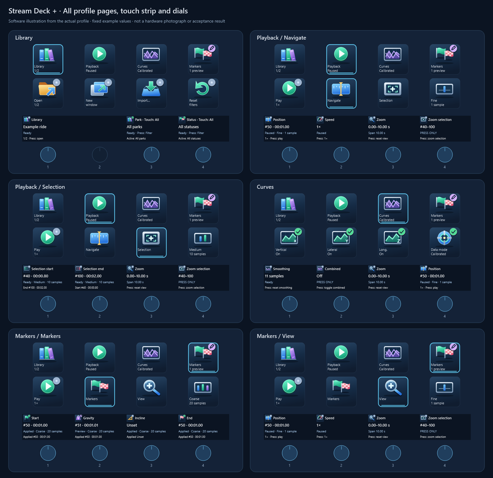
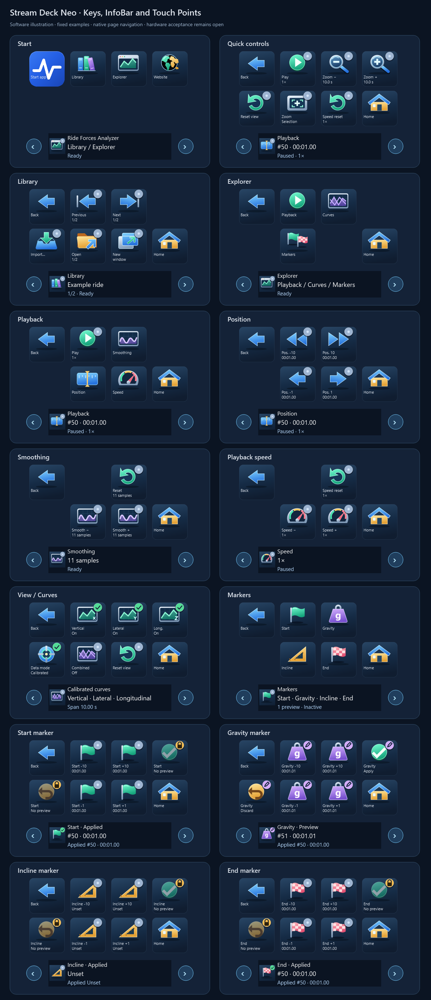
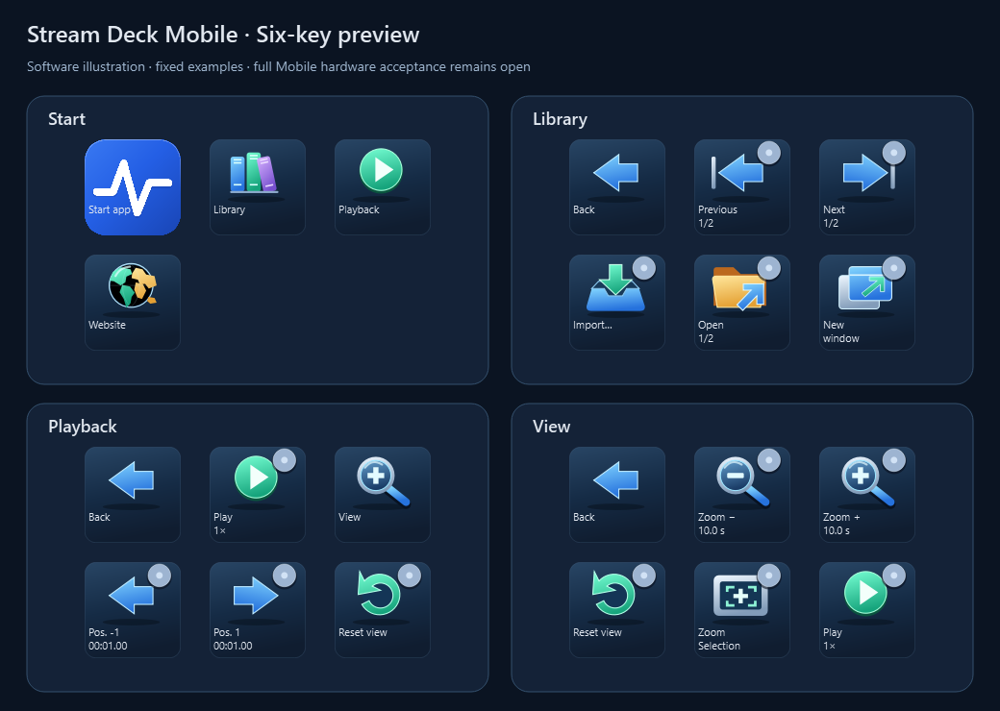

# Control Analyzer with Stream Deck +, Neo and Mobile

Use the plugin to browse your Library, control playback and view settings, and
prepare or apply recording markers. Controls act on the Analyzer
window you are currently using; they do not open another window.

The Plus and Neo profiles use the same colored icons and short key captions.
The examples use the English plugin labels. The Analyzer can use its own selected
interface language. Complete physical Plus acceptance, Neo/Mobile import and operation,
plugin installation/update and macOS operation remain unverified.
Requires Stream Deck **7.6+**;
the plugin runs on the desktop, alongside Analyzer.

## Set up the controls

1. Obtain `Ride-Forces-Analyzer.streamDeckPlugin` and
   `PLUGIN-SHA256SUMS.txt` from the same [GitHub release](https://github.com/rudnerbjoern/ride-forces-analyzer/releases)
   and compare the archive SHA-256 with the checksum file
   (`Get-FileHash` on Windows, `shasum -a 256` on macOS), then double-click the
   archive and confirm Stream Deck's installation prompt.
2. Confirm the matching profile in Stream Deck's installation prompt for your
   connected device. Stream Deck installs it together with the plugin and switches
   to it. Existing unrelated profiles remain available.
3. In Analyzer, enable **Settings → Application → Enable Stream Deck** and save.
4. Select **Ride Forces Analyzer +** or **Ride Forces Analyzer Neo** in Stream Deck.
   On Neo Start, select **Start app**
   in the software preview and choose your Analyzer EXE or a Windows shortcut in
   **Open** action's file field. The bundled profile leaves this path
   empty because it depends on your installation.
5. Bring the intended Analyzer Explorer to the foreground and click the chart.

### Find and import the device profile

Profiles are included in the plugin and offered during plugin installation.
Stream Deck switches to the profile after installation. A separate manual import
is normally unnecessary. If you declined that prompt, open **Preferences → Profiles**,
select your device and use **Import** with the matching archive:

| Device            | Profile file               | Profile name                        |
| ----------------- | -------------------------- | ----------------------------------- |
| Plus              | `plus.streamDeckProfile`   | Ride Forces Analyzer +              |
| Neo               | `neo.streamDeckProfile`    | Ride Forces Analyzer Neo            |
| Mobile (six keys) | `mobile.streamDeckProfile` | Ride Forces Analyzer Mobile Preview |

The files are in the installed plugin's `profiles` subfolder:

- Windows: `%APPDATA%\Elgato\StreamDeck\Plugins\io.github.rudnerbjoern.ride-forces-analyzer.sdPlugin\profiles`
- macOS: `~/Library/Application Support/com.elgato.StreamDeck/Plugins/io.github.rudnerbjoern.ride-forces-analyzer.sdPlugin/profiles`

Pair Mobile with the desktop Stream Deck app before importing its profile.
Do not replace unrelated profiles or import a Neo/Mobile profile onto Plus.

Operate the **physical LCD keys, dials and touch strip**. Clicking a key in the
Stream Deck desktop application's preview selects its configuration; it does not
execute that key. Keep Analyzer in the foreground when using application controls.

## macOS availability

The plugin requires **macOS 15+** with **Stream Deck 7.6+**. Mac installation
and operation are **unverified**.
Launch the Mac Analyzer `.app`. On Neo/Mobile, set **Start app** to that `.app`
in Stream Deck; the Windows EXE/shortcut instructions apply only to Windows.

## Update or troubleshoot the connection

Plugin and Analyzer versions are independent. Install the plugin archive supplied
with the intended Analyzer release; the application update checker does not update
the plugin. GitHub installation does not register Marketplace updates. Install a
new archive manually and reimport its profile only when you want its changed
assignments or menu graphics. Keep your customized profiles.

If controls stay offline, check that Analyzer is running, **Enable Stream Deck**
was saved, and the app/plugin came from a compatible release. There is no manual
port field. If a lock badge appears, close open dialogs/dropdowns, leave text
fields and bring the intended Explorer forward. The plugin's menus still work without a connection.
Clicking the desktop preview only edits a key; actual device input is required
to execute it. See [locks and connection changes](#understand-locks-and-connection-changes).

## Recognize the functions and states

*Software illustration of all six Plus profile pages with keys, touch strip
and four dials. Navigate shows Fine, Selection Medium and Markers Coarse.
These are example states; your actual step size is shared across pages.
[Open the full-size image](../images/stream-deck-plus-controls.png).*

The colored illustration identifies the function. A separate badge indicates its
current state; a dimmed icon can still show the last confirmed value.

| Badge / state            | Meaning                                                           |
| ------------------------ | ----------------------------------------------------------------- |
| Neutral dot              | Ready, or a toggle currently off. Check the displayed value.      |
| Green check              | Active toggle or a confirmed applied marker.                      |
| Purple pencil            | Marker preview; the proposed value has not been applied.          |
| Blue clock               | A change is being processed. Wait for confirmation.               |
| Red cross                | A change failed; the previous applied value is kept.              |
| Amber lock               | Control unavailable; the text gives the reason.                   |
| Gray disconnected symbol | No connection. Values disappear until it reconnects.              |

The display follows confirmed program state, including changes you make with
the mouse in Analyzer. Wait for the displayed state to change after pressing a key.

## Move through the menus

On **Plus**, the first row always shows **Library**, **Playback**, **Curves** and
**Markers**. The profile starts on Library. In Playback, keys **6/7** switch
**Navigate / Selection**; in Markers they switch **Markers / View**. Returning to
Playback or Markers recalls the last view used on that device. A cyan border marks
the displayed menu. Plus has no Back, Home, Start app or Website keys.
**Step size** is key **8** in Playback and Markers.

Use the bundled Plus profile installed with the plugin for these menu keys.
Existing customized profiles remain available;
menu keys can switch from a copy into the bundled profile.

On **Neo**, Start offers **Start app**, **Library**, **Explorer** and **Website**.
Explorer contains Playback, Curves and Markers. **Back** is key **1** and **Home**
is key **8**, returning to Start. Start app opens the application chosen during
setup; Website opens the project website.

Keys are numbered left to right, top row first. Menu navigation remains available
while Analyzer is disconnected or application commands are blocked.

## Browse and open Library recordings

These dial instructions are for **Plus**. See the separate [Neo](#neo-keys-infobar-and-touch-points)
and [Mobile](#mobile-limited-six-key-preview) sections for their buttons.

On Plus, choose **Library** on the top row. Its second row is **Open**,
**New window**, **Import**, **Reset filters** (keys **5–8**). Reset filters clears
park, workflow status and search in all Explorer windows without replacing an open recording.
Turn the **first dial** to select one visible recording per
notch. It follows the Library's current sorting and filters and wraps in either
direction. One recording stays selected; an empty list cannot be opened.

Turning only selects. **Press the dial** to open the selection in the current
Explorer. **Open**, key **5**, does the same. There are no Previous/Next keys.
**Import** opens Analyzer's existing recording-import dialog; choose files there
with the mouse or keyboard. The touch field shows the selected name and its
position in the visible list. Import is key **7**.
**New window**, key **6**, opens the selected recording in an additional Explorer
while keeping the current recording open. If that recording is already open,
its existing window is brought to the front instead.

Dial **2** is unused. Turn dial **3** to choose a **Park**, or dial **4** to choose
a workflow **Status**. Both follow the dropdown order in Analyzer and stop at
either end. Turning only prepares a choice: **Preview** shows the proposed value,
while **Active** shows the filter currently in use. Press that dial to apply its
choice. **Pending** waits for confirmation; **Failed** does not change the active
filter. Tap its touch field to request **All parks** or **All statuses** immediately.
Each dial changes only its own filter and keeps the other filter and search.
Filters remain usable when no recordings match.

Each Plus keeps its own prepared choices. Changing a filter or its options in
Analyzer discards its prepared choice. Leaving Library, changing the recording
or Explorer, or losing the connection discards unapplied choices; reconnecting
does not apply them. **Reset filters** discards both choices and requests a reset
of Park, Status and search. Input focus, dialogs and background operation lock
filter commands just like other Analyzer controls.

## Control playback and the view

Open **Playback → Navigate**. Dials run from left to right:

| Dial               | Turn                                      | Press          | Touch-strip information                            |
| ------------------ | ----------------------------------------- | -------------- | -------------------------------------------------- |
| 1 · Position       | Move through samples; stop at the ends.   | Play/pause.    | Sample, replay time, play state and step size.     |
| 2 · Speed          | Select the next supported playback speed. | Return to 1×.  | Actual speed and play/pause state.                 |
| 3 · Zoom           | Zoom the time axis.                       | Reset view.    | Actual visible interval and duration in seconds.   |
| 4 · Zoom selection | Unassigned.                               | Fit selection. | Confirmed selection bounds; PRESS ONLY.            |

**Step size** cycles Position, Selection and marker dials through
**1 → 10 → 20 → 1 samples per notch**. The key and touch strip show the current
step size: **Fine** (1), **Medium** (10), **Coarse** (20). The icons use one, two
and three coloured bars, without a status badge. It starts at 1 sample, survives menu changes and never
changes Library stepping.

Position changes pause playback. Zoom, curves, smoothing and speed changes leave
playback running. Use Play to resume after a manual position or marker adjustment.

Position, Smoothing and Speed have no additional key folders on Plus. The
**Play/Pause** key **5**, directly above Position, and the Position dial press both toggle playback.
**Reset view** is the Zoom dial press. **Markers → View** uses the same four dials.
Controls labelled **PRESS ONLY** ignore turning and touch taps.

## Curves, Raw/Calibrated and smoothing

Open **Curves**. The three force-line keys turn the corresponding
lines on/off. **Data mode** shows and switches between **Raw** and **Calibrated**;
The three direction keys are **5–7**; Data mode is key **8**.
Press **dial 2** to switch the combined curve on/off. Dial **3** controls Zoom
(press: Reset view). Turn **dial 4** to move the replay position using the step size
chosen in Playback/Markers; press it for Play/Pause. Dial 2 ignores turning;
touch taps on dials 2 and 4 do nothing. Labels and on/off states follow Analyzer.

The **first dial** selects the smoothing window: **1, 3, …, 51 samples**. Further
turns below 1 stay at 1; turns above 51 stay at 51. There is no wraparound in either
direction. Press the dial to reset smoothing to **11 samples**.

Raw mode displays unfiltered source values and disables smoothing, matching the
Analyzer's Inspector. The touch field shows **Raw source values**; select
**Calibrated** before adjusting smoothing.

## Adjust the selection and zoom to it

Open **Playback → Selection**. Dial **1** adjusts the selection's **Start** sample;
dial **2** adjusts its **End** sample. The touch fields show the confirmed sample
and time, the opposite boundary and Step size mode. **Step size** switches
through **1, 10 and 20 samples per notch**, shared with Position and Markers.

Turns apply directly to the current Select range, just like the Inspector's
**From sample / To sample** fields. Start stops at zero or End; End stops at Start
or the last source sample. Further outward turns stay at the boundary, without
wrapping. Presses and touch taps on dials 1 and 2 are unassigned.

Dial **3** controls Zoom (press: Reset view). Press **dial 4** to fit the chart
to the selection; turning and touch taps on dial 4 do nothing. Key **5** is
Play/Pause. Selection changes made in Analyzer
also appear on the touch strip. These controls do not move the replay cursor or
change the recording's markers or calibration.

## Preview, apply or discard markers

Open **Markers → Markers**. Dial order is **Start, Gravity, Incline, End**.

1. **Turn** a dial to change only that marker's preview. This pauses playback;
   the chart calculations and saved markers stay unchanged.
2. The Explorer chart shows a dotted line labelled **Preview** at the proposed
   position, alongside the unchanged applied marker. Check its position and the
   sample/time on the touch strip. The separate **Applied** line shows the value
   currently in use.
3. **Press** that dial to apply its preview. **Pending** means the chart is still
   updating. **Applied** confirms success; **Failed** retains the previous value.
4. **Tap the corresponding touch field** to discard only its preview.

Start cannot pass End, and End cannot pass Start. Gravity and Incline may lie
outside Start/End but must remain inside the source recording. If either reference
is unset, place it in Analyzer first.

Previews survive menu changes. Opening another recording or changing the target
Explorer clears them. Applying or discarding one marker does not confirm the
others and does not resume playback. Applied markers are saved automatically
for that Library recording.

The Plus Markers page has Play/Pause, Markers, View and Step size on keys 5–8.
The top-row Markers key shows **Failed** before **Pending**, then the number of
previews, on every page. The other menu keys show Library position/count,
Playing/Paused and Raw/Calibrated. These values change when Analyzer confirms them.

## Neo keys, InfoBar and Touch Points

Neo uses the eight keys instead of dials. Import `neo.streamDeckProfile` when a
Neo is connected. Its Start row is **Start app · Library · Explorer · Website**;
configure the app path once, as described above. The Plus profile is separate.

*Software illustration of the Neo profile. Values are examples;
device operation remains unverified. [Open full size](../images/stream-deck-neo-controls.png).*

The **left/right Touch Points** are native previous/next-page controls. The
profile provides two main pages: **Start** and **Quick controls**. Quick controls
contains Play/Pause, Zoom −/+, Reset view, Zoom to selection and Reset speed.
The InfoBar displays information; use the Touch Points beside it to switch pages.

Folders stay reachable from Start. Back is key **1**, Home is key **8**; on Quick
controls both return to Start. In Position and each marker editor, the two center
columns are **minus / plus**. The top pair uses **10 samples** and the bottom
pair **1 sample**. Marker **Apply** is key **4**, **Discard** key **5**. Preview,
apply and discard retain the same recording/target rules as Plus.

Smoothing and Speed put **−/+** on keys **6/7** and **Reset** on key **3**.
Library offers Previous/Next, Open, Import and **New window**. Open and New window
are adjacent on the bottom row; New window keeps the current Explorer open. Curves groups three direction
keys above Data mode, Combined and Reset view.

The InfoBar follows confirmed program state: selected Library entry and index,
position/time and playback speed, curve visibility, smoothing or marker state.
Marker name/state is on the first line, the preview or applied position on
the second, and the last applied value on the third. Long text is elided within
the display; disconnected state clears program values.

## Mobile: limited six-key preview

The prepared **Ride Forces Analyzer Mobile Preview** profile uses **three columns
and two rows in landscape**. Pair Stream Deck Mobile with the Stream Deck desktop
app, choose its six-key layout and import `mobile.streamDeckProfile` onto that
Mobile device. We recommend holding the phone in landscape and setting
**Layout orientation** to **None** or **Fixed**, depending on the wording in your
Mobile app. This keeps the 3×2 arrangement with Back at the top left. The profile
does not lock orientation automatically.
The plugin still requires Stream Deck 7.6 or later and **Enable Stream Deck** in
Analyzer. [Elgato's setup instructions](https://help.elgato.com/hc/en-us/articles/16786832942221-Elgato-Stream-Deck-Mobile-2-0-Getting-Started)
cover pairing with the desktop Stream Deck app.

*Software illustration of the Mobile profile with example values.
Full Mobile hardware acceptance remains open.*

- **Start:** Start app, Library, Playback and Website. Configure the Analyzer EXE or
  Windows shortcut (or the Mac `.app`) on the **desktop** in Start app's Open settings.
- **Library:** Previous/Next, Open, Import and **New window**. Browsing follows visible sorting and
  filters; only Open opens the selection in the current Explorer. Keys show short
  action names and the selected index/count; the full recording name stays in
  the Analyzer Library (and on the Plus touch strip or Neo InfoBar).
- **Playback:** Play/Pause, one sample backward/forward, Reset view and the View folder.
- **View:** Zoom −/+, Reset view, Zoom to selection and Play/Pause.

The Library page uses this landscape arrangement:

| Left   | Middle   | Right      |
| ------ | -------- | ---------- |
| Back   | Previous | Next       |
| Import | Open     | New window |

**Back is key 1 at the top left; there is no Home key.** Key 6 is used for Reset view on Playback
and Play/Pause on View. **New window** on Library opens the selected recording in
an additional Explorer without replacing the current recording.
This preview omits curve/smoothing/speed editors, markers and manual selection
bounds. Use the Analyzer window for those controls. Mobile buttons follow the same
connection and locking rules as the other devices.

## Understand locks and connection changes

Controls are blocked while another application is in front, an Analyzer text/number
field or dropdown is selected, a dialog is open, or the chart is recalculating. Other reasons
include a missing recording, empty Library or absent marker preview. Read the
status text, finish the interaction and click the intended Explorer's chart.

For multiple Explorers, activate the one you want to control. Never assume that
a preview from another window or recording still applies.

If Analyzer closes, Stream Deck is disabled in Settings, or the connection is
lost, application controls become unavailable. After reconnecting, wait for fresh
values. Commands are not queued or replayed; do not assume an interrupted marker
apply succeeded. Check the marker in Analyzer before retrying.

[Explore recordings](EXPLORER.md) · [Installation and updates](INSTALLATION.md)
