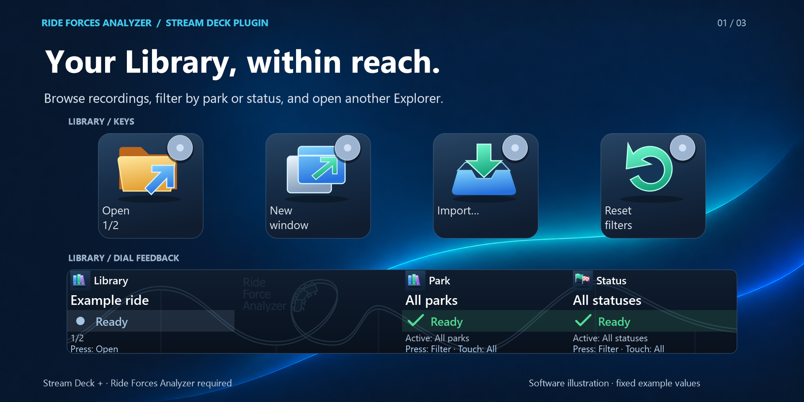
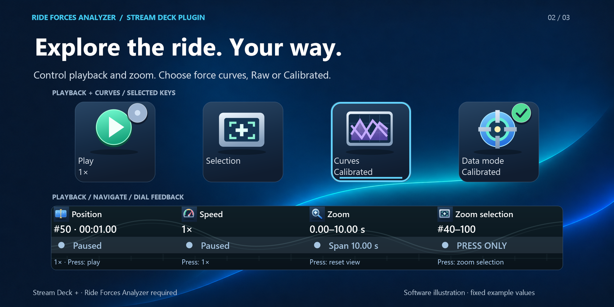
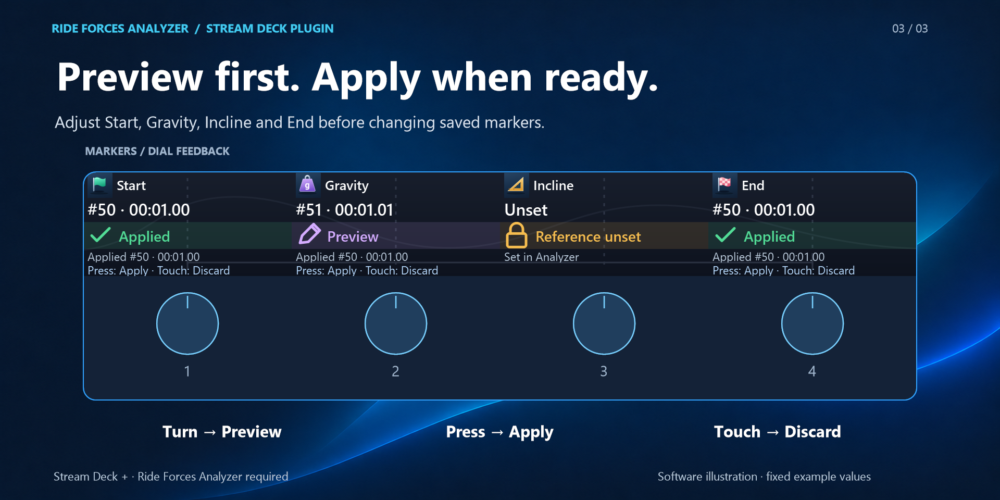

# Marketplace gallery

Upload the three numbered PNGs in this order. Each is **1920 × 960 px**, opaque, and below the **10 MB** image limit.

| Order | Upload file                                                          | Focus                                             | Size            |
| ----- | -------------------------------------------------------------------- | ------------------------------------------------- | --------------- |
| 1     | [01-library.png](../../media/gallery/01-library.png)                 | Library selection, filters and opening recordings | 1,523,377 bytes |
| 2     | [02-playback-curves.png](../../media/gallery/02-playback-curves.png) | Playback, zoom, force curves and data mode        | 1,513,872 bytes |
| 3     | [03-markers.png](../../media/gallery/03-markers.png)                 | Preview, apply and discard marker changes         | 1,256,399 bytes |

## 1. Your Library, within reach

Browse recordings, filter by park or status, and open another Explorer.

## 2. Explore the ride. Your way

Control playback and zoom. Choose force curves, Raw or Calibrated.

## 3. Preview first. Apply when ready

Adjust Start, Gravity, Incline and End before changing saved markers.

**Turn → Preview · Press → Apply · Touch → Discard**

## Design and sources

The palette follows the [approved thumbnail](../thumbnail/README.md): dark navy (`#0b1423`), blue/cyan accents and white type.
The [Marketplace reference](https://marketplace.elgato.com/product/chatgpt-codex-fb6a7052-2b1a-4500-ba2a-13996edf0b47)
informs the feature-led headlines and enlarged controls.

- [background.png](background.png): common backing plate, scaled to the output canvas.
- [background-prompt.txt](background-prompt.txt): exact built-in image-generation prompt for the backing plate.
- Controls use original production SVGs, layouts and fixed example values from the
  [existing profile renderer](../../../../../scripts/generate_stream_deck_screenshots.py), rendered directly at gallery resolution.
  The [reference manifest](../../../../../docs/images/stream-deck-reference.json) identifies the profile pages and values.
- The second image combines selected keys from **Playback / Navigate** and **Curves**. Its lower strip shows **Playback / Navigate**.
- The marker dials follow the renderer's aligned four-dial illustration. All three images identify **Stream Deck +** and the
  separately required Analyzer application, and label the controls **Software illustration · fixed example values**.
- Type uses Segoe UI, with matching headline, subtitle and footer positions throughout the set.

UI illustration credit: **Björn Rudner (`rudnerbjoern`)**, [CC BY-SA 4.0](https://creativecommons.org/licenses/by-sa/4.0/).
The original control artwork and example feedback are enlarged and arranged on the shared gallery background.
See the [image guide](../../../../../docs/images/README.md#license-reference) for the source attribution reference.
