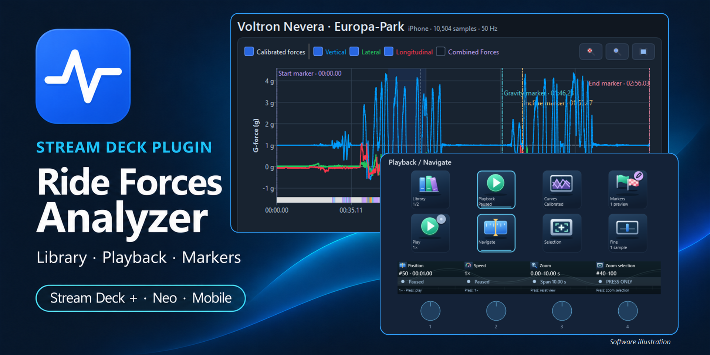

# Marketplace thumbnail

## Visual direction



- Dark navy background (`#0b1423`) with restrained blue/cyan glow and curved accents.
- Existing application icon above the large, white, two-line product title on the left.
- Force-chart panel in the upper right; overlapping Plus playback controls below it.
- Cyan plugin label, white feature line and outlined device-family label.
- Generous spacing and clear hierarchy, with the product name readable at thumbnail size.
- Keep the **Software illustration** caption with the illustrated controls.

### Text

```text
STREAM DECK PLUGIN
Ride Forces
Analyzer
Library · Playback · Markers
Stream Deck + · Neo · Mobile
Software illustration
```

## Files and sources

| File                                                                            | Purpose                                                                        |
| ------------------------------------------------------------------------------- | ------------------------------------------------------------------------------ |
| [thumbnail.png](../../media/thumbnail.png)                                      | Upload artwork; PNG, 1920 × 960 px, 2:1, 1,697,806 bytes                       |
| [background.png](background.png)                                                | Backing plate with title and icon, without UI panels                           |
| [background-prompt.txt](background-prompt.txt)                                  | Exact built-in image-generation prompt used to remove the proposal's UI panels |
| [appearance-dark.png](../../../../../docs/images/appearance-dark.png)           | Actual Analyzer screenshot inserted into the final artwork                     |
| [stream-deck-overview.png](../../../../../docs/images/stream-deck-overview.png) | Original Plus software illustration inserted into the final artwork            |
| [proposal.png](proposal.png)                                                    | Approved visual proposal; PNG, 1774 × 887 px, 2:1                              |
| [proposal-prompt.txt](proposal-prompt.txt)                                      | Exact built-in image-generation prompt for the proposal                        |
| [icon.png](../../media/icon.png)                                                | Existing application icon used as a reference                                  |
| [workspace-dark.png](../../../../../docs/images/workspace-dark.png)             | Original Analyzer screenshot used as the proposal's reference                  |

## Final artwork

Upload [thumbnail.png](../../media/thumbnail.png). It matches the Marketplace's recommended **1920 × 960 px** size and is below the **5 MB** limit.

The final composition uses the generated backing plate, scaled to the output canvas, with the two original UI crops
composited directly. Both crops retain their aspect ratio; their labels and curves are not regenerated.

Coordinates are pixels, measured from the top-left corner. Crop bounds use `x, y, width, height`.

| Panel          | Source crop                                     | Output position | Output size    |
| -------------- | ----------------------------------------------- | --------------- | -------------- |
| Analyzer chart | `appearance-dark.png`: `0, 74, 800, 400`        | `624, 36`       | `1184 × 592`   |
| Plus controls  | `stream-deck-overview.png`: `28, 100, 984, 600` | `1028, 414`     | `806 × 491.46` |

The controls overlap the chart's lower-right area. Both panels have a 2 px cyan border (`#31a2ff`) and rounded corners
(20 px chart radius, 24 px controls radius). The **Software illustration** caption uses Segoe UI Italic, 19 px, right-aligned
in the rectangle `1450, 910, 368, 27`.

The proposal is retained for its visual direction only; its generated UI labels and chart details are not authoritative.
